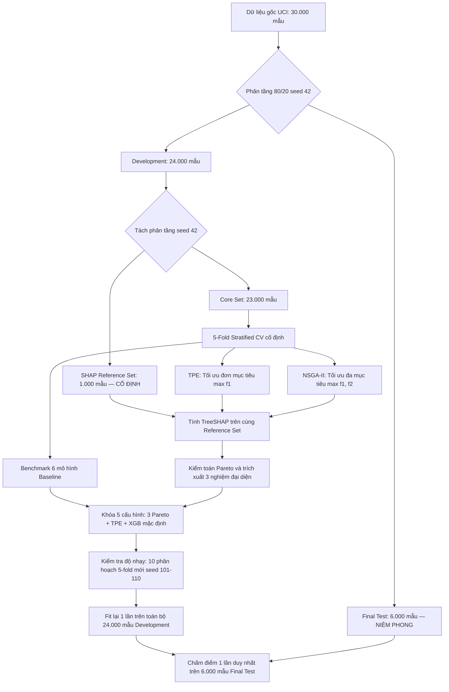
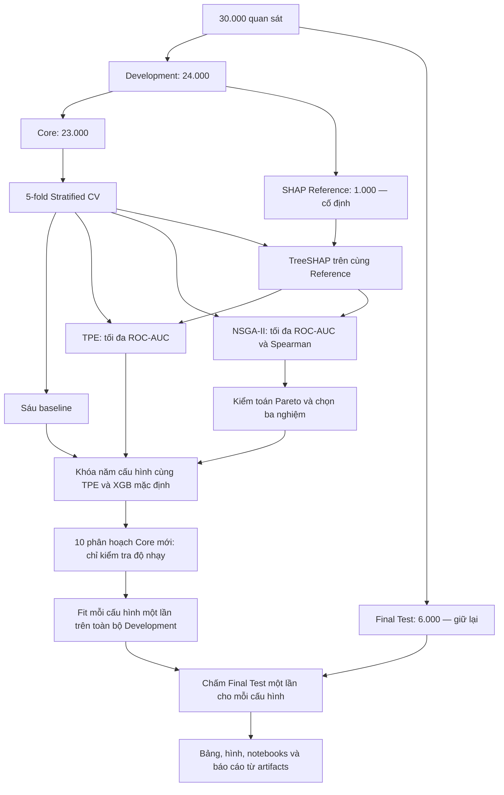
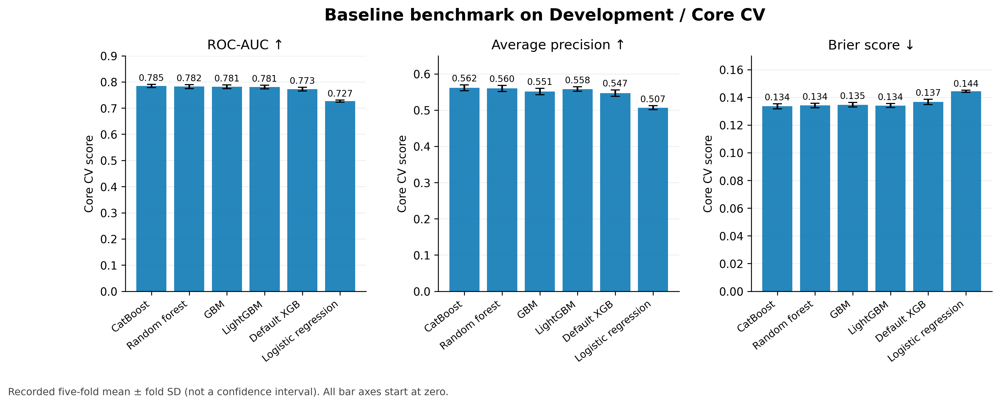
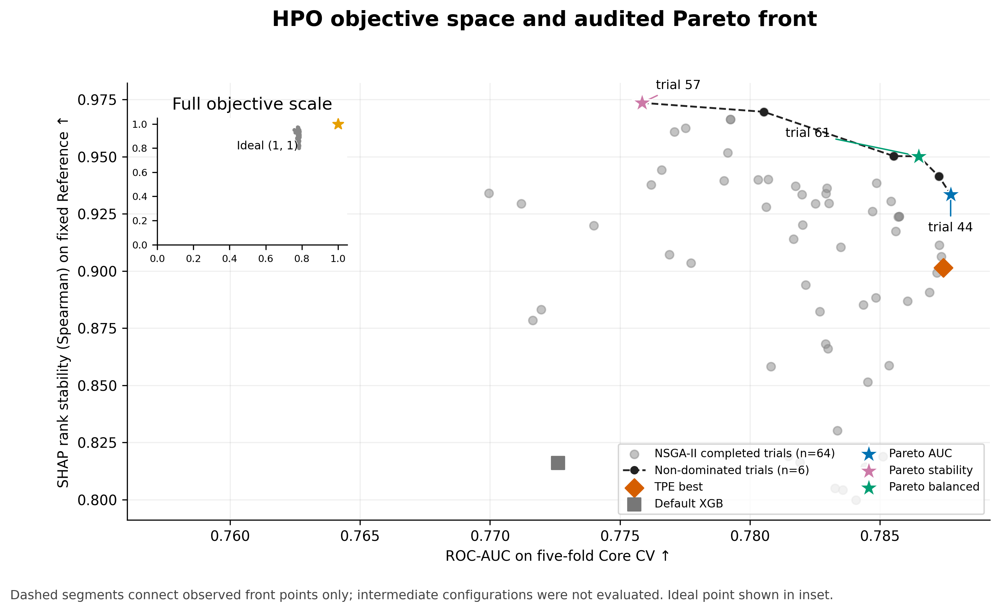
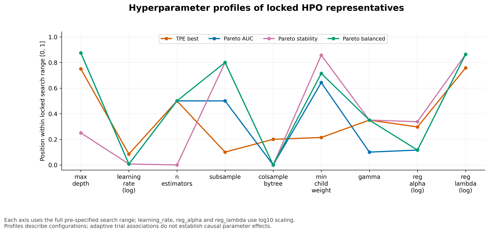
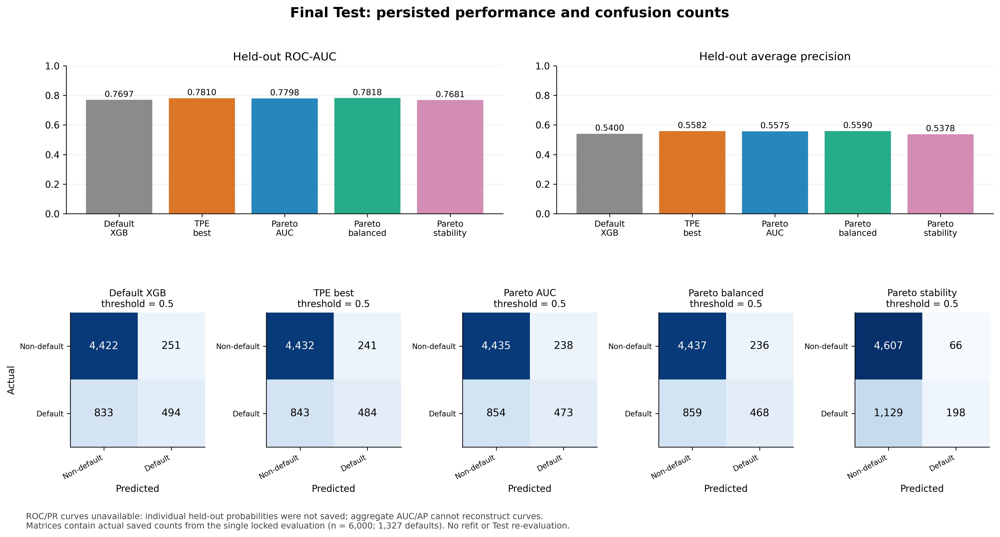
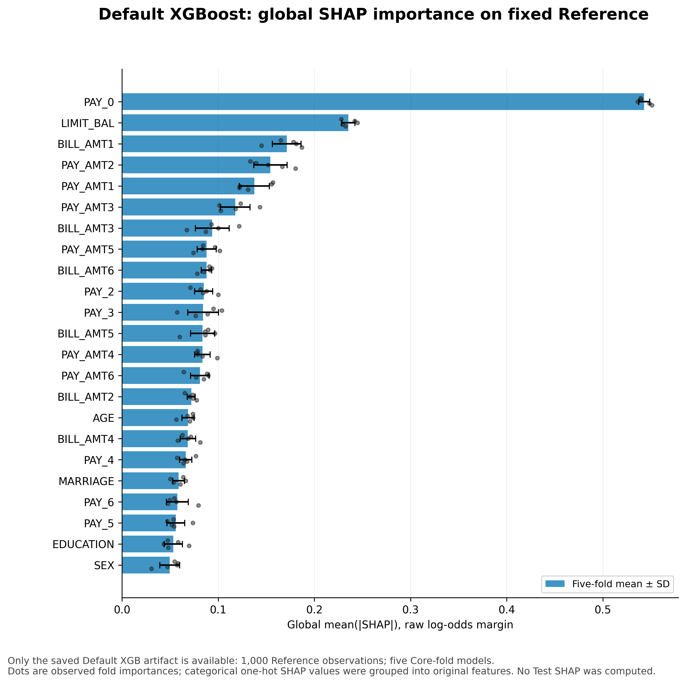
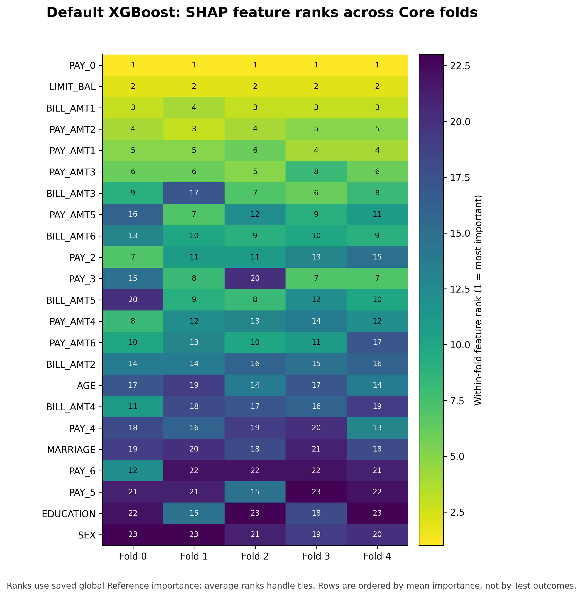
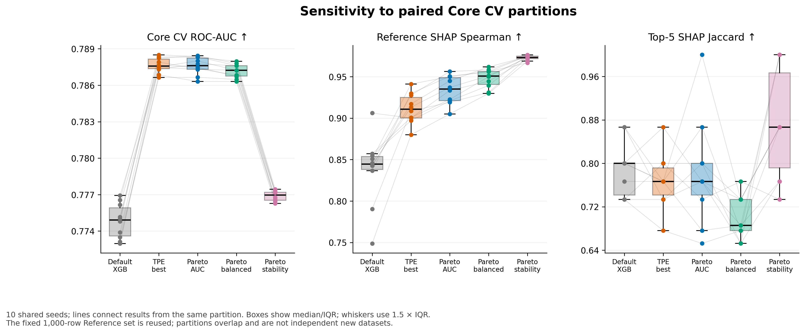
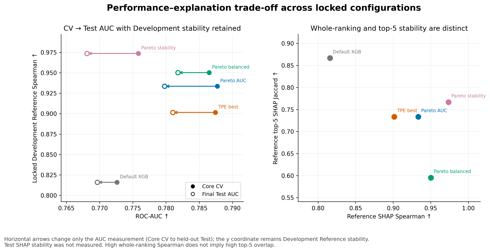

# BÁO CÁO ĐỒ ÁN CHUYÊN NGÀNH

**ĐỀ TÀI:**  
### TỐI ƯU ĐA MỤC TIÊU SIÊU THAM SỐ XGBOOST CHO DỰ ĐOÁN RỦI RO TÍN DỤNG CÁ NHÂN XÉT ĐẾN HIỆU NĂNG DỰ ĐOÁN VÀ ĐỘ ỔN ĐỊNH CỦA GIẢI THÍCH SHAP

---

**Sinh viên thực hiện:**  
1. **Lê Hoàng Sơn**  
2. **Phạm Thiên Phúc**  

**Giảng viên hướng dẫn:**  
**TS. Phan Tấn Quốc**  

---

## LỜI CAM ĐOAN

Chúng tôi xin cam đoan báo cáo đồ án chuyên ngành này là công trình nghiên cứu khoa học được thực hiện độc lập và nghiêm túc bởi nhóm tác giả dưới sự hướng dẫn trực tiếp của TS. Phan Tấn Quốc.

Toàn bộ số liệu thực nghiệm, bảng biểu, đồ thị và kết quả phân tích trình bày trong báo cáo đều được trích xuất trực tiếp từ các tệp nhật ký thực thi (manifests) và bảng dữ liệu kết quả (`artifacts/`) của hệ thống mã nguồn dự án. Các quy tắc phân chia dữ liệu, cô lập tập tham chiếu SHAP và niêm phong tập kiểm tra độc lập (Final Test) được tuân thủ nghiêm ngặt, đảm bảo tính trung thực khoa học và khả năng tái lập 100%. Các tài liệu, công trình nghiên cứu và mã nguồn kế thừa từ các tác giả khác đều được trích dẫn nguồn gốc rõ ràng theo đúng quy chuẩn học thuật.

*Thành phố Hồ Chí Minh, năm 2026*  
**Nhóm sinh viên thực hiện**  
Lê Hoàng Sơn — Phạm Thiên Phúc  

---

## TÓM TẮT ĐỀ TÀI (ABSTRACT)

### Tóm tắt tiếng Việt
Trong quản trị rủi ro tín dụng bán lẻ tại các ngân hàng thương mại hiện đại, việc ước lượng chính xác xác suất vỡ nợ (Probability of Default - PD) theo chuẩn mực Basel II/III và IFRS 9 đóng vai trò sống còn trong việc kiểm soát tổn thất tín dụng dự kiến ($ECL$). Mặc dù các mô hình học máy tăng cường dạng cây kết hợp như XGBoost mang lại năng lực phân tách rủi ro vượt trội so với Hồi quy Logistic truyền thống, bản chất phức tạp của cấu trúc ensemble biến mô hình thành một hệ thống "hộp đen". Nhằm đáp ứng các quy định pháp lý quốc tế (ECOA, FCRA, GDPR Điều 22) về quyền được giải trình minh bạch (*Right to Explanation*), phương pháp TreeSHAP dựa trên lý thuyết trò chơi hợp tác thường được áp dụng để bóc tách đóng góp của từng biến số tài chính. 

Tuy nhiên, trong chu trình vận hành thực tế, XGBoost tối ưu đơn mục tiêu theo ROC-AUC thường tạo ra các cấu hình cây sâu, nhạy cảm với biến động dữ liệu huấn luyện giữa các lần kiểm định chéo, dẫn đến hiện tượng **Bất ổn định của lời giải thích (Explanation Instability)**: thứ hạng quan trọng của các biến tài chính bị xáo trộn nghiêm trọng dù hiệu năng dự báo hầu như không đổi.

Đề tài này đề xuất một khung phương pháp luận khoa học giải quyết đồng thời hai mục tiêu xung đột: tối đa hóa hiệu năng phân loại rủi ro vỡ nợ ($f_1$ - ROC-AUC kiểm định chéo 5-fold Core) và tối đa hóa độ ổn định thứ hạng giải thích SHAP toàn cục ($f_2$ - hệ số tương quan Spearman trung bình của vector TreeSHAP 23 biến gốc trên 1.000 mẫu tham chiếu cố định). Bằng cách triển khai giải thuật di truyền đa mục tiêu NSGA-II đối chuẩn trực tiếp với thuật toán Bayes TPE đơn mục tiêu trên cùng không gian 9 siêu tham số và cùng ngân sách 64 trial hoàn thành (tương ứng 320 lần fit và 320 lần tính TreeSHAP mỗi nhánh) trên bộ dữ liệu chuẩn *Default of Credit Card Clients* (30.000 hồ sơ), nghiên cứu đã xác lập 6 nghiệm Pareto thực nghiệm không bị chi phối. 

Ba cấu hình đại diện (Pareto AUC - trial 44, Pareto Stability - trial 57, và Pareto Balanced - trial 61) được khóa tiên nghiệm trên tập Development và kiểm toán tính vững chắc qua 10 phân hoạch 5-fold mới (seed 101–110, 250 lần fit/TreeSHAP), trước khi đánh giá độc lập một lần duy nhất trên 6.000 mẫu Final Test. Kết quả khẳng định: cấu hình cân bằng (Pareto Balanced) đạt ROC-AUC Test cao nhất (0,781791), AP cao nhất (0,559020), Brier thấp nhất (0,134622) và cải thiện độ ổn định giải thích trên Development thêm +0,036304 điểm Spearman so với TPE đơn mục tiêu (Wilcoxon $p=0{,}001953$). Nghiên cứu cung cấp cơ sở định lượng thực nghiệm vững chắc cho các định chế tài chính trong việc cân bằng giữa hiệu năng dự báo và tính giải trình pháp lý bền vững.

### Abstract in English
In modern retail credit risk management under Basel II/III and IFRS 9 regulatory frameworks, accurate estimation of the Probability of Default (PD) is critical to controlling Expected Credit Loss (ECL). While gradient boosted decision tree ensembles such as XGBoost deliver superior discriminatory power compared to traditional Logistic Regression, their black-box nature hinders compliance with stringent legal requirements (ECOA, FCRA, GDPR Article 22) regarding Adverse Action Notices and the Right to Explanation. TreeSHAP, rooted in cooperative game theory, is widely adopted to attribute feature contributions. 

However, standard single-objective hyperparameter optimization (HPO) targeting ROC-AUC typically yields deep tree structures that overfit local data splits, causing **Explanation Instability**: global feature importance rankings fluctuate substantially across cross-validation folds despite near-identical predictive performance.

This study proposes a comprehensive multi-objective optimization framework to simultaneously maximize predictive discriminative performance ($f_1$ - 5-fold Core CV ROC-AUC) and explanation stability ($f_2$ - pairwise mean Spearman rank correlation of global TreeSHAP vectors across 23 original features evaluated on an isolated 1,000-sample reference set). Utilizing the NSGA-II genetic algorithm benchmarked against single-objective TPE across an identical 9-dimensional hyperparameter search space and matched budget of 64 completed trials (320 model fits and 320 TreeSHAP evaluations per branch) on the UCI *Default of Credit Card Clients* dataset (30,000 observations), we identify an empirical non-dominated Pareto front of 6 configurations. 

Three representative candidates (Pareto AUC - trial 44, Pareto Stability - trial 57, and Pareto Balanced - trial 61) were locked purely on Development data and stress-tested across 10 newly seeded 5-fold partitions (seeds 101–110, 250 fits/TreeSHAP evaluations) before a single, locked evaluation on 6,000 held-out Final Test samples. The empirical findings demonstrate that the Pareto Balanced configuration achieves the highest Test ROC-AUC (0.781791), Test AP (0.559020), lowest Brier score (0.134622), while simultaneously enhancing explanation stability by +0.036304 Spearman points over TPE across 10 partitions (Wilcoxon $p=0.001953$). This study provides a rigorous quantitative methodology for financial institutions navigating the trade-off between predictive accuracy and regulatory explainability.

---

## DANH MỤC TỪ VIẾT TẮT

| Viết tắt | Thuật ngữ tiếng Anh | Diễn giải tiếng Việt |
|:---|:---|:---|
| **AP** | Average Precision | Độ chính xác trung bình (diện tích dưới PR curve) |
| **AUC / ROC-AUC** | Area Under Receiver Operating Characteristic | Diện tích dưới đường cong ROC |
| **Basel II/III** | Basel Accords | Các hiệp ước an toàn vốn ngân hàng quốc tế |
| **CV** | Cross-Validation | Kiểm định chéo |
| **EAD** | Exposure at Default | Tổng dư nợ tại thời điểm vỡ nợ |
| **ECL** | Expected Credit Loss | Tổn thất tín dụng dự kiến |
| **ECOA** | Equal Credit Opportunity Act | Đạo luật Bình đẳng Cơ hội Tín dụng (Hoa Kỳ) |
| **FCRA** | Fair Credit Reporting Act | Đạo luật Báo cáo Tín dụng Công bằng (Hoa Kỳ) |
| **FN / FP** | False Negative / False Positive | Âm giả (Sai lầm loại II) / Dương giả (Sai lầm loại I) |
| **GBDT** | Gradient Boosted Decision Trees | Cây quyết định tăng cường độ dốc |
| **GDPR** | General Data Protection Regulation | Quy chế Bảo vệ Dữ liệu Chung Châu Âu |
| **HPO** | Hyperparameter Optimization | Tối ưu hóa siêu tham số |
| **IFRS 9** | International Financial Reporting Standard 9 | Chuẩn mực Báo cáo Tài chính Quốc tế số 9 |
| **IRB** | Internal Ratings-Based approach | Phương pháp tiếp cận dựa trên xếp hạng nội bộ |
| **LGD** | Loss Given Default | Tỷ lệ tổn thất khi vỡ nợ |
| **LR** | Logistic Regression | Hồi quy Logistic |
| **NSGA-II** | Non-dominated Sorting Genetic Algorithm II | Thuật toán di truyền phân loại không bị chi phối II |
| **PD** | Probability of Default | Xác suất vỡ nợ |
| **RF** | Random Forest | Rừng ngẫu nhiên |
| **RQ** | Research Question | Câu hỏi nghiên cứu |
| **SHAP** | SHapley Additive exPlanations | Phương pháp giải thích cộng tính Shapley |
| **TN / TP** | True Negative / True Positive | Đúng âm / Đúng dương |
| **TPE** | Tree-structured Parzen Estimator | Bộ ước lượng Parzen cấu trúc cây |
| **UCI** | University of California, Irvine | Kho lưu trữ dữ liệu học máy UCI |
| **XAI** | Explainable Artificial Intelligence | Trí tuệ nhân tạo có thể giải thích |
| **XGBoost** | Extreme Gradient Boosting | Thuật toán tăng cường độ dốc cực đại |

---

## DANH MỤC BẢNG BIỂU

- **Bảng 1.1:** Các thuộc tính trong bộ dữ liệu *Default of Credit Card Clients*.
- **Bảng 1.2:** Ma trận chi phí sai lầm bất đối xứng trong thẩm định tín dụng.
- **Bảng 2.1:** Không gian 9 siêu tham số XGBoost và phương thức lấy mẫu.
- **Bảng 2.2:** Tóm tắt các quyết định phương pháp luận cốt lõi trong tính toán SHAP stability.
- **Bảng 3.1:** Sáu mô hình đối chứng trên 5-fold Core CV.
- **Bảng 3.2:** Thời gian thực thi pipeline của 6 mô hình đối chứng trên 5-fold Core.
- **Bảng 3.3:** So sánh XGBoost mặc định và nghiệm TPE tốt nhất trên Development.
- **Bảng 3.4:** Ma trận tương quan Spearman giữa siêu tham số và hai hàm mục tiêu HPO.
- **Bảng 3.5:** Kết quả kiểm toán độc lập Pareto front của study NSGA-II chính thức.
- **Bảng 3.6:** Các nghiệm đại diện và đối chứng trên Development.
- **Bảng 3.7:** Cấu hình siêu tham số chi tiết của các ứng viên tối ưu đã khóa.
- **Bảng 3.8:** Khả năng dự đoán trên Final Test độc lập.
- **Bảng 3.9:** Các chỉ số phân loại tại ngưỡng xác suất 0,5 và ma trận nhầm lẫn trên Final Test.
- **Bảng 3.10:** Bảng độ biến thiên Global TreeSHAP của 10 biến hàng đầu trên XGBoost đối chứng.
- **Bảng 3.11:** Stability và AUC qua 10 phân hoạch Core mới (seed 101–110).
- **Bảng 3.12:** Chênh lệch ghép cặp chi tiết giữa các nghiệm Pareto và hai đối chứng qua 10 phân hoạch Core.
- **Bảng 3.13:** Chênh lệch giữa các nghiệm Pareto và TPE theo từng giai đoạn.
- **Bảng 3.14:** Ma trận tổng kết câu trả lời cho 4 câu hỏi nghiên cứu RQ1–RQ4.

---

## DANH MỤC HÌNH VẼ

- **Hình 2.1:** Sơ đồ kiến trúc tổng thể quy trình phương pháp luận đề xuất.
- **Hình 3.1:** Benchmark Core CV: ROC-AUC, AP và Brier; thanh sai số là std năm fold.
- **Hình 3.2:** Không gian mục tiêu Development: 64 trial NSGA-II, Pareto front, các nghiệm đã chọn và đối chứng.
- **Hình 3.3:** So sánh cấu hình siêu tham số của TPE và ba nghiệm Pareto trên thang chuẩn hóa.
- **Hình 3.4:** Các metric và ma trận nhầm lẫn Final Test từ lượt đánh giá đã khóa.
- **Hình 3.5:** Global SHAP importance trên Reference của XGBoost đối chứng; biến thiên qua năm fold.
- **Hình 3.6:** Ma trận biến thiên thứ hạng đặc trưng TreeSHAP của XGBoost đối chứng qua 5 fold Core.
- **Hình 3.7:** Phân phối và chênh lệch ghép cặp qua 10 phân hoạch Core (Boxplots độ nhạy).
- **Hình 3.8:** Bức tranh toàn cảnh không gian đánh đổi (Trade-off Landscape) giữa hiệu năng và độ ổn định.

---

# MỤC LỤC CHI TIẾT

- **CHƯƠNG 1. TỔNG QUAN ĐỀ TÀI VÀ CƠ SỞ LÝ THUYẾT**
  - 1.1. Bối cảnh nghiên cứu và bài toán quản trị rủi ro tín dụng cá nhân
  - 1.2. Ma trận chi phí sai lầm bất đối xứng trong thẩm định tín dụng
  - 1.3. Mô hình học máy dạng cây và thuật toán XGBoost
  - 1.4. Tối ưu hóa siêu tham số (HPO) và bài toán tối ưu đa mục tiêu
  - 1.5. Trí tuệ nhân tạo có thể giải thích (XAI) và phương pháp SHAP
  - 1.6. Thách thức về độ bất ổn định của giải thích SHAP trong mô hình Ensemble
  - 1.7. Mục tiêu nghiên cứu, câu hỏi nghiên cứu (RQ1–RQ4) và bố cục đề tài
- **CHƯƠNG 2. PHƯƠNG PHÁP ĐỀ XUẤT**
  - 2.1. Phát biểu bài toán
  - 2.2. Kiến trúc tổng thể của phương pháp đề xuất
  - 2.3. Phân chia dữ liệu, protocol seed/fold và reference set cho SHAP
  - 2.4. Không gian siêu tham số XGBoost
  - 2.5. Objective 1: predictive performance
  - 2.6. Phương pháp tính SHAP/TreeSHAP
  - 2.7. Xây dựng độ đo SHAP stability
  - 2.8. Objective 2: explanation stability
  - 2.9. Thiết kế tối ưu siêu tham số XGBoost
  - 2.10. Pareto dominance và Pareto front
  - 2.11. Phương pháp lựa chọn nghiệm đại diện từ Pareto front
  - 2.12. Tóm tắt chương
- **CHƯƠNG 3. THỰC NGHIỆM VÀ ĐÁNH GIÁ**
  - 3.1. Dữ liệu thực nghiệm
  - 3.2. Tiền xử lý dữ liệu
  - 3.3. Môi trường thực nghiệm: phần cứng, phần mềm và phiên bản thư viện
  - 3.4. Thiết kế và quy trình thực nghiệm
  - 3.5. Số lần chạy, seed, fold và protocol đánh giá
  - 3.6. Các chỉ số đánh giá
  - 3.7. Kết quả các mô hình baseline/đối chứng
  - 3.8. Kết quả XGBoost tối ưu đơn mục tiêu
  - 3.9. Kết quả XGBoost tối ưu đa mục tiêu
  - 3.10. Phân tích Pareto front
  - 3.11. So sánh predictive performance
  - 3.12. Phân tích SHAP stability
  - 3.13. Phân tích trade-off giữa performance và stability
  - 3.14. Thảo luận, hạn chế và đe dọa đến tính hợp lệ
  - 3.15. Tóm tắt chương
- **KẾT LUẬN VÀ HƯỚNG PHÁT TRIỂN**
- **DANH MỤC TÀI LIỆU THAM KHẢO**

---

# CHƯƠNG 1. TỔNG QUAN ĐỀ TÀI VÀ CƠ SỞ LÝ THUYẾT

**Đề tài:** Tối ưu đa mục tiêu siêu tham số XGBoost cho dự đoán rủi ro tín dụng cá nhân xét đến hiệu năng dự đoán và độ ổn định của giải thích SHAP.  
**Sinh viên thực hiện:** Lê Hoàng Sơn, Phạm Thiên Phúc — **Giảng viên hướng dẫn:** TS. Phan Tấn Quốc.

---

## 1.1. Bối cảnh nghiên cứu và bài toán quản trị rủi ro tín dụng cá nhân

### 1.1.1. Tầm quan trọng của thẩm định tín dụng bán lẻ và khung pháp lý Basel II/III, IFRS 9
Trong hệ thống tài chính ngân hàng hiện đại, tín dụng tiêu dùng (Retail Credit) và thẻ tín dụng (Credit Card) là phân khúc kinh doanh mang lại biên lợi nhuận cao nhưng đồng thời tiềm ẩn rủi ro tín dụng rất lớn do khối lượng hồ sơ khổng lồ và tính phân tán của danh mục. Theo các hiệp ước an toàn vốn quốc tế **Basel II** (Basel Committee on Banking Supervision, 2004) và **Basel III** (2010), các tổ chức tín dụng được khuyến khích áp dụng phương pháp tiếp cận dựa trên xếp hạng nội bộ nâng cao (Advanced Internal Ratings-Based - AIRB) để định lượng chính xác tài sản có rủi ro và xác định mức an toàn vốn tối thiểu. 

Song song đó, chuẩn mực Báo cáo Tài chính Quốc tế số 9 (**IFRS 9**, IASB, 2014) yêu cầu các ngân hàng phải chuyển từ mô hình tổn thất đã phát sinh (Incurred Loss Model) sang mô hình tổn thất tín dụng dự kiến (**Expected Credit Loss - ECL**). Theo mô hình này, việc trích lập dự phòng rủi ro phải được thực hiện chủ động ngay từ khi cấp tín dụng dựa trên ước lượng tổn thất trong toàn bộ vòng đời hợp đồng:

$$
\mathrm{ECL} = \mathrm{PD} \times \mathrm{LGD} \times \mathrm{EAD}
$$

Trong đó:
- **$\mathrm{PD}$ (Probability of Default - Xác suất vỡ nợ):** Khả năng một khách hàng không thực hiện được nghĩa vụ thanh toán trong một khoảng thời gian xác định (thường là 12 tháng hoặc chu kỳ tháng kế tiếp).
- **$\mathrm{LGD}$ (Loss Given Default - Tỷ lệ tổn thất khi vỡ nợ):** Tỷ lệ phần trăm dư nợ bị tổn thất thực tế sau khi đã xử lý tài sản bảo đảm và thực hiện các biện pháp thu hồi nợ.
- **$\mathrm{EAD}$ (Exposure at Default - Tổng dư nợ tại thời điểm vỡ nợ):** Tổng giá trị nghĩa vụ nợ của khách hàng tại thời điểm phát sinh sự kiện vỡ nợ, bao gồm dư nợ gốc hiện hữu, lãi dồn tích và hạn mức thẻ chưa sử dụng dự kiến sẽ được rút thêm trước khi vỡ nợ.

Do $\mathrm{LGD}$ và $\mathrm{EAD}$ phụ thuộc vào tính chất hợp đồng và biện pháp thu hồi nợ sau khi vỡ nợ xảy ra, việc mô hình hóa chính xác **Xác suất vỡ nợ ($\mathrm{PD}$)** ngay từ khâu thẩm định ban đầu đóng vai trò quyết định hàng đầu trong việc giảm thiểu tổn thất và tối ưu hóa chi phí dự phòng vốn rủi ro của ngân hàng.

### 1.1.3. Bản chất toán học của bài toán chấm điểm tín dụng
Bài toán chấm điểm tín dụng cá nhân (Credit Scoring) được phát biểu dưới dạng bài toán phân loại nhị phân có giám sát (Supervised Binary Classification). Giả sử không gian đầu vào là $\mathcal{X} \subseteq \mathbb{R}^d$ đại diện cho $d$ biến giải thích (gồm thông tin nhân khẩu học, lịch sử thanh toán, dư nợ hóa đơn và số tiền thanh toán) và không gian nhãn $\mathcal{Y} = \{0, 1\}$. 

Ký hiệu $y_i = 1$ biểu thị khách hàng thứ $i$ rơi vào trạng thái vỡ nợ trong kỳ đánh giá tiếp theo (Default), và $y_i = 0$ biểu thị khách hàng hoàn thành đầy đủ nghĩa vụ trả nợ (Non-default). Mô hình học máy có nhiệm vụ học một hàm ánh xạ:

$$
f: \mathcal{X} \to [0, 1], \qquad \hat{p}_i = f(x_i) = P(y_i = 1 \mid x_i)
$$

Xác suất dự báo $\hat{p}_i$ phản ánh mức độ rủi ro vỡ nợ của hồ sơ $x_i$, từ đó hỗ trợ hệ thống ra quyết định chấp thuận cấp tín dụng, từ chối hoặc điều chỉnh hạn mức thẻ phù hợp.

### 1.1.4. Bộ dữ liệu chuẩn Default of Credit Card Clients và các nhóm đặc trưng
Để giải quyết bài toán thực nghiệm, nghiên cứu sử dụng bộ dữ liệu chuẩn mực *Default of Credit Card Clients* được thu thập bởi Yeh & Lien (2009) từ một ngân hàng thương mại phát hành thẻ tín dụng tại Đài Loan, lưu trữ tại UCI Machine Learning Repository. Bộ dữ liệu bao gồm 30.000 hồ sơ khách hàng, 23 đặc trưng giải thích phản ánh toàn diện các khía cạnh tài chính và nhân khẩu học, cùng 1 biến mục tiêu nhị phân `default.payment.next.month`:

**Bảng 1.1: Các thuộc tính trong bộ dữ liệu Default of Credit Card Clients.**

| Nhóm đặc trưng | Tên biến | Kiểu dữ liệu | Ý nghĩa nghiệp vụ và miền giá trị |
|:---|:---|:---:|:---|
| **Hạn mức tín dụng** | `LIMIT_BAL` | Liên tục (NT$) | Hạn mức tín dụng được cấp (bao gồm cả tín dụng cá nhân và gia đình). |
| **Nhân khẩu học** | `SEX` | Rời rạc | Giới tính (1 = Nam, 2 = Nữ). |
| | `EDUCATION` | Rời rạc | Trình độ học vấn (1 = Sau đại học, 2 = Đại học, 3 = Phổ thông, 4/5/6/0 = Khác). |
| | `MARRIAGE` | Rời rạc | Tình trạng hôn nhân (1 = Đã kết hôn, 2 = Độc thân, 3/0 = Khác). |
| | `AGE` | Liên tục (Năm) | Độ tuổi của chủ thẻ tín dụng. |
| **Lịch sử trả nợ** (Tháng 4 – Tháng 9/2005) | `PAY_0` | Thứ bậc | Trạng thái trả nợ tháng 9/2005 (-1 = Đúng hạn, 1 = Trễ 1 tháng, 2 = Trễ 2 tháng,...). |
| | `PAY_2` | Thứ bậc | Trạng thái trả nợ tháng 8/2005. |
| | `PAY_3` | Thứ bậc | Trạng thái trả nợ tháng 7/2005. |
| | `PAY_4` | Thứ bậc | Trạng thái trả nợ tháng 6/2005. |
| | `PAY_5` | Thứ bậc | Trạng thái trả nợ tháng 5/2005. |
| | `PAY_6` | Thứ bậc | Trạng thái trả nợ tháng 4/2005. |
| **Dư nợ sao kê hóa đơn** (Tháng 4 – Tháng 9/2005) | `BILL_AMT1` | Liên tục (NT$) | Số dư sao kê hóa đơn tháng 9/2005. |
| | `BILL_AMT2` | Liên tục (NT$) | Số dư sao kê hóa đơn tháng 8/2005. |
| | `BILL_AMT3` | Liên tục (NT$) | Số dư sao kê hóa đơn tháng 7/2005. |
| | `BILL_AMT4` | Liên tục (NT$) | Số dư sao kê hóa đơn tháng 6/2005. |
| | `BILL_AMT5` | Liên tục (NT$) | Số dư sao kê hóa đơn tháng 5/2005. |
| | `BILL_AMT6` | Liên tục (NT$) | Số dư sao kê hóa đơn tháng 4/2005. |
| **Số tiền đã thanh toán** (Tháng 4 – Tháng 9/2005) | `PAY_AMT1` | Liên tục (NT$) | Số tiền đã thanh toán trong tháng 9/2005. |
| | `PAY_AMT2` | Liên tục (NT$) | Số tiền đã thanh toán trong tháng 8/2005. |
| | `PAY_AMT3` | Liên tục (NT$) | Số tiền đã thanh toán trong tháng 7/2005. |
| | `PAY_AMT4` | Liên tục (NT$) | Số tiền đã thanh toán trong tháng 6/2005. |
| | `PAY_AMT5` | Liên tục (NT$) | Số tiền đã thanh toán trong tháng 5/2005. |
| | `PAY_AMT6` | Liên tục (NT$) | Số tiền đã thanh toán trong tháng 4/2005. |
| **Biến mục tiêu** | `default.payment.next.month` | Nhị phân | 1: Vỡ nợ tháng 10/2005 (Default), 0: Không vỡ nợ (Non-default). |

---

## 1.2. Ma trận chi phí sai lầm bất đối xứng trong thẩm định tín dụng

### 1.2.1. Phân loại sai lầm thống kê trong thẩm định tín dụng
Khi áp dụng một ngưỡng quyết định $\tau \in [0, 1]$ (thông thường là $\tau = 0{,}5$) để chuyển đổi xác suất dự báo $\hat{p}_i$ thành quyết định nhị phân $\hat{y}_i = \mathbf{1}[\hat{p}_i \ge \tau]$, không gian dự báo được chia thành 4 khả năng theo ma trận nhầm lẫn (Confusion Matrix):

**Bảng 1.2: Ma trận chi phí sai lầm bất đối xứng trong thẩm định tín dụng.**

| Thực tế \ Dự báo | Dự báo Tốt ($\hat{y} = 0$) | Dự báo Vỡ nợ ($\hat{y} = 1$) |
|:---|:---:|:---:|
| **Thực tế Tốt ($y = 0$)** | Đúng âm ($TN$ - True Negative) | **Dương giả ($FP$ - False Positive / Sai lầm loại I)** |
| **Thực tế Vỡ nợ ($y = 1$)** | **Âm giả ($FN$ - False Negative / Sai lầm loại II)** | Đúng dương ($TP$ - True Positive) |

### 1.2.2. Tính bất đối xứng nghiêm trọng về thiệt hại tài chính
Trong bối cảnh ngân hàng, hai loại sai lầm thống kê mang lại hậu quả tài chính và kinh doanh hoàn toàn khác biệt:
1. **Sai lầm loại I (False Positive - $FP$):** Hệ thống dự báo khách hàng tốt là khách hàng vỡ nợ, dẫn đến quyết định từ chối cấp thẻ tín dụng một cách oan uổng. Hậu quả là ngân hàng đánh mất một khách hàng tiềm năng, mất doanh thu thu nhập lãi và phí quẹt thẻ trong tương lai. Chi phí thiệt hại này tương đương chi phí cơ hội, được chuẩn hóa ở mức tương đối là **$C_{FP} \approx 1\times$**.
2. **Sai lầm loại II (False Negative - $FN$):** Hệ thống dự báo khách hàng vỡ nợ là khách hàng tốt, dẫn đến việc cấp thẻ hoặc giải ngân cho người không có khả năng chi trả. Khi khách hàng vỡ nợ, ngân hàng đối mặt với việc mất toàn bộ vốn gốc giải ngân cùng chi phí xử lý nợ xấu đắt đỏ ($EAD \times LGD$). Trong thực tế ngành tài chính tiêu dùng, thiệt hại của sai lầm loại II nghiêm trọng gấp nhiều lần sai lầm loại I, với tỷ lệ chi phí tổn thất thường nằm trong khoảng:

$$
C_{FN} \approx 5 \times C_{FP} \quad \text{đến} \quad 20 \times C_{FP}
$$

### 1.2.3. Hệ quả phương pháp luận đối với độ đo đánh giá
Do tính chất bất đối xứng sâu sắc giữa $C_{FP}$ và $C_{FN}$ cùng hiện tượng mất cân bằng lớp tự nhiên trong dữ liệu tín dụng (tỷ lệ default thông thường chỉ chiếm từ 15% đến 25%), độ chính xác tổng thể (Accuracy) tại một ngưỡng tùy ý như $0{,}5$ hoàn toàn không có ý nghĩa thực tiễn: một mô hình tầm thường luôn dự đoán tất cả khách hàng là không vỡ nợ vẫn đạt độ chính xác ~78%, nhưng lại gây ra tổn thất tín dụng tối đa do bỏ sót 100% hồ sơ vỡ nợ ($FN$).

Do đó, các độ đo phân tách phi phụ thuộc ngưỡng (threshold-independent metrics) đóng vai trò sống còn trong việc đánh giá và lựa chọn mô hình:
- **ROC-AUC (Area Under the Receiver Operating Characteristic Curve):** Thước đo khả năng xếp hạng tổng quát, phản ánh xác suất mà mô hình gán điểm rủi ro cho một khách hàng vỡ nợ ngẫu nhiên cao hơn một khách hàng không vỡ nợ ngẫu nhiên. ROC-AUC là chỉ số khách quan và độc lập với việc lựa chọn ngưỡng cắt.
- **Average Precision (AP / PR-AUC):** Đo lường diện tích dưới đường cong Precision-Recall, tập trung trực tiếp vào chất lượng nhận diện của lớp thiểu số (lớp vỡ nợ), đặc biệt nhạy cảm với các biến động dương giả ($FP$) khi tỷ lệ lớp mất cân bằng.
- **Balanced Accuracy và Brier Score:** Đánh giá độ chính xác trung bình có trọng số giữa hai lớp và sai số trung bình bình phương của xác suất dự báo đã hiệu chuẩn.

---

## 1.3. Mô hình học máy dạng cây và thuật toán XGBoost

### 1.3.1. Sự phát triển từ mô hình tuyến tính đến mô hình học kết hợp (Ensemble Learning)
Trong nhiều thập kỷ, Hồi quy Logistic (Logistic Regression) là chuẩn mực công nghiệp trong mô hình hóa thẻ điểm tín dụng (Scorecard) nhờ tính chất tường minh, dễ triển khai dưới dạng bảng điểm tuyến tính và khả năng tuân thủ quy chuẩn Basel. Tuy nhiên, Logistic Regression tồn tại hạn chế căn bản: giả định mối quan hệ tuyến tính giữa log-odds và các biến giải thích, đòi hỏi các bước biến đổi biến thủ công phức tạp (WoE - Weight of Evidence, binning rời rạc hóa) và không thể tự động khai thác các tương tác phi tuyến bậc cao giữa các đặc trưng tài chính.

Sự trỗi dậy của các mô hình học máy dạng cây kết hợp (Tree-based Ensemble Methods) đã tạo ra bước đột phá về hiệu năng phân loại trong dữ liệu dạng bảng (Tabular Data):
- **Random Forest (Breiman, 2001):** Sử dụng kỹ thuật Bagging (Bootstrap Aggregating) kết hợp chọn ngẫu nhiên tập đặc trưng để giảm phương sai (variance) của các cây quyết định độc lập.
- **Gradient Boosting Decision Trees - GBDT (Friedman, 2001):** Sử dụng cơ chế Boosting tuần tự, trong đó mỗi cây quyết định mới được huấn luyện để xấp xỉ phần dư (residuals) hoặc gradient âm của hàm mất mát từ các cây phía trước.

### 1.3.2. Cấu trúc giải thuật XGBoost (Chen & Guestrin, 2016)
XGBoost (Extreme Gradient Boosting) là bản cài đặt tối ưu hóa mở rộng của GBDT, bổ sung các cơ chế chính quy hóa chặt chẽ và thuật toán tối ưu phần cứng để đạt hiệu năng vượt trội.

#### 1. Hàm mục tiêu chính quy hóa (Regularized Objective)
Tại vòng lặp thứ $t$, mô hình dự đoán $\hat{y}_i^{(t)} = \hat{y}_i^{(t-1)} + f_t(x_i)$, trong đó $f_t$ là cây quyết định mới cần học. Hàm mục tiêu tổng quát được xác định bởi:

$$
\mathcal{L}^{(t)} = \sum_{i=1}^n \ell\left(y_i, \hat{y}_i^{(t-1)} + f_t(x_i)\right) + \Omega(f_t)
$$

Thành phần kiểm soát độ phức tạp mô hình $\Omega(f_t)$ bao gồm phạt số lượng nút lá $T$ và phạt độ lớn trọng số nút lá $w \in \mathbb{R}^T$ theo cả hai chuẩn $L_1$ và $L_2$:

$$
\Omega(f_t) = \gamma T + \alpha \sum_{j=1}^T |w_j| + \frac{\lambda}{2} \sum_{j=1}^T w_j^2
$$

Trong đó $\gamma$ là ngưỡng tối thiểu để cho phép chia nhánh mới, $\alpha$ là hệ số phạt chính quy hóa $L_1$ (Lasso), và $\lambda$ là hệ số phạt chính quy hóa $L_2$ (Ridge).

#### 2. Khai triển Taylor bậc hai của hàm mục tiêu
XGBoost xấp xỉ hàm mất mát $\ell$ bằng khai triển Taylor bậc hai quanh giá trị dự báo ở bước trước $\hat{y}_i^{(t-1)}$:

$$
\mathcal{L}^{(t)} \approx \sum_{i=1}^n \left[ \ell(y_i, \hat{y}_i^{(t-1)}) + g_i f_t(x_i) + \frac{1}{2} h_i f_t^2(x_i) \right] + \Omega(f_t)
$$

Với gradient bậc một $g_i$ và gradient bậc hai (Hessian) $h_i$ đối với hàm mất mát Binary Cross-Entropy (`binary:logistic`):

$$
g_i = \frac{\partial \ell(y_i, \hat{p}_i^{(t-1)})}{\partial \hat{z}_i^{(t-1)}} = \hat{p}_i^{(t-1)} - y_i, \qquad h_i = \frac{\partial^2 \ell(y_i, \hat{p}_i^{(t-1)})}{\partial (\hat{z}_i^{(t-1)})^2} = \hat{p}_i^{(t-1)}(1 - \hat{p}_i^{(t-1)})
$$

#### 3. Nghiệm giải tích trọng số nút lá và tiêu chuẩn phân nhánh (Gain)
Gọi $I_j = \{i : q(x_i) = j\}$ là tập hợp các chỉ số mẫu rơi vào nút lá $j$. Đặt $G_j = \sum_{i \in I_j} g_i$ và $H_j = \sum_{i \in I_j} h_i$. Khi xét phạt $L_2$ thuần túy ($\alpha = 0$), trọng số tối ưu tại lá $j$ có dạng nghiệm đóng:

$$
w_j^* = -\frac{G_j}{H_j + \lambda}
$$

Giá trị hàm mục tiêu tối ưu tương ứng trên toàn bộ cây là:

$$
\mathcal{L}_{\mathrm{opt}}^{(t)} = -\frac{1}{2} \sum_{j=1}^T \frac{G_j^2}{H_j + \lambda} + \gamma T
$$

Khi phân chia một nút lá thành hai nút con Trái ($L$) và Phải ($R$), độ lợi phân nhánh (Gain) được tính toán để lựa chọn điểm cắt tốt nhất:

$$
\mathrm{Gain} = \frac{1}{2} \left[ \frac{G_L^2}{H_L + \lambda} + \frac{G_R^2}{H_R + \lambda} - \frac{(G_L + G_R)^2}{H_L + H_R + \lambda} \right] - \gamma
$$

Thuật toán chỉ thực hiện phân chia nếu $\mathrm{Gain} > 0$, ngăn chặn hiện tượng quá khớp (overfitting) ngay từ cấu trúc cây.

---

## 1.4. Tối ưu hóa siêu tham số (HPO) và bài toán tối ưu đa mục tiêu

### 1.4.1. Không gian siêu tham số và thách thức tối ưu hóa
Mô hình XGBoost có cấu trúc siêu tham số phức tạp điều khiển trực tiếp năng lực biểu diễn và khả năng tổng quát hóa:
1. **Quy mô và năng lực cây:** `n_estimators` (số lượng cây tăng cường), `max_depth` (độ sâu tối đa của từng cây).
2. **Tốc độ học và co cụm:** `learning_rate` ($\eta$ - tốc độ co hẹp đóng góp của cây mới).
3. **Lấy mẫu ngẫu nhiên chống quá khớp:** `subsample` (tỷ lệ lấy mẫu hàng quan sát), `colsample_bytree` (tỷ lệ lấy mẫu cột đặc trưng tại mỗi cây).
4. **Kiểm soát phân nhánh và chính quy hóa:** `min_child_weight` (tổng Hessian tối thiểu của nút lá), `gamma` (phạt số nút lá), `reg_alpha` ($L_1$), `reg_lambda` ($L_2$).

Việc tìm kiếm cấu hình tối ưu bằng lưới vét cạn (Grid Search) gặp hiện tượng bùng nổ tổ hợp chiều (Curse of Dimensionality), trong khi tìm kiếm ngẫu nhiên (Random Search) không khai thác được lịch sử thử nghiệm trước đó.

### 1.4.2. Thuật toán tối ưu hóa Bayes qua TPE (Tree-structured Parzen Estimator)
TPE (Bergstra et al., 2011) là giải thuật tối ưu hóa Bayes phi tham số được tích hợp trong thư viện Optuna (Akiba et al., 2019). Thay vì mô hình hóa hàm mục tiêu $p(y \mid x)$ bằng quá trình Gauss (Gaussian Process), TPE sử dụng quy tắc Bayes để mô hình hóa phân phối tham số có điều kiện dựa trên một ngưỡng phân vị $\gamma$:

$$
p(x \mid y) = \begin{cases} \ell(x) & \text{nếu } y < y^* \\ g(x) & \text{nếu } y \ge y^* \end{cases}
$$

Thuật toán tối đa hóa độ đo Expected Improvement ($EI$):

$$
EI(x) \propto \frac{\ell(x)}{g(x)}
$$

Bằng cách ưu tiên lấy mẫu tại các vùng không gian có tỷ số $\ell(x) / g(x)$ cao, TPE tập trung khai thác các vùng tham số có xác suất sinh ra hiệu năng vượt trội một cách hiệu quả về mặt ngân sách tính toán.

### 1.4.3. Thuật toán di truyền tối ưu đa mục tiêu NSGA-II và khái niệm Pareto
Trong nhiều bài toán thực tế, mục tiêu nghiên cứu không chỉ là tối đa hóa hiệu năng dự đoán mà còn phải cân bằng đồng thời với các tiêu chí phi hiệu năng (độ ổn định, tính công bằng, chi phí tính toán).

#### 1. Khái niệm Pareto Dominance (Chi phối Pareto)
Xét bài toán tối ưu đa mục tiêu với $m$ hàm mục tiêu cần tối đa hóa: $\max_{\theta \in \Theta} F(\theta) = [f_1(\theta), f_2(\theta), \dots, f_m(\theta)]$.
- Một nghiệm $\theta_a$ được gọi là **chi phối** (dominate) nghiệm $\theta_b$ (ký hiệu $\theta_a \succ \theta_b$) khi và chỉ khi:

$$
\forall k \in \{1, \dots, m\}: f_k(\theta_a) \ge f_k(\theta_b) \quad \land \quad \exists j \in \{1, \dots, m\}: f_j(\theta_a) > f_j(\theta_b)
$$

- Tập hợp tất cả các nghiệm không bị chi phối bởi bất kỳ nghiệm nào khác trong không gian tìm kiếm được gọi là **Tập nghiệm Pareto** (Pareto Optimal Set), và hình chiếu của chúng trong không gian mục tiêu được gọi là **Biên Pareto** (Pareto Front).

#### 2. Cơ chế của NSGA-II (Deb et al., 2002)
NSGA-II (Non-dominated Sorting Genetic Algorithm II) duy trì một quần thể ứng viên qua các thế hệ nhờ hai cơ chế cốt lõi:
- **Phân hạng không chi phối nhanh (Fast Non-dominated Sorting):** Phân chia quần thể thành các tầng Pareto (Front 1, Front 2,...), trong đó Front 1 gồm các cá thể không bị chi phối bởi bất kỳ cá thể nào.
- **Khoảng cách chen chúc (Crowding Distance):** Ước lượng mật độ các cá thể xung quanh một điểm trên biên mục tiêu, ưu tiên lựa chọn các cá thể ở vùng thưa thớt nhằm bảo tồn tính đa dạng và trải rộng của tập nghiệm Pareto.

---

## 1.5. Trí tuệ nhân tạo có thể giải thích (XAI) và phương pháp SHAP

### 1.5.1. Yêu cầu pháp lý và bài toán "Hộp đen" (Black-Box Problem)
Mặc dù XGBoost mang lại hiệu năng phân loại vượt trội so với Hồi quy Logistic, bản chất kết hợp của hàng trăm cây quyết định biến mô hình thành một hệ thống "hộp đen" phức tạp. Trong lĩnh vực tài chính tín dụng, tính đóng kín này vi phạm nghiêm trọng các khung pháp lý quốc tế:
- **Hoa Kỳ:** Đạo luật Bình đẳng Cơ hội Tín dụng (Equal Credit Opportunity Act - ECOA) và Đạo luật Báo cáo Tín dụng Công bằng (Fair Credit Reporting Act - FCRA) bắt buộc tổ chức tài chính phải gửi Thông báo Hành động Bất lợi (*Adverse Action Notice*), nêu rõ các lý do chính khiến hồ sơ bị từ chối cấp tín dụng.
- **Liên minh Châu Âu (EU):** Điều 22 của Quy chế Bảo vệ Dữ liệu Chung (GDPR) trao cho công dân quyền được nhận lời giải thích có ý nghĩa (*Right to Explanation*) đối với các quyết định được đưa ra hoàn toàn bằng quy trình tự động.
- **Ủy ban Basel:** Các nguyên tắc về quản trị rủi ro mô hình (Model Risk Management - SR 11-7) đòi hỏi mô hình nội bộ phải được kiểm toán, thẩm định và chứng minh được tính vững chắc của các biến số tác động.

### 1.5.2. Giá trị Shapley trong lý thuyết trò chơi hợp tác
Để giải quyết bài toán diễn giải mô hình phức tạp một cách có cơ sở toán học vững chắc, Lundberg & Lee (2017) đã phát triển khung phương pháp SHAP (SHapley Additive exPlanations) dựa trên khái niệm giá trị Shapley từ lý thuyết trò chơi hợp tác (Shapley, 1953).

Xét tập hợp $N = \{1, 2, \dots, d\}$ người chơi (đại diện cho $d$ đặc trưng đầu vào) hợp tác để tạo ra một giá trị tổng thể $v(N)$ (giá trị dự báo của mô hình). Giá trị Shapley của đặc trưng thứ $j$ là mức đóng góp biên trung bình của đặc trưng đó qua tất cả các liên minh có thể có $S \subseteq N \setminus \{j\}$:

$$
\phi_j = \sum_{S \subseteq N \setminus \{j\}} \frac{|S|! (|N| - |S| - 1)!}{|N|!} \left[ v(S \cup \{j\}) - v(S) \right]
$$

Giá trị Shapley là phương pháp phân bổ duy nhất thỏa mãn đồng thời 4 tiên đề công bằng toán học:
1. **Tính hiệu quả (Efficiency):** Tổng các đóng góp của các đặc trưng bằng hiệu số giữa dự báo mô hình và kỳ vọng cơ sở: $\sum_{j=1}^d \phi_j = f(x) - \mathbb{E}[f(x)]$.
2. **Tính đối xứng (Symmetry):** Hai đặc trưng có đóng góp biên như nhau vào mọi liên minh sẽ nhận giá trị Shapley bằng nhau.
3. **Thuộc tính người chơi giả (Dummy / Null Player):** Đặc trưng không mang lại đóng góp biên vào bất kỳ liên minh nào sẽ có giá trị đóng góp bằng 0.
4. **Tính cộng được (Additivity):** Nếu một trò chơi là tổng của hai trò chơi độc lập, giá trị Shapley bằng tổng giá trị Shapley của từng trò chơi riêng rẽ.

### 1.5.3. Thuật toán TreeSHAP (Lundberg et al., 2020)
Mặc dù giá trị Shapley có nền tảng toán học chặt chẽ, việc tính toán trực tiếp theo định nghĩa đòi hỏi độ phức tạp hàm mũ $O(d \cdot 2^d)$, hoàn toàn bất khả thi đối với các tập dữ liệu có hàng chục biến.

TreeSHAP (Lundberg et al., 2018, 2020) là giải thuật đột phá cho phép tính toán chính xác giá trị Shapley cho các mô hình học máy dạng cây trong thời gian đa thức $O(T L D^2)$, trong đó $T$ là số lượng cây, $L$ là số nút lá tối đa và $D$ là độ sâu tối đa của cây.
- **Thang đo đầu ra:** Đối với bài toán phân loại nhị phân bằng XGBoost, TreeSHAP tính toán đóng góp trên thang đo raw margin (log-odds), bảo toàn tính cộng tính chặt chẽ trước khi qua hàm phi tuyến sigmoid.
- **Cơ chế tính toán dựa trên đường đi (Tree-path dependent):** Ước lượng kỳ vọng có điều kiện $\mathbb{E}[f(x) \mid x_S]$ bằng cách lần theo tỷ lệ trọng số mẫu quan sát được tại các nút phân nhánh trong cấu trúc cây đã học, loại bỏ sự cần thiết phải tích hợp qua một tập dữ liệu nền ngoại suy nhân tạo.

---

## 1.6. Thách thức về độ bất ổn định của giải thích SHAP trong mô hình Ensemble

### 1.6.1. Hiện tượng bất ổn định giải thích (Explanation Instability)
Mặc dù SHAP đảm bảo tính duy nhất và công bằng đối với một mô hình cố định, trong thực tiễn triển khai chu trình học máy, mô hình không bao giờ là bất biến. Khi dữ liệu huấn luyện trải qua các biến động nhỏ (ví dụ: thay đổi mẫu ngẫu nhiên giữa các fold kiểm định chéo, bổ sung dữ liệu mới theo chu kỳ hàng tháng hoặc thay đổi hạt giống ngẫu nhiên `random_state`), cấu trúc phân nhánh của các cây quyết định trong XGBoost có thể thay đổi đáng kể.

Sự biến động cấu trúc cây dẫn đến hiện tượng **Bất ổn định của lời giải thích (Explanation Instability)**: thứ hạng quan trọng của các đặc trưng (Feature Importance Ranking) bị xáo trộn nghiêm trọng giữa các lần huấn luyện, mặc dù hiệu năng dự báo tổng thể (ROC-AUC) của mô hình hầu như không thay đổi.

### 1.6.2. Căn nguyên kỹ thuật của sự bất ổn định
1. **Tính đa cộng tuyến (Multicollinearity):** Trong dữ liệu tài chính, các biến số lịch sử tín dụng thường có tương quan nội tại rất cao (ví dụ: số dư hóa đơn `BILL_AMT1` đến `BILL_AMT6`, lịch sử trả nợ `PAY_0` đến `PAY_6`). Khi hai biến có tương quan mạnh, tiêu chuẩn phân nhánh (Gain) tại một nút lá có thể chênh lệch rất nhỏ; một biến động mẫu nhỏ trong tập huấn luyện có thể khiến cây chọn biến $A$ thay vì biến $B$, dẫn đến việc SHAP chuyển toàn bộ điểm đóng góp từ biến này sang biến kia.
2. **Cơ chế lấy mẫu ngẫu nhiên (Subsampling & Colsampling):** Các kỹ thuật lấy mẫu ngẫu nhiên hàng (`subsample`) và cột (`colsample_bytree`) được thiết kế để chống quá khớp nhưng đồng thời làm tăng tính ngẫu nhiên của các điểm cắt cây giữa các fold.
3. **Cấu trúc cây sâu và phức tạp:** Cấu hình XGBoost có độ sâu lớn (`max_depth` cao) và ít bị ràng buộc chính quy hóa sẽ học các phân mảnh cục bộ của dữ liệu huấn luyện, làm suy giảm tính nhất quán toàn cục của các giải thích.

### 1.6.3. Rủi ro nghiệp vụ và khoảng trống nghiên cứu
Hiện tượng bất ổn định giải thích tạo ra rủi ro nghiêm trọng cho các định chế tài chính:
- **Rủi ro tuân thủ pháp lý:** Nếu một khách hàng bị từ chối vay vốn vào tháng trước vì lý do "Thời gian trễ hạn thanh toán (`PAY_0`)", nhưng khi hệ thống cập nhật dữ liệu huấn luyện vào tháng sau lại từ chối với lý do "Hạn mức tín dụng quá thấp (`LIMIT_BAL`)", ngân hàng không thể giải trình một cách nhất quán trước cơ quan thanh tra giám sát.
- **Khoảng trống nghiên cứu hiện hữu:** Tuyệt đại đa số các nghiên cứu tối ưu hóa siêu tham số (HPO) truyền thống trong lĩnh vực rủi ro tín dụng chỉ tập trung duy nhất vào mục tiêu hiệu năng dự báo (ROC-AUC hoặc F1-score). Việc bỏ qua độ ổn định của giải thích trong quá trình tìm kiếm cấu hình khiến mô hình được chọn dễ rơi vào trạng thái quá khớp cục bộ về mặt diễn giải.

---

## 1.7. Mục tiêu nghiên cứu, câu hỏi nghiên cứu (RQ1–RQ4) và bố cục đề tài

### 1.7.1. Mục tiêu nghiên cứu
Đề tài hướng tới việc xây dựng và thực nghiệm một quy trình khoa học toàn diện nhằm giải quyết đồng thời hai yêu cầu xung đột trong mô hình hóa rủi ro tín dụng cá nhân:
1. **Tối đa hóa hiệu năng phân loại rủi ro vỡ nợ (ROC-AUC)** trên dữ liệu kiểm định chéo.
2. **Tối đa hóa độ ổn định của thứ hạng giải thích SHAP toàn cục (SHAP Stability)** qua các tập huấn luyện độc lập trên cùng một tập khách hàng tham chiếu cố định.
3. Áp dụng phương pháp tối ưu đa mục tiêu dựa trên giải thuật di truyền NSGA-II để khảo sát không gian đánh đổi (trade-off) Pareto, từ đó thiết lập quy trình lựa chọn nghiệm khách quan phục vụ triển khai thực tế.

### 1.7.2. Các câu hỏi nghiên cứu trọng tâm (Research Questions)
Để định hướng thực nghiệm và kiểm chứng khoa học, đề tài xác lập 4 câu hỏi nghiên cứu:
- **RQ1:** *Các siêu tham số điều khiển cấu trúc và chính quy hóa của XGBoost tác động như thế nào đến hiệu năng dự đoán (ROC-AUC) và độ ổn định của giải thích SHAP?*
- **RQ2:** *Cấu hình siêu tham số tối ưu đơn mục tiêu theo ROC-AUC bằng thuật toán TPE có đồng thời đảm bảo độ ổn định của giải thích SHAP hay không?*
- **RQ3:** *Thuật toán tối ưu hóa đa mục tiêu NSGA-II có thể tìm ra các cấu hình Pareto mang lại sự cân bằng vượt trội giữa hiệu năng dự đoán và độ ổn định giải thích so với phương pháp đơn mục tiêu và cấu hình mặc định hay không?*
- **RQ4:** *Các cấu hình XGBoost tối ưu đa mục tiêu đứng ở vị thế nào khi so sánh đối chuẩn (benchmark) với các mô hình học máy phổ biến khác trong quản trị rủi ro tín dụng (Logistic Regression, Random Forest, Gradient Boosting, LightGBM, CatBoost)?*

### 1.7.3. Đóng góp chính của đề tài
1. **Xây dựng thước đo định lượng độ ổn định giải thích SHAP:** Định nghĩa chỉ số Spearman stability trung bình ghép cặp giữa các vector độ quan trọng TreeSHAP toàn cục của 23 đặc trưng gốc qua 5-fold Cross-Validation trên một tập tham chiếu (Reference Set) 1.000 mẫu được cô lập nghiêm ngặt.
2. **Quy trình tối ưu hóa đa mục tiêu hai nhánh có kiểm soát:** Thực thi song song nhánh đơn mục tiêu TPE và nhánh đa mục tiêu NSGA-II trên cùng một không gian tìm kiếm 9 siêu tham số và cùng ngân sách đánh giá (64 trial hoàn thành = 320 lần fit và 320 lần tính TreeSHAP mỗi nhánh).
3. **Khung lựa chọn nghiệm Pareto không thiên lệch:** Thiết lập quy tắc chọn nghiệm tiên nghiệm (ưu tiên AUC, ưu tiên ổn định, và cân bằng khoảng cách chuẩn hóa min-max tới điểm lý tưởng) hoàn toàn trên tập Development.
4. **Kiểm toán độ nhạy và đánh giá độc lập trên Final Test:** Thực nghiệm kiểm tra độ nhạy qua 10 phân hoạch 5-fold mới (seed 101–110, 250 lần fit/TreeSHAP) và khóa giao thức đánh giá cuối cùng trên 6.000 mẫu Final Test độc lập, đảm bảo tính minh bạch và ngăn ngừa triệt để rò rỉ dữ liệu.

### 1.7.4. Bố cục tổng thể của báo cáo
Báo cáo đề tài được cấu trúc thành 3 chương chính:
- **Chương 1 — Tổng quan đề tài và cơ sở lý thuyết:** Trình bày bối cảnh rủi ro tín dụng, ma trận chi phí sai lầm, cơ sở thuật toán XGBoost, tối ưu hóa siêu tham số Bayes/NSGA-II, lý thuyết giá trị Shapley và thách thức bất ổn định giải thích.
- **Chương 2 — Phương pháp đề xuất:** Mô tả chi tiết kiến trúc giải pháp, giao thức phân chia dữ liệu cô lập chống rò rỉ, không gian siêu tham số, hai hàm mục tiêu toán học ($f_1, f_2$), thuật toán TreeSHAP trên biến phân loại đã nhóm, và quy tắc trích xuất nghiệm đại diện từ Pareto front.
- **Chương 3 — Thực nghiệm và đánh giá:** Trình bày kết quả đối chuẩn 6 mô hình baseline, lịch sử tối ưu TPE và NSGA-II, phân tích Pareto front, so sánh hiệu năng trên Final Test, kiểm định độ nhạy qua 10 phân hoạch mới, thảo luận trade-off, giới hạn nghiên cứu và trả lời chi tiết 4 câu hỏi nghiên cứu RQ1–RQ4.

---

# CHƯƠNG 2. PHƯƠNG PHÁP ĐỀ XUẤT

**Đề tài:** Tối ưu đa mục tiêu siêu tham số XGBoost cho dự đoán rủi ro tín dụng cá nhân xét đến hiệu năng dự đoán và độ ổn định của giải thích SHAP.  
**Sinh viên thực hiện:** Lê Hoàng Sơn, Phạm Thiên Phúc — **Giảng viên hướng dẫn:** TS. Phan Tấn Quốc.

---

## 2.1. Phát biểu bài toán

Bộ dữ liệu *Default of Credit Card Clients* (Yeh & Lien, 2009) từ UCI Machine Learning Repository bao gồm 30.000 quan sát khách hàng thẻ tín dụng, 23 biến dự báo đặc trưng, một biến mã định danh `ID` và một nhãn nhị phân `default.payment.next.month`. Ký hiệu:

$$
x_i \in \mathbb{R}^{23}
$$

là thông tin hồ sơ của khách hàng thứ $i$ trước các bước mã hóa tiền xử lý, và $y_i \in \{0, 1\}$ là nhãn thực tế, trong đó $y_i = 1$ biểu thị khách hàng rơi vào trạng thái vỡ nợ (default) trong chu kỳ tháng tiếp theo, $y_i = 0$ biểu thị thanh toán đúng hạn. Mã `ID` chỉ đóng vai trò nhận diện bản ghi trong cơ sở dữ liệu và được loại bỏ hoàn toàn khỏi không gian biến đầu vào khi xây dựng mô hình.

Mô hình phân loại XGBoost ước lượng xác suất hậu nghiệm:

$$
\hat{p}_\theta(y = 1 \mid x) = \sigma(F_\theta(x))
$$

với cấu hình không gian siêu tham số $\theta \in \Theta$, trong đó $F_\theta(x)$ là tổng đầu ra raw margin (log-odds) của các cây quyết định tăng cường và $\sigma(z) = (1 + e^{-z})^{-1}$ là hàm sigmoid. Năng lực phân biệt hai lớp của mô hình được đánh giá thông qua diện tích dưới đường cong đặc trưng hoạt động của bộ thu (ROC-AUC). ROC-AUC đo lường khả năng xếp hạng tổng quát, không đồng nhất trực tiếp với lợi nhuận kinh doanh hay ngưỡng phê duyệt tín dụng của ngân hàng.

Đề tài giải quyết bài toán lựa chọn cấu hình siêu tham số $\theta^*$ thông qua hai tiêu chí định lượng:
1. **Hiệu năng dự đoán ($f_1(\theta)$):** Giá trị ROC-AUC trung bình qua kiểm định chéo phân tầng trên tập phát triển (Development Core).
2. **Độ ổn định của giải thích SHAP toàn cục ($f_2(\theta)$):** Hệ số tương quan thứ hạng Spearman trung bình của vector độ quan trọng TreeSHAP toàn cục tính trên cùng một tập tham chiếu (Reference Set) cố định qua các mô hình huấn luyện ở các fold khác nhau.

Nhánh tối ưu đơn mục tiêu giải bài toán cực đại hóa hiệu năng: $\max_{\theta \in \Theta} f_1(\theta)$. Nhánh tối ưu đa mục tiêu tìm kiếm tập các cấu hình không bị chi phối (Pareto optimal) theo cặp mục tiêu vector:

$$
\max_{\theta \in \Theta} F(\theta) = \left[ f_1(\theta), f_2(\theta) \right]
$$

Giá trị của cả hai hàm mục tiêu chỉ được tính toán từ quy trình kiểm định chéo trên dữ liệu phát triển (Development Set), tuân thủ cùng một phân hoạch mẫu, cùng một tập tham chiếu và cùng quy tắc tiền xử lý. Tập kiểm tra độc lập (Final Test Set) được niêm phong nghiêm ngặt, chỉ được đánh giá duy nhất một lần sau khi toàn bộ quy trình lựa chọn cấu hình đã được hoàn tất và khóa cố định.

---

## 2.2. Kiến trúc tổng thể của phương pháp đề xuất

Quy trình phương pháp luận của đề tài được thiết kế theo luồng xử lý khép kín nhằm bảo đảm tính tái lập và loại bỏ hoàn toàn nguy cơ rò rỉ thông tin (data leakage):

**Hình 2.1: Sơ đồ kiến trúc tổng thể quy trình phương pháp luận đề xuất.**

1. **Khởi tạo và phân tách dữ liệu:** Bắt đầu từ tệp dữ liệu chuẩn UCI `default_credit_card.csv` (30.000 dòng, 25 cột), loại bỏ biến định danh `ID`, phân chia phân tầng thành Development (24.000 mẫu, 80%) và Test (6.000 mẫu, 20%). Từ Development, trích xuất 1.000 mẫu phân tầng làm tập tham chiếu SHAP cố định (Reference Set). Phần còn lại gồm 23.000 mẫu tạo thành tập Core.
2. **Kiểm định chéo phân tầng trên Core:** Thiết lập 5 fold phân tầng cố định (`StratifiedKFold`, seed 42). Trong từng fold, pipeline tiền xử lý chỉ được fit trên 18.400 mẫu train, sau đó transform cho 4.600 mẫu validation và 1.000 mẫu tham chiếu Reference.
3. **Thực nghiệm đối chuẩn (Baseline Benchmark):** Đánh giá 6 mô hình học máy đối chứng (Logistic Regression, Random Forest, Gradient Boosting, LightGBM, CatBoost, XGBoost mặc định) trên cùng 5 fold Core để xác lập chuẩn so sánh hiệu năng ban đầu.
4. **Tối ưu hóa hai nhánh:** Tiến hành song song nhánh đơn mục tiêu TPE và nhánh đa mục tiêu NSGA-II trong Optuna với cùng không gian tìm kiếm 9 siêu tham số và ngân sách 64 trial hoàn thành mỗi nhánh. Mọi trial đều tính đủ 5 ROC-AUC validation và 5 vector TreeSHAP trên Reference Set.
5. **Kiểm toán Pareto và chọn nghiệm đại diện:** Trích xuất tập nghiệm không bị chi phối từ study NSGA-II, chọn ra 3 nghiệm đại diện theo quy tắc khóa: Nghiệm ưu tiên AUC, Nghiệm ưu tiên ổn định và Nghiệm cân bằng khoảng cách chuẩn hóa.
6. **Kiểm tra độ nhạy và đánh giá cuối cùng:** Kiểm toán tính vững chắc của 5 cấu hình đã khóa (3 nghiệm Pareto, nghiệm TPE tốt nhất, và XGBoost mặc định) qua 10 phân hoạch 5-fold mới trên Core (seed 101–110, tổng cộng 250 lần fit/TreeSHAP), sau đó huấn luyện lại trên toàn bộ 24.000 mẫu Development và đánh giá độc lập một lần duy nhất trên 6.000 mẫu Final Test.

---

## 2.3. Phân chia dữ liệu, protocol seed/fold và reference set cho SHAP

### 2.3.1. Giao thức phân chia Outer Split và Reference Set
Từ 30.000 quan sát gốc, phép chia ngẫu nhiên phân tầng (`StratifiedShuffleSplit`, seed 42) chia tách tập dữ liệu thành hai phần không giao nhau:
- **Tập phát triển (Development Set):** Chiếm 80% (24.000 quan sát), phục vụ toàn bộ các pha tiền xử lý, kiểm định chéo, tối ưu hóa siêu tham số, phân tích Pareto và kiểm tra độ nhạy.
- **Tập kiểm tra cuối cùng (Final Test Set):** Chiếm 20% (6.000 quan sát, gồm 1.327 ca default và 4.673 ca non-default, tỷ lệ default 22,1167%). Tập này bị niêm phong hoàn toàn và không tham gia vào bất kỳ khâu huấn luyện, thẩm định, tính toán SHAP hay lựa chọn nghiệm nào.

Từ 24.000 mẫu Development, thực hiện trích xuất phân tầng 1.000 quan sát (`stratify=y`, seed 42) làm **Tập tham chiếu SHAP cố định (SHAP Reference Set)**. 23.000 quan sát còn lại của Development tạo thành **Tập Core (Core Set)**. Ba tập dữ liệu này thỏa mãn điều kiện rời nhau đôi một:

$$
\text{Core} \cap \text{Reference} = \emptyset, \quad \text{Core} \cap \text{Test} = \emptyset, \quad \text{Reference} \cap \text{Test} = \emptyset
$$

Tập tham chiếu Reference chỉ đóng vai trò là tập các hồ sơ khách hàng **được giải thích** bởi SHAP để so sánh thứ hạng đặc trưng giữa các mô hình, tuyệt đối không tham gia vào tập train hay tập validation của bất kỳ fold nào trong quá trình HPO.

### 2.3.2. Cấu trúc 5-Fold Cross-Validation trên Core Set
Trên tập Core gồm 23.000 quan sát, một bộ chia 5-fold phân tầng (`StratifiedKFold(n_splits=5, shuffle=True, random_state=42)`) được tạo lập một lần duy nhất và áp dụng cố định cho mọi mô hình baseline và mọi trial tối ưu hóa:
- Mỗi fold $r \in \{1, \dots, 5\}$ gồm chính xác **18.400 quan sát train** và **4.600 quan sát validation**.
- Mỗi quan sát trong Core xuất hiện chính xác một lần tại tập validation của một fold duy nhất.
- Tỷ lệ lớp vỡ nợ (~22,12%) được bảo toàn đồng nhất trên tất cả các tập train và validation của cả 5 fold.

### 2.3.3. Pipeline tiền xử lý chống rò rỉ (No-Leakage Preprocessing)
Để ngăn chặn hoàn toàn hiện tượng rò rỉ thông tin từ tập validation hoặc tập reference vào quá trình huấn luyện:
1. **Làm sạch giá trị dị biệt:** Gộp các mã học vấn ngoài danh mục chuẩn `EDUCATION` $\in \{0, 5, 6\}$ về nhóm `4` (Others); gộp mã tình trạng hôn nhân dị biệt `MARRIAGE=0` về nhóm `3` (Others). Đây là quy tắc ánh xạ định danh cố định, không phụ thuộc vào thống kê dữ liệu.
2. **Mã hóa biến phân loại:** Ba biến danh mục `SEX`, `EDUCATION`, `MARRIAGE` được chuyển đổi thành biến giả (dummy variables) bằng `OneHotEncoder(handle_unknown='ignore', drop=None)`.
3. **Chuẩn hóa biến số học:** Riêng đối với mô hình đối chứng Logistic Regression, các biến số liên tục (`LIMIT_BAL`, `AGE`, các biến hóa đơn `BILL_AMT` và số tiền thanh toán `PAY_AMT`) được chuẩn hóa bằng `StandardScaler`. Các mô hình dạng cây (RF, GBM, LightGBM, CatBoost và XGBoost) giữ nguyên thang đo gốc và không sử dụng bước chuẩn hóa này.
4. **Nguyên tắc đóng gói trong Fold:** Trong từng fold $r$, encoder và scaler được `fit` **chỉ trên 18.400 quan sát train** của fold đó; sau đó áp dụng phép `transform` độc lập lên 4.600 quan sát validation và 1.000 quan sát của Reference Set.

---

## 2.4. Không gian siêu tham số XGBoost

Không gian tìm kiếm $\Theta$ bao gồm 9 siêu tham số trọng yếu chi phối cấu trúc cây, cơ chế học, lấy mẫu ngẫu nhiên và mức độ chính quy hóa của XGBoost, được cấu hình thống nhất trong `configs/xgb_search_space.yaml`:

**Bảng 2.1: Không gian 9 siêu tham số XGBoost và phương thức lấy mẫu.**

| Siêu tham số | Kiểu phân phối | Miền giá trị | Bước / Thang đo | Ý nghĩa kỹ thuật |
|---|:---:|:---:|:---:|---|
| `n_estimators` | Integer | [100, 1000] | Bước 50 | Số lượng cây quyết định tăng cường tối đa |
| `max_depth` | Integer | [2, 10] | Bước 1 | Độ sâu tối đa cho phép của mỗi cây quyết định |
| `learning_rate` | Float | [0.01, 0.30] | Thang Log | Tốc độ co hẹp trọng số cập nhật ($\eta$) |
| `min_child_weight` | Integer | [1, 15] | Bước 1 | Tổng trọng số Hessian tối thiểu tại nút lá |
| `subsample` | Float | [0.50, 1.00] | Bước 0.05 | Tỷ lệ lấy mẫu ngẫu nhiên hàng dữ liệu mỗi vòng lặp |
| `colsample_bytree` | Float | [0.50, 1.00] | Bước 0.05 | Tỷ lệ lấy mẫu ngẫu nhiên cột đặc trưng mỗi cây |
| `gamma` | Float | [0.0, 10.0] | Bước 0.5 | Ngưỡng suy giảm mất mát tối thiểu để chia nhánh ($\gamma$) |
| `reg_alpha` | Float | [$10^{-4}$, $10.0$] | Thang Log | Hệ số chính quy hóa $L_1$ trên trọng số lá |
| `reg_lambda` | Float | [$10^{-3}$, $100.0$] | Thang Log | Hệ số chính quy hóa $L_2$ trên trọng số lá |

Các tham số hệ thống được giữ cố định cho toàn bộ các lần chạy:
- `objective = "binary:logistic"` (hàm mất mát cross-entropy nhị phân).
- `eval_metric = "logloss"` (thước đo theo dõi huấn luyện).
- `tree_method = "hist"` (thuật toán xây dựng cây dựa trên phân vị lược đồ phân bố histogram, tối ưu tốc độ tính toán).
- `random_state = 42` (cố định hạt giống ngẫu nhiên của mô hình).
- `n_jobs = -1` (tận dụng toàn bộ luồng CPU khả dụng).

---

## 2.5. Objective 1: predictive performance

Với một cấu hình siêu tham số $\theta \in \Theta$, tại fold thứ $r \in \{1, \dots, 5\}$, mô hình XGBoost được huấn luyện trên tập train $D_{\mathrm{train}, r}$ (18.400 mẫu). Ký hiệu $\hat{p}_{\theta, r} \in [0, 1]^{4600}$ là vector xác suất vỡ nợ dự báo trên tập validation $D_{\mathrm{val}, r}$ (4.600 mẫu), và $y_{\mathrm{val}, r} \in \{0, 1\}^{4600}$ là vector nhãn thực tế.

Chỉ số ROC-AUC của fold $r$, ký hiệu $\operatorname{ROC-AUC}_r(\theta)$, được tính toán dựa trên thống kê Wilcoxon-Mann-Whitney:

$$
\operatorname{ROC-AUC}_r(\theta) = \frac{1}{n_r^+ n_r^-} \sum_{i: y_i = 1} \sum_{j: y_j = 0} \left( \mathbf{1}[\hat{p}_i > \hat{p}_j] + \frac{1}{2} \mathbf{1}[\hat{p}_i = \hat{p}_j] \right)
$$

trong đó $n_r^+$ và $n_r^-$ lần lượt là số lượng mẫu vỡ nợ và không vỡ nợ trong tập validation của fold $r$.

Hàm mục tiêu thứ nhất cần tối đa hóa ($f_1(\theta)$) là trung bình số học không trọng số của ROC-AUC trên 5 fold kiểm định chéo Core cố định:

$$
f_1(\theta) = \overline{\operatorname{ROC-AUC}}_{\mathrm{Core}}(\theta) = \frac{1}{5} \sum_{r=1}^5 \operatorname{ROC-AUC}_r(\theta)
$$

ROC-AUC đo lường khả năng phân tách tổng quát trên toàn bộ dải ngưỡng; nó không đòi hỏi việc chỉ định trước một ngưỡng quyết định tùy ý. Để bổ trợ thông tin đánh giá toàn diện, các chỉ số Average Precision (AP), Precision, Recall, F1-score, Balanced Accuracy và Brier score cũng được ghi nhận đồng thời trong kết quả chạy, nhưng không tham gia vào hàm mục tiêu $f_1$ của HPO.

---

## 2.6. Phương pháp tính SHAP/TreeSHAP

### 2.6.1. Giải thuật TreeSHAP trên raw margin
Để loại bỏ sự phụ thuộc vào các xấp xỉ lấy mẫu Monte Carlo và bảo đảm tính tái lập tuyệt đối, đề tài sử dụng giải thuật TreeSHAP chính xác thông qua hàm nội vi native của XGBoost: `Booster.predict(pred_contribs=True, approx_contribs=False)`.

Đầu ra của phép giải thích là raw margin của bộ phân loại nhị phân (tương ứng với thang đo log-odds trước khi biến đổi qua hàm sigmoid):

$$
z(x) = \ln \left( \frac{\hat{p}(x)}{1 - \hat{p}(x)} \right) = \phi_0 + \sum_{k=1}^K \phi_k(x)
$$

trong đó $\phi_0 = \mathbb{E}[z(x)]$ là giá trị đóng góp cơ sở (bias), và $\phi_k(x)$ là đóng góp TreeSHAP của cột thuộc tính thứ $k$ sau khi đã qua bước mã hóa One-Hot. Tổng giá trị của các đóng góp cộng với bias luôn được kiểm tra tự động để đảm bảo khớp chính xác với raw margin do mô hình sinh ra. Phép tính dựa trên đường đi của cấu trúc cây (tree-path-dependent); 1.000 mẫu Reference Set đóng vai trò là các đối tượng được giải thích, không phải một tập nền interventional.

### 2.6.2. Quy tắc gộp đóng góp cho biến phân loại One-Hot
Sau bước tiền xử lý, ba biến danh mục (`SEX`, `EDUCATION`, `MARRIAGE`) được mở rộng thành nhiều cột nhị phân, nâng tổng số cột đưa vào mô hình lên $K = 30$ cột (tương ứng 20 biến số học giữ nguyên và 10 cột mã hóa One-Hot).

Để đo lường độ quan trọng trên đúng **23 biến nghiệp vụ gốc**, đề tài thiết lập quy tắc gộp đóng góp SHAP: đối với biến phân loại gốc thứ $j$, gọi $G_j$ là tập hợp các chỉ số cột One-Hot tương ứng với biến $j$. Trên quan sát khách hàng thứ $i$ của tập Reference, đóng góp SHAP tổng hợp của biến gốc $j$ tại fold $r$ được tính bằng **tổng đại số có dấu trước khi lấy trị tuyệt đối**:

$$
\phi_{ij}^{(r)} = \sum_{c \in G_j} \phi_{ic}^{(r)}
$$

Đối với các biến số học không mã hóa One-Hot, tập $G_j$ chỉ chứa một phần tử duy nhất. Sau đó, độ quan trọng toàn cục (Global Feature Importance) của biến gốc $j$ trong lần huấn luyện thứ $r$ được tính bằng trung bình trị tuyệt đối của $\phi_{ij}^{(r)}$ trên toàn bộ $N_{\mathrm{ref}} = 1.000$ quan sát tham chiếu:

$$
I_j^{(r)} = \frac{1}{N_{\mathrm{ref}}} \sum_{i=1}^{N_{\mathrm{ref}}} \left| \phi_{ij}^{(r)} \right|, \qquad N_{\mathrm{ref}} = 1000
$$

Quy tắc này phản ánh chính xác cường độ tác động thuần túy của biến gốc $j$ lên biến thiên log-odds của mô hình: các đóng góp mang dấu trái ngược giữa các cột One-Hot trong cùng một hồ sơ khách hàng sẽ triệt tiêu lẫn nhau một cách tự nhiên. Kết quả thu được tại mỗi fold $r$ là một vector độ quan trọng toàn cục chuẩn hóa:

$$
I^{(r)} = \left[ I_1^{(r)}, I_2^{(r)}, \dots, I_{23}^{(r)} \right]^T \in \mathbb{R}^{23}
$$

---

## 2.7. Xây dựng độ đo SHAP stability

### 2.7.1. Định nghĩa độ ổn định thứ hạng Spearman (Spearman Rank Stability)
Năm tập huấn luyện độc lập của 5-fold CV trên Core tạo ra $R = 5$ mô hình khác nhau cho cùng một cấu hình siêu tham số $\theta$. Do hạt giống ngẫu nhiên của XGBoost được cố định ở `random_state=42`, nguồn biến thiên duy nhất được khảo sát trong thực nghiệm này là **sự thay đổi của tập dữ liệu huấn luyện** giữa các fold (data perturbation qua CV split).

Với mỗi cặp mô hình $(a, b)$ trong số 5 mô hình ($1 \le a < b \le 5$), hệ số tương quan thứ hạng Spearman giữa hai vector độ quan trọng $I^{(a)}$ và $I^{(b)}$ của 23 biến gốc được xác định bởi:

$$
\rho_s\left(I^{(a)}, I^{(b)}\right) = 1 - \frac{6 \sum_{j=1}^{23} \left( \operatorname{rank}\left(I_j^{(a)}\right) - \operatorname{rank}\left(I_j^{(b)}\right) \right)^2}{23 \cdot (23^2 - 1)}
$$

Độ đo ổn định giải thích tổng thể $S(\theta)$ là trung bình số học của hệ số Spearman trên toàn bộ $\binom{5}{2} = 10$ cặp mô hình:

$$
S(\theta) = \frac{2}{R(R-1)} \sum_{1 \le a < b \le R} \rho_s\left(I^{(a)}, I^{(b)}\right), \qquad R = 5
$$

### 2.7.2. Xử lý các trường hợp đồng hạng và suy biến
- **Đồng hạng (Ties):** Khi các biến có giá trị độ quan trọng bằng nhau, giải thuật gán hạng trung bình (fractional rank) theo chuẩn của SciPy.
- **Vector suy biến (Constant Vector):** Nếu một vector độ quan trọng có mọi phần tử đều bằng nhau (ví dụ: mô hình dự báo hằng số), hệ số tương quan thứ hạng không xác định; cặp chứa vector suy biến được gán điểm 0 theo nguyên tắc thận trọng (conservative penalty), không xem là ổn định hoàn hảo.
- **Độ đo bổ trợ Top-5 Jaccard:** Để khảo sát riêng sự nhất quán của nhóm 5 đặc trưng quan trọng nhất, chỉ số tương đồng Jaccard trung bình trên tập top-5 đặc trưng giữa các cặp mô hình cũng được tính toán bổ trợ:

$$
J_5(\theta) = \frac{2}{R(R-1)} \sum_{1 \le a < b \le R} \frac{\left| \operatorname{Top5}\left(I^{(a)}\right) \cap \operatorname{Top5}\left(I^{(b)}\right) \right|}{\left| \operatorname{Top5}\left(I^{(a)}\right) \cup \operatorname{Top5}\left(I^{(b)}\right) \right|}
$$

Trường hợp đồng hạng tại ranh giới vị trí thứ 5 được phá vỡ theo thứ tự định danh mặc định của 23 biến gốc. Chỉ số $J_5$ chỉ dùng làm chỉ báo phân tích bổ trợ, không thay thế mục tiêu chính $S(\theta)$.

---

## 2.8. Objective 2: explanation stability

Hàm mục tiêu thứ hai trong bài toán tối ưu đa mục tiêu là tối đa hóa độ ổn định thứ hạng giải thích SHAP:

$$
f_2(\theta) = S(\theta) \in [-1, 1]
$$

Hàm mục tiêu $f_2(\theta)$ phản ánh mức độ nhất quán của bảng xếp hạng độ quan trọng đặc trưng toàn cục khi mô hình được huấn luyện lại trên các tập con dữ liệu khác nhau của cùng một phân phối. Một cấu hình có $f_2 \to 1$ đảm bảo rằng ngân hàng khi cập nhật dữ liệu huấn luyện định kỳ sẽ không làm đảo lộn thứ tự các yếu tố rủi ro chính được giải trình trước cơ quan giám sát.

Cả hai mục tiêu $f_1(\theta)$ và $f_2(\theta)$ đều được tính toán từ **cùng 5 mô hình** huấn luyện trên 5 fold Core và cùng 1.000 quan sát của Reference Set. Mọi cấu hình đều được đánh giá trong cùng điều kiện thực nghiệm, loại bỏ mọi sự chênh lệch do phân hoạch ngẫu nhiên gây ra.

**Bảng 2.2: Tóm tắt các quyết định phương pháp luận cốt lõi trong tính toán SHAP stability.**

| Khía cạnh phương pháp luận | Quyết định thiết kế đề xuất | Cơ sở kỹ thuật và ý nghĩa khoa học |
|:---|:---|:---|
| **Tập đối tượng giải thích** | Tập tham chiếu cố định (Reference Set) $N_{\mathrm{ref}} = 1.000$ mẫu | Trích xuất phân tầng độc lập từ Development; cô lập tuyệt đối khỏi tập train và validation của mọi fold để loại trừ nhiễu do thay đổi mẫu giải thích. |
| **Không gian đầu ra SHAP** | Raw margin (log-odds trước sigmoid) | Đảm bảo tính cộng tính hoàn hảo ($\sum \phi_k = \hat{z}(x) - \mathbb{E}[\hat{z}(x)]$) theo tiên đề Efficiency của Lundberg & Lee (2017). |
| **Cơ chế tính toán TreeSHAP** | Thuật toán native `Booster.predict(pred_contribs=True)` | Tính toán giải tích chính xác dựa trên đường đi (tree-path-dependent) với độ phức tạp đa thức, loại bỏ phương sai lấy mẫu Monte Carlo. |
| **Quy tắc gộp biến phân loại** | Cộng đại số có dấu theo khách hàng trước khi lấy trị tuyệt đối | Bảo toàn bản chất triệt tiêu tương hỗ giữa các mức phân loại One-Hot; gộp về đúng 23 biến nghiệp vụ gốc mà không làm méo mó độ lớn đóng góp. |
| **Thước đo ổn định chính ($f_2$)** | Hệ số tương quan thứ hạng Spearman trung bình 10 cặp mô hình | Đo lường mức độ bảo toàn trật tự xếp hạng tương đối của 23 biến tài chính qua các tập huấn luyện độc lập; miền giá trị $[-1, 1]$. |
| **Chỉ số đo lường bổ trợ** | Độ trùng lặp Top-5 Jaccard ($J_5$) | Kiểm tra tính nhất quán riêng biệt của nhóm 5 đặc trưng chi phối quyết định tín dụng cao nhất; miền giá trị $[0, 1]$. |
| **Xử lý bất thường** | Gán thứ hạng trung bình (Ties); phạt điểm 0 cho vector suy biến | Tuân thủ chuẩn thống kê SciPy; xử lý thận trọng các trường hợp mô hình hỏng hoặc dự báo hằng số. |

---

## 2.9. Thiết kế tối ưu siêu tham số XGBoost

### 2.9.1. Bài toán tối ưu hóa tổng quát
Hai nhánh tối ưu hóa siêu tham số được định nghĩa chính xác như sau:
1. **Nhánh đơn mục tiêu (Single-Objective HPO):** Sử dụng thuật toán TPE để tìm kiếm:

$$
\theta_{\mathrm{TPE}}^* = \arg\max_{\theta \in \Theta} f_1(\theta)
$$

2. **Nhánh đa mục tiêu (Multi-Objective HPO):** Sử dụng thuật toán di truyền NSGA-II để tìm kiếm tập nghiệm Pareto:

$$
\Theta_{\mathrm{Pareto}}^* = \left\{ \theta \in \Theta : \nexists \theta' \in \Theta \text{ sao cho } \theta' \succ \theta \right\}
$$

với quan hệ chi phối Pareto được áp dụng đồng thời cho cặp mục tiêu $\max [f_1(\theta), f_2(\theta)]$.

### 2.9.2. Hai chiến lược tìm kiếm và quản lý Study
Quy trình tối ưu được quản lý thông qua thư viện Optuna với cơ sở dữ liệu lưu trữ SQLite độc lập (`hpo.sqlite3`):
- **Nhánh TPE:** Khởi tạo `TPESampler(seed=42, n_startup_trials=16)`. Sampler chỉ tiếp nhận phản hồi của mục tiêu đơn $f_1$. Giá trị $f_2$ và Jaccard được lưu trữ dưới dạng `user_attrs` để đối chứng.
- **Nhánh NSGA-II:** Khởi tạo `NSGAIISampler(seed=42, population_size=16)`. Sampler tiếp nhận đồng thời cặp mục tiêu $(f_1, f_2)$ với hướng tối ưu `directions=["maximize", "maximize"]`.
- Cả hai nhánh đều thực thi với chế độ tuần tự nghiêm ngặt `n_jobs=1` để đảm bảo tính tất định và đo lường chính xác thời gian thực thi của từng trial.

### 2.9.3. Ngân sách đánh giá và giai đoạn Pilot
- **Thử nghiệm Pilot:** Trước khi tiến hành lượt chạy chính, một pha pilot gồm 8 trial mỗi nhánh (gồm các cấu hình cực tiểu biên 100 cây, độ sâu 2 và cực đại biên 1.000 cây, độ sâu 10) đã được thực hiện và lưu trữ riêng. Toàn bộ 8/8 trial ở cả hai nhánh đều đạt trạng thái `COMPLETE`, xác nhận tính ổn định và tính khả thi về thời gian của pipeline. Dữ liệu pilot được cách ly hoàn toàn và không gộp vào study chính thức.
- **Ngân sách chính thức:** Ngân sách được khóa cố định ở **64 trial hoàn thành (`COMPLETE`)** cho mỗi nhánh. Với mỗi trial đòi hỏi huấn luyện 5 mô hình CV và tính toán 5 lượt TreeSHAP:
  - Nhánh TPE: $64 \times 5 = 320$ lần fit mô hình và 320 lần tính TreeSHAP.
  - Nhánh NSGA-II: $64 \times 5 = 320$ lần fit mô hình và 320 lần tính TreeSHAP.
  - Tổng ngân sách đánh giá hai nhánh đạt **640 lần fit XGBoost** và **640 lần giải thích TreeSHAP** trên tập Core.
  - Cỡ quần thể 16 cho phép NSGA-II tiến hóa qua chính xác $64 / 16 = 4$ thế hệ di truyền.

### 2.9.4. Trình tự thực thi của một Trial
Mỗi trial $t$ trong Optuna tuân thủ chu trình khép kín 4 bước:
1. Sampler đề xuất vector siêu tham số $\theta$ từ không gian $\Theta$.
2. Với từng fold $r \in \{1, \dots, 5\}$: fit preprocessor trên train Core, huấn luyện XGBoost, dự báo xác suất trên validation Core tính $\operatorname{ROC-AUC}_r$, và tính TreeSHAP trên 1.000 mẫu Reference Set.
3. Tổng hợp $f_1(\theta)$ qua 5 fold, gộp các cột One-Hot thành 23 biến gốc, tính ma trận tương quan Spearman giữa 10 cặp vector quan trọng để thu được $f_2(\theta)$ và $J_5(\theta)$.
4. Kiểm tra tính hữu hạn: nếu $f_1 \in [0, 1]$ và $f_2 \in [-1, 1]$, trial được đánh dấu `COMPLETE` và lưu vào SQLite. Bất kỳ lỗi ngoại lệ nào sẽ đánh dấu trial là `FAIL`, tuyệt đối không gán giá trị giả định $(0, 0)$.

---

## 2.10. Pareto dominance và Pareto front

Xét tập hợp $C$ gồm tất cả các trial có trạng thái `COMPLETE` trong study NSGA-II chính thức ($|C| = 64$). Mỗi trial $t \in C$ có tọa độ mục tiêu $F(t) = (f_1(t), f_2(t))$.

Trial $a$ **chi phối** trial $b$ ($a \succ b$) khi và chỉ khi:

$$
f_1(a) \ge f_1(b) \quad \land \quad f_2(a) \ge f_2(b) \quad \land \quad \left( f_1(a) > f_1(b) \lor f_2(a) > f_2(b) \right)
$$

Số lượng nghiệm trong $C$ chi phối trial $b$ được xác định bởi:

$$
d(b) = \sum_{a \in C, a \ne b} \mathbf{1}[a \succ b]
$$

Tập nghiệm không bị chi phối thực nghiệm (Empirical Pareto Front) là:

$$
P(C) = \{ b \in C : d(b) = 0 \}
$$

Quy trình kiểm toán độc lập (`pareto.py`) đọc dữ liệu trực tiếp từ SQLite, tự động so khớp từng cặp tọa độ để tính $d(b)$, sau đó đối chiếu chéo với thuộc tính `study.best_trials` của Optuna nhằm bảo đảm tính toàn vẹn 100% của thuật toán lọc.

---

## 2.11. Phương pháp lựa chọn nghiệm đại diện từ Pareto front

Việc lựa chọn các cấu hình siêu tham số đại diện phục vụ kiểm tra độ nhạy và đánh giá cuối cùng được **khóa tiên nghiệm hoàn toàn trên tập Development**, không sử dụng bất kỳ thông tin nào từ tập Final Test.

Từ tập nghiệm không bị chi phối $P(C)$, nếu tồn tại các trial có cùng tọa độ mục tiêu $(f_1, f_2)$, giữ lại trial có mã số nhỏ nhất để thu được tập các điểm Pareto duy nhất $U$. Ba cấu hình đại diện ứng với ba triết lý ra quyết định được xác định tuần tự theo thuật toán:

1. **Nghiệm ưu tiên hiệu năng dự đoán (Pareto AUC):**
   Chọn điểm trong $U$ có giá trị $f_1$ cực đại:

   $$
   t_{\mathrm{AUC}} = \arg\max_{u \in U} f_1(u)
   $$

   (Nếu có nhiều điểm đồng hạng, ưu tiên $f_2$ cao hơn, sau đó ưu tiên mã trial nhỏ hơn).

2. **Nghiệm ưu tiên độ ổn định giải thích (Pareto Stability):**
   Chọn điểm trong $U$ có giá trị $f_2$ cực đại:

   $$
   t_{\mathrm{Stability}} = \arg\max_{u \in U} f_2(u)
   $$

   (Nếu có nhiều điểm đồng hạng, ưu tiên $f_1$ cao hơn, sau đó ưu tiên mã trial nhỏ hơn. Điểm này đảm bảo khác biệt với $t_{\mathrm{AUC}}$ khi hai mục tiêu có sự đánh đổi).

3. **Nghiệm cân bằng thỏa hiệp (Pareto Balanced):**
   Xét tập các điểm còn lại $U' = U \setminus \{t_{\mathrm{AUC}}, t_{\mathrm{Stability}}\}$. Thực hiện chuẩn hóa min-max riêng biệt cho từng hàm mục tiêu trên **toàn bộ tập $U$**:

   $$
   \tilde{f}_j(u) = \frac{f_j(u) - \min_{v \in U} f_j(v)}{\max_{v \in U} f_j(v) - \min_{v \in U} f_j(v)}, \qquad j \in \{1, 2\}
   $$

   (Nếu một mục tiêu có mẫu số bằng 0, gán $\tilde{f}_j(u) = 1$). Điểm lý tưởng trong không gian chuẩn hóa là $(1, 1)$. Nghiệm cân bằng là điểm trong $U'$ có khoảng cách Euclid ngắn nhất tới điểm lý tưởng:

   $$
   t_{\mathrm{Balanced}} = \arg\min_{u \in U'} D(u) = \arg\min_{u \in U'} \sqrt{ (1 - \tilde{f}_1(u))^2 + (1 - \tilde{f}_2(u))^2 }
   $$

Quy tắc này tạo ra chính xác 3 cấu hình đại diện phản ánh ba góc độ lựa chọn khách quan: tối đa hóa phân tách rủi ro, tối đa hóa tuân thủ giải trình pháp lý, và giải pháp cân bằng tối ưu hóa hình học. Cùng với cấu hình tối ưu đơn mục tiêu TPE ($t_{\mathrm{TPE}}$) và cấu hình XGBoost mặc định, đề tài khóa cố định danh sách **5 cấu hình ứng viên** để bước vào giai đoạn thực nghiệm chuyên sâu ở Chương 3.

---

## 2.12. Tóm tắt chương

Chương 2 đã thiết lập một khung phương pháp luận hoàn chỉnh và chặt chẽ cho bài toán tối ưu hóa đa mục tiêu siêu tham số XGBoost trong thẩm định rủi ro tín dụng cá nhân:
1. **Kiểm soát rò rỉ dữ liệu:** Phân lập tuyệt đối giữa Development (Core 23.000 mẫu, Reference 1.000 mẫu) và Final Test (6.000 mẫu); mọi biến đổi One-Hot và chuẩn hóa đều được đóng gói bên trong từng fold CV.
2. **Hàm mục tiêu toán học rõ ràng:** Xác lập $f_1$ là ROC-AUC trung bình 5-fold Core và $f_2$ là độ ổn định thứ hạng Spearman trung bình của vector TreeSHAP 23 biến gốc trên 1.000 mẫu tham chiếu cố định.
3. **Chiến lược tối ưu hóa đối chuẩn:** Triển khai đồng thời TPE đơn mục tiêu và NSGA-II đa mục tiêu với cùng không gian 9 siêu tham số và ngân sách đối ứng 64 trial hoàn thành mỗi nhánh.
4. **Quy tắc trích xuất nghiệm Pareto tường minh:** Xác định thuật toán chọn 3 nghiệm đại diện (ưu tiên AUC, ưu tiên ổn định, và cân bằng khoảng cách chuẩn hóa) hoàn toàn độc lập với dữ liệu kiểm tra.

Toàn bộ các kết quả số liệu thực nghiệm, kiểm toán Pareto độc lập, đánh giá độ nhạy qua 10 phân hoạch mới và kiểm định trên Final Test độc lập sẽ được trình bày chi tiết trong Chương 3.

---

# CHƯƠNG 3. THỰC NGHIỆM VÀ ĐÁNH GIÁ

**Đề tài:** Tối ưu đa mục tiêu siêu tham số XGBoost cho dự đoán rủi ro tín dụng cá nhân xét đến hiệu năng dự đoán và độ ổn định của giải thích SHAP.

**Tác giả:** Lê Hoàng Sơn, Phạm Thiên Phúc — **GVHD:** TS. Phan Tấn Quốc.

Chương này trình bày kết quả đã lưu của thực nghiệm, tuân theo 15 mục trong [đề cương](LeHoangSon_PhamThienPhuc_Decuong_DACN.docx). Các bảng số liệu lấy từ `artifacts/tables/`; những phép phân tích bổ sung chỉ đọc kết quả hiện có. Quy ước dấu phẩy là dấu thập phân; các chênh lệch là chênh lệch tuyệt đối của chỉ số. Số sau dấu ± là độ lệch chuẩn mô tả với `ddof=0`, không phải sai số chuẩn hoặc khoảng tin cậy. Tập Final Test đã được đánh giá theo giao thức khóa; việc hoàn thiện chương và sinh hình không huấn luyện hay chấm Test thêm lần nữa.

## 3.1. Dữ liệu thực nghiệm

Bộ dữ liệu **Default of Credit Card Clients** của UCI gồm 30.000 khách hàng tại Đài Loan, với thông tin nhân khẩu học và lịch sử thanh toán, hóa đơn, số tiền trả trong sáu tháng từ tháng 4 đến tháng 9 năm 2005. UCI xác định 23 biến giải thích và nhãn default nhị phân. [Nguồn dữ liệu UCI](https://archive.ics.uci.edu/dataset/350/default%2Bof%2Bcredit%2Bcard%2Bclients).

Tệp [dữ liệu gốc](../data/raw/default_credit_card.csv) có **25 cột**: `ID`, 23 biến dự đoán và `default.payment.next.month`. Sau loại `ID`, còn **24 biến gồm 23 đầu vào và một nhãn**, không phải 24 biến dự đoán. Trong 30.000 quan sát có 6.636 trường hợp default và 23.364 trường hợp không default; tỷ lệ lớp dương là **22,12%**. Kiểm tra tệp hiện có không ghi nhận ô thiếu. Mã phân loại ít gặp hoặc ngoài danh mục chuẩn vẫn cần xử lý như trình bày ở mục 3.2.

| Nhóm đầu vào | Các biến | Số biến |
|---|---|---:|
| Nhân khẩu học phân loại | `SEX`, `EDUCATION`, `MARRIAGE` | 3 |
| Hạn mức và tuổi | `LIMIT_BAL`, `AGE` | 2 |
| Trạng thái thanh toán | `PAY_0`, `PAY_2`, …, `PAY_6` | 6 |
| Số tiền hóa đơn | `BILL_AMT1`, …, `BILL_AMT6` | 6 |
| Số tiền đã trả | `PAY_AMT1`, …, `PAY_AMT6` | 6 |

Phép chia phân tầng 80/20 giữ lại **24.000 mẫu Development** và **6.000 mẫu Final Test**. Development tiếp tục được chia thành **Core 23.000 mẫu** và **SHAP Reference 1.000 mẫu**. Ba tập Core, Reference và Test không giao nhau. Test có 1.327 trường hợp default và 4.673 trường hợp không default, tương ứng **22,1167%**. Tỷ lệ này là thống kê của tập đã khóa, không được sử dụng để điều chỉnh mô hình.

Nhãn default của bộ dữ liệu phản ánh bài toán dự đoán thanh toán thẻ trong tháng kế tiếp. Kết quả không trực tiếp đại diện cho mọi loại nợ xấu, sản phẩm cho vay hoặc khách hàng ngân hàng Việt Nam. Cấu hình nhóm biến và phép chia được lưu trong [configs/data.yaml](../configs/data.yaml).

## 3.2. Tiền xử lý dữ liệu

Pipeline trong [preprocessing.py](../src/creditrisk/preprocessing.py) gộp `EDUCATION` nhận giá trị 0, 5, 6 vào nhóm 4 và `MARRIAGE=0` vào nhóm 3. Đây là quy tắc ánh xạ cố định; không sử dụng nhãn hoặc thống kê Test. Ba biến phân loại được one-hot bằng `OneHotEncoder(handle_unknown="ignore", drop=None)`.

Logistic Regression sử dụng `StandardScaler` cho `LIMIT_BAL`, `AGE`, các biến hóa đơn và số tiền đã trả. Các mô hình cây giữ nguyên thang đo của nhóm số này. Sáu biến trạng thái thanh toán được giữ ở dạng số thứ tự. Vì vậy, không có bước chuẩn hóa số học chung cho mọi mô hình. Không có bước cân bằng lớp bằng lấy mẫu lại trong các cấu hình thực nghiệm hiện tại.

Với mỗi fold, encoder và scaler được **fit chỉ trên train Core**, rồi transform validation Core và cùng tập Reference. Một pipeline mới được tạo cho mỗi fold; không fit các biến đổi có tham số trên toàn bộ dữ liệu trước CV. Trong lần huấn luyện cuối, pipeline được fit trên 24.000 mẫu Development rồi transform Test. Việc đưa Reference trở lại Development trong lần fit cuối diễn ra sau khi khóa cấu hình, khi không còn dùng mô hình này để đo stability của HPO.

Để so sánh độ quan trọng trên cùng 23 biến ban đầu, các đóng góp SHAP của những cột one-hot thuộc biến $j$ được cộng **có dấu theo từng quan sát trước khi lấy trị tuyệt đối**:

$$
\phi_{ij}^{\mathrm{group}}=\sum_{\ell\in G_j}\phi_{i\ell}^{\mathrm{encoded}},
\qquad I_j=\frac{1}{N_{ref}}\sum_{i=1}^{N_{ref}}
\left|\phi_{ij}^{\mathrm{group}}\right|.
$$

Phép tính này khác với cộng các trị tuyệt đối từng cột one-hot: các đóng góp trái dấu có thể triệt tiêu ở bước nhóm. [shap_utils.py](../src/creditrisk/shap_utils.py) kiểm tra tên biến, số chiều và tính cộng của SHAP trước khi dùng các vector độ quan trọng cho stability.

## 3.3. Môi trường thực nghiệm: phần cứng, phần mềm và phiên bản thư viện

Hai manifest HPO chính ghi **Python 3.10.21**, nền tảng `Linux-7.2.7-200.fc44.x86_64-x86_64-with-glibc2.41` và **12 CPU logic**. Đây là thông tin được ghi khi chạy thực nghiệm, không phải suy đoán từ phiên máy hiện tại. Manifest không lưu model CPU, dung lượng RAM hay thông tin GPU; những mục này được ghi nhận là **chưa có dấu vết lịch sử**, không tự điền bằng một cấu hình giả định.

| Thành phần | Phiên bản ghi trong manifest thực nghiệm |
|---|---:|
| XGBoost | 3.2.0 |
| Optuna | 5.0.0 |
| scikit-learn | 1.7.2 |
| NumPy | 1.26.4 |
| pandas | 2.3.3 |
| SciPy | 1.15.3 |
| PyYAML | 6.0.3 |

Nguồn truy xuất là [manifest TPE](../artifacts/tables/xgb_single_hpo_manifest.csv), [manifest NSGA-II](../artifacts/tables/xgb_multi_hpo_manifest.csv) và [manifest Final Test](../artifacts/tables/xgb_final_test_manifest.json). Môi trường kiểm tra hiện tại còn có SHAP 0.49.1, LightGBM 4.7.0 và CatBoost 1.2.10; các phiên bản này không được manifest lịch sử ghi lại, nên không được coi là bằng chứng về phiên bản của lần benchmark ban đầu.

Cấu hình HPO dùng `objective="binary:logistic"`, `tree_method="hist"`, `eval_metric="logloss"`, `random_state=42`, `n_jobs=-1`; không có thiết lập CUDA trong cấu hình. TreeSHAP được tính bằng API native `Booster.predict(pred_contribs=True, approx_contribs=False)`. Do đó, việc cài thư viện `shap` không có nghĩa toàn bộ số liệu stability được tính qua `shap.TreeExplainer`.

Thời gian trong các bảng được giữ theo định nghĩa từng script. `duration_sec` của baseline bao gồm tiền xử lý, huấn luyện và đánh giá đủ năm fold; `duration_seconds` HPO còn bao gồm TreeSHAP. Các giá trị này mô tả chi phí của lượt chạy được ghi lại, không phải so sánh tốc độ phần cứng có kiểm soát.

## 3.4. Thiết kế và quy trình thực nghiệm

Bài toán tối ưu xét đồng thời hai mục tiêu cần cực đại:

$$
\max_{\theta\in\Theta} F(\theta)
=\left[f_1(\theta),f_2(\theta)\right]
=\left[\overline{\mathrm{ROC\!\!-\!\!AUC}}_{Core\ CV}(\theta),S(\theta)\right].
$$

Đầu tiên, sáu baseline được đánh giá trên cùng các fold Core. Sau đó XGBoost được tối ưu theo hai nhánh có cùng không gian tìm kiếm và ngân sách 64 trial: TPE chỉ tối đa ROC-AUC; NSGA-II tối đa cả ROC-AUC và Spearman SHAP. TPE vẫn được đo SHAP để đối chiếu, nhưng stability không tham gia lựa chọn trial tốt nhất của nhánh này.

Phép kiểm toán Pareto và quy tắc chọn nghiệm chỉ đọc hai objective Development. Kiểm tra độ nhạy dùng lại năm cấu hình đã khóa; không chọn lại trial, siêu tham số hay vai trò nghiệm theo kết quả mới. Đánh giá cuối là năm lần fit và năm lần chấm trong **một lượt đánh giá đã khóa**. Một mô hình refit duy nhất không cung cấp độ ổn định giữa các lần huấn luyện; vì vậy không có mục tiêu stability trên Test trong kết quả hiện có.

Ba notebook thực hành tiếp nối notebook phân chia dữ liệu: [04 — benchmark](../notebooks/04_baseline_benchmarking.ipynb), [05 — HPO và Pareto](../notebooks/05_xgb_hpo_and_pareto_analysis.ipynb), [06 — độ nhạy và đánh giá cuối](../notebooks/06_sensitivity_and_final_evaluation.ipynb). Chúng đọc kết quả đã lưu và trình bày phân tích, không kích hoạt lại HPO hay đánh giá Test.

## 3.5. Số lần chạy, seed, fold và protocol đánh giá

| Thành phần | Thiết lập đã khóa |
|---|---|
| Outer split | Stratified 80/20, seed 42 |
| Reference | 1.000 quan sát từ Development, seed 42; loại khỏi Core |
| Core CV chính | 5 fold phân tầng; mỗi fold train 18.400, validation 4.600 mẫu |
| Seed mô hình XGBoost | 42 ở mọi fold/trial và kiểm tra độ nhạy |
| TPE chính | 64 trial hoàn thành, seed sampler 42, 16 startup trial |
| NSGA-II chính | 64 trial hoàn thành, seed sampler 42, quần thể 16 |
| Ngân sách hai nhánh chính | 320 lần fit và 320 lần tính SHAP mỗi nhánh; không có trial lỗi |
| Kiểm tra độ nhạy | Seed phân hoạch 101–110; 5 cấu hình × 10 seed × 5 fold = 250 lần fit/SHAP |
| Final Test | 5 cấu hình, mỗi cấu hình fit một lần trên 24.000 Development; ngưỡng 0,5 |

Pilot có tám trial mỗi nhánh và được lưu riêng; các kết quả chính trong chương sử dụng hai study 64 trial, không gộp pilot để tăng kích thước mẫu. Mã trial là mã đánh số từ 0 trong từng study: trial 50 của TPE và trial 50 của NSGA-II là hai cấu hình khác nhau.

Không gian tìm kiếm gồm đúng chín siêu tham số theo [xgb_search_space.yaml](../configs/xgb_search_space.yaml):

| Siêu tham số | Khoảng/kiểu lấy mẫu |
|---|---|
| `n_estimators` | 100–1.000, số nguyên bước 50 |
| `max_depth` | 2–10, số nguyên bước 1 |
| `learning_rate` | 0,01–0,30, thang log |
| `min_child_weight` | 1–15, số nguyên bước 1 |
| `subsample` | 0,50–1,00, bước 0,05 |
| `colsample_bytree` | 0,50–1,00, bước 0,05 |
| `gamma` | 0–10, bước 0,5 |
| `reg_alpha` | $10^{-4}$–10, thang log |
| `reg_lambda` | $10^{-3}$–100, thang log |

Mọi trial sử dụng cùng dữ liệu, Reference và phân hoạch CV chính. HPO manifest lưu fingerprint giao thức; sensitivity và Final Test manifest lưu nguồn cấu hình, checksum đầu vào và số lần đánh giá. Các bước kiểm tra sau thực nghiệm có thể xác minh artifact mà không tạo thêm mô hình. Việc dùng CV để tìm trial tốt nhất đồng thời làm phát sinh thiên lệch lựa chọn trên Development; đây là lý do phải giữ Test ngoài quá trình tìm kiếm.

## 3.6. Các chỉ số đánh giá

Gọi $y_i\in\{0,1\}$, $p_i=P(y_i=1\mid x_i)$, và $\hat y_i=\mathbf 1[p_i\ge0,5]$. TP, FP, TN, FN lần lượt là đúng dương, dương giả, đúng âm, âm giả. ROC-AUC đánh giá khả năng xếp hạng một mẫu dương cao hơn một mẫu âm; điểm bằng nhau nhận trọng số $1/2$:

$$
\mathrm{AUC}=\frac{1}{n_+n_-}\sum_{i:y_i=1}\sum_{j:y_j=0}
\left(\mathbf 1[p_i>p_j]+\tfrac12\mathbf 1[p_i=p_j]\right),
\quad f_1(\theta)=\frac15\sum_{r=1}^{5}\mathrm{AUC}_r(\theta).
$$

Average Precision dùng $\mathrm{AP}=\sum_k(R_k-R_{k-1})P_k$, trong đó $P_k,R_k$ là precision và recall tại các mức điểm. AP được tính bằng `average_precision_score`, **không đồng nhất với tích phân hình thang của đường PR**. Giá trị AP nên được đọc cùng tỷ lệ lớp dương 22,12%; ROC-AUC và AP không phụ thuộc vào riêng ngưỡng 0,5.

$$
\mathrm{Precision}=\frac{TP}{TP+FP},\qquad
\mathrm{Recall}=\frac{TP}{TP+FN},\qquad
F_1=\frac{2TP}{2TP+FP+FN},
$$

$$
\mathrm{Balanced\ Accuracy}=\frac12\left(\frac{TP}{TP+FN}+\frac{TN}{TN+FP}\right),
\qquad \mathrm{Brier}=\frac1n\sum_{i=1}^{n}(p_i-y_i)^2.
$$

AUC, AP, precision, recall, F1 và balanced accuracy càng cao càng tốt; Brier càng thấp càng tốt. Brier phản ánh sai số xác suất tổng hợp, không tự chứng minh xác suất đã được hiệu chuẩn. Khi precision/recall/F1 có mẫu số bằng 0, mã nguồn dùng `zero_division=0`.

Với mô hình fold $r$, global importance của biến $j$ là trung bình trị tuyệt đối của SHAP đã nhóm trên cùng 1.000 mẫu Reference:

$$
I_j^{(r)}=\frac1{1000}\sum_{i=1}^{1000}|\phi_{ij}^{(r)}|,
\quad \rho_s(I^{(a)},I^{(b)})=
\mathrm{Corr}\!\left(\mathrm{rank}(I^{(a)}),\mathrm{rank}(I^{(b)})\right),
$$

$$
S(\theta)=\frac{2}{R(R-1)}\sum_{a<b}\rho_s(I^{(a)},I^{(b)}),\qquad R=5.
$$

Có $\binom52=10$ cặp vector giữa năm fold. SciPy gán thứ hạng trung bình khi có ties. Độ tương quan của vector hằng không xác định; implementation quy ước cặp chứa vector hằng nhận 0. Miền của Spearman là $[-1,1]$; càng gần 1 thì thứ hạng toàn bộ 23 biến càng nhất quán.

Với $A_r$ là tập năm biến có importance cao nhất ở fold $r$, chỉ số bổ sung là:

$$
J_5(\theta)=\frac{2}{R(R-1)}\sum_{a<b}\frac{|A_a\cap A_b|}{|A_a\cup A_b|}.
$$

Ties ở ranh giới top-5 được phá bằng thứ tự biến đã cấu hình; cặp có vector hằng nhận 0. Jaccard nằm trong $[0,1]$, chỉ đánh giá thành viên top-5, còn Spearman đánh giá thứ hạng toàn bộ biến. Hai chỉ số đo hai khía cạnh khác nhau và có thể biến thiên trái chiều. Đơn vị tổng hợp độ nhạy là **một phân hoạch năm fold**, không phải 50 fold hay 100 cặp Spearman độc lập. Công thức được hiện thực trong [metrics.py](../src/creditrisk/metrics.py) và [stability.py](../src/creditrisk/stability.py).

## 3.7. Kết quả các mô hình baseline/đối chứng

**Bảng 3.1. Sáu mô hình đối chứng trên 5-fold Core CV.**

| Mô hình | ROC-AUC ± std | AP | F1 | Precision | Recall | Balanced Accuracy | Brier |
|---|---:|---:|---:|---:|---:|---:|---:|
| CatBoost | 0,784666 ± 0,006131 | 0,561650 | 0,479076 | 0,669979 | 0,373043 | 0,660450 | 0,133521 |
| Random Forest | 0,782083 ± 0,007861 | 0,559917 | 0,469098 | 0,674078 | 0,359872 | 0,655204 | 0,134151 |
| Gradient Boosting | 0,781476 ± 0,007005 | 0,551224 | 0,483310 | 0,667367 | 0,379135 | 0,662714 | 0,134605 |
| LightGBM | 0,780781 ± 0,007269 | 0,558117 | 0,482163 | 0,676199 | 0,374809 | 0,661919 | 0,134069 |
| XGBoost mặc định | 0,772620 ± 0,007096 | 0,546795 | 0,478584 | 0,661302 | 0,375202 | 0,660301 | 0,136651 |
| Logistic Regression | 0,726933 ± 0,004152 | 0,506727 | 0,366932 | 0,709027 | 0,247645 | 0,609391 | 0,144338 |

Nguồn: [baseline_benchmark.csv](../artifacts/tables/baseline_benchmark.csv). Các cột phụ trình bày trung bình năm fold; std đầy đủ của từng chỉ số nằm trong tệp nguồn. “XGBoost mặc định” là tên đối chứng trong dự án, được cấu hình 200 cây, learning rate 0,1 và max depth 6; không phải toàn bộ giá trị mặc định của thư viện XGBoost 3.2.0.

CatBoost dẫn nhóm đối chứng về ROC-AUC, AP và Brier. Các mô hình cây có ROC-AUC cao hơn Logistic Regression trong thiết lập này, nhưng đây là kết luận thực nghiệm trên một tập dữ liệu và các cấu hình cụ thể. Không suy ra mọi mô hình cây luôn tốt hơn mọi mô hình tuyến tính. Khác biệt ROC-AUC giữa CatBoost và Random Forest chỉ khoảng 0,002583; thanh std không thay thế kiểm định ghép cặp và cũng không chứng minh thứ tự tổng quát ngoài bộ dữ liệu.

Logistic Regression có precision 0,709027 cao nhất bảng nhưng recall 0,247645 thấp nhất, minh họa việc ưu thế ở một chỉ số phụ thuộc ngưỡng không đồng nghĩa ưu thế về xếp hạng. Gradient Boosting có F1 0,483310 cao nhất nhóm baseline. Do đó phải phân biệt “dẫn đầu AUC” với “dẫn đầu mọi metric”.

Thời gian đủ năm fold được ghi là LR 2,934 giây, RF 3,984 giây, XGBoost 4,787 giây, CatBoost 4,937 giây, LightGBM 6,182 giây và GBM 52,370 giây. Đây là thời gian pipeline của một lượt chạy, không phải thời gian fit trung bình hoặc đánh giá độ trễ triển khai. Các artifact baseline chỉ lưu chỉ số tổng hợp; không có xác suất theo quan sát để dựng lại ROC/PR của từng fold. Vì vậy chương dùng biểu đồ metric thật và không nội suy đường cong từ một giá trị AUC/AP.

**Bảng 3.2. Thời gian thực thi pipeline của 6 mô hình đối chứng trên 5-fold Core.**

| Mô hình đối chứng | Thời gian hoàn thành 5 fold (giây) | Nền tảng / Thư viện | Cấu hình luồng thực thi |
|:---|---:|:---|:---|
| Logistic Regression | 2,934 | Scikit-learn 1.7.2 | StandardScaler + L-BFGS, tối đa 1.000 vòng lặp |
| Random Forest | 3,984 | Scikit-learn 1.7.2 | 100 cây, `n_jobs=-1` |
| XGBoost mặc định | 4,787 | XGBoost 3.2.0 | 200 cây, `max_depth=6`, `tree_method="hist"`, `n_jobs=-1` |
| CatBoost | 4,937 | CatBoost 1.2.10 | 1.000 cây mặc định, tối ưu CPU |
| LightGBM | 6,182 | LightGBM 4.7.0 | 100 cây, `n_jobs=-1` |
| Gradient Boosting (GBM) | 52,370 | Scikit-learn 1.7.2 | 100 cây, giải thuật tuần tự đơn luồng |

**Trả lời RQ4 ở mức benchmark:** XGBoost đối chứng đứng thứ năm trong sáu cấu hình về ROC-AUC. Sau HPO, các nghiệm XGBoost ưu tiên AUC và cân bằng vượt ROC-AUC trung bình của cả năm thuật toán đối chứng còn lại trên Core CV; phạm vi kết luận này được định lượng tiếp ở mục 3.11.

## 3.8. Kết quả XGBoost tối ưu đơn mục tiêu

TPE dùng phân bố tham số của các trial tốt và còn lại để đề xuất trial tiếp theo; thuật toán sampler của nhánh này chỉ quan sát mục tiêu ROC-AUC để lựa chọn. [Tài liệu TPESampler của Optuna](https://optuna.readthedocs.io/en/stable/reference/samplers/generated/optuna.samplers.TPESampler.html).

Study chính hoàn thành 64 trial, mỗi trial dùng năm mô hình Core CV và cùng Reference. Trial **50** là nghiệm có ROC-AUC cao nhất **trong nhánh TPE**, bằng 0,787436; đây không phải AUC cao nhất của toàn bộ hai nhánh HPO. Các trial TPE có AUC từ 0,757544 đến 0,787436 và Spearman từ 0,804249 đến 0,957115.

**Bảng 3.3. So sánh XGBoost mặc định và nghiệm TPE tốt nhất trên Development.**

| Cấu hình | Trial | ROC-AUC CV | Spearman SHAP | Jaccard top-5 |
|---|---:|---:|---:|---:|
| XGBoost mặc định | — | 0,772620 | 0,816008 | 0,866667 |
| TPE tối ưu ROC-AUC | 50 | 0,787436 | 0,901482 | 0,733333 |
| TPE trừ đối chứng | — | +0,014815 | +0,085474 | −0,133333 |

Nguồn: [xgb_default_objectives.csv](../artifacts/tables/xgb_default_objectives.csv) và [xgb_single_hpo_best.csv](../artifacts/tables/xgb_single_hpo_best.csv). Chênh lệch được tính trước khi làm tròn, nên phép trừ các số đã làm tròn có thể khác chữ số cuối.

Trial 50 có 550 cây, độ sâu tối đa 8, learning rate 0,013356, min child weight 4, subsample 0,55, colsample 0,60, gamma 3,5, L1 0,003035 và L2 6,150117. Cấu hình này cải thiện AUC và Spearman so với đối chứng, đồng thời làm giảm Jaccard top-5. Không thể quy phần giảm Jaccard cho một siêu tham số riêng vì chín tham số cùng thay đổi.

**Trả lời RQ2:** nghiệm tối ưu AUC của TPE có Spearman tương đối cao và tốt hơn đối chứng, nhưng **không đồng thời tối ưu mọi khía cạnh ổn định**. Spearman 0,901482 không phải cao nhất trong các trial đã khảo sát; Jaccard 0,733333 thấp hơn đối chứng 0,866667. Tối đa AUC không bảo đảm tập năm biến quan trọng nhất ổn định hơn.

## 3.9. Kết quả XGBoost tối ưu đa mục tiêu

Nhánh NSGA-II hoàn thành 64 trial với hai hướng `maximize`. Sampler sử dụng chọn lọc nghiệm không bị chi phối và duy trì quần thể để tìm các phương án đánh đổi; đây là cách triển khai thuật toán đa mục tiêu trong Optuna. [Tài liệu NSGAIISampler](https://optuna.readthedocs.io/en/stable/reference/samplers/generated/optuna.samplers.NSGAIISampler.html).

Trong [xgb_multi_hpo_trials.csv](../artifacts/tables/xgb_multi_hpo_trials.csv), ROC-AUC nằm trong khoảng **0,757544–0,787721**, Spearman trong khoảng **0,799802–0,973594**. Biên nghiệm quan sát không tạo thành một cấu hình đạt cực đại cả hai mục tiêu. Trial 44 có AUC lớn nhất, còn trial 57 có Spearman lớn nhất. Ngân sách 64 trial xác định tập nghiệm đã tìm thấy, không bảo đảm tìm ra Pareto front toàn cục của không gian tham số.

Để trả lời RQ1 cho đủ chín tham số, bảng dưới tính tương quan Spearman giữa giá trị tham số và từng objective, **riêng trong mỗi study 64 trial**, từ các CSV đã lưu. Đây là tương quan giữa siêu tham số với chỉ số, khác với Spearman giữa các vector importance dùng làm objective stability.

**Bảng 3.4. Ma trận tương quan Spearman giữa siêu tham số và hai hàm mục tiêu HPO.**

| Siêu tham số | ρ với ROC-AUC (TPE) | ρ với Spearman SHAP (TPE) | ρ với ROC-AUC (NSGA-II) | ρ với Spearman SHAP (NSGA-II) |
|---|---:|---:|---:|---:|
| `n_estimators` | +0,250 | +0,076 | +0,175 | +0,019 |
| `max_depth` | +0,094 | −0,157 | +0,317 | −0,064 |
| `learning_rate` | −0,042 | −0,446 | −0,265 | −0,555 |
| `min_child_weight` | +0,153 | +0,109 | +0,067 | +0,165 |
| `subsample` | −0,001 | +0,147 | +0,013 | +0,042 |
| `colsample_bytree` | −0,119 | +0,034 | −0,086 | +0,054 |
| `gamma` | +0,092 | +0,323 | +0,178 | +0,143 |
| `reg_alpha` | +0,005 | +0,089 | −0,051 | −0,073 |
| `reg_lambda` | +0,131 | +0,165 | +0,010 | +0,267 |

Nguồn: tính từ [xgb_single_hpo_trials.csv](../artifacts/tables/xgb_single_hpo_trials.csv) và [xgb_multi_hpo_trials.csv](../artifacts/tables/xgb_multi_hpo_trials.csv).

**Trả lời RQ1:** mức độ liên hệ của chín tham số với hai mục tiêu là **đa chiều và khác nhau giữa hai sampler**.
- `learning_rate` liên hệ âm rõ rệt nhất với Spearman SHAP ở cả TPE (−0,446) và NSGA-II (−0,555).
- `gamma` và `reg_lambda` có liên hệ dương với Spearman SHAP trong cả hai study.
- `max_depth` liên hệ dương với AUC ở NSGA-II (+0,317) nhưng liên hệ âm với Spearman ở cả hai nhánh.
- Lấy mẫu hàng/cột (`subsample`, `colsample_bytree`) và L1 (`reg_alpha`) có hệ số tương quan tuyến tính/thứ hạng tương đối nhỏ trong các trial đã quan sát.

Các tương quan này mô tả phân bố trong 64 trial của từng study; chúng phản ánh đồng thời chiến lược lấy mẫu của sampler và bề mặt mục tiêu. Chúng không phải là thử nghiệm can thiệp cô lập (ablation study) để suy luận nhân quả cho từng tham số.

## 3.10. Phân tích Pareto front

Bộ lọc Pareto quét lại 64 trial của study NSGA-II chính; sáu trial không bị chi phối bởi bất kỳ trial nào khác trong study, trùng khớp với [pareto_front.csv](../artifacts/tables/pareto_front.csv).

**Bảng 3.5. Kết quả kiểm toán độc lập Pareto front của study NSGA-II chính thức.**

| Trial | ROC-AUC CV | Spearman SHAP | Jaccard top-5 | Ghi chú lựa chọn |
|---:|---:|---:|---:|---|
| 44 | 0,787721 | 0,933498 | 0,866667 | Nghiệm ưu tiên AUC |
| 61 | 0,786497 | 0,950197 | 0,666667 | Nghiệm balanced |
| 28 | 0,785465 | 0,955437 | 0,866667 | Điểm trung gian |
| 31 | 0,784883 | 0,957489 | 0,733333 | Điểm trung gian |
| 27 | 0,783707 | 0,967384 | 0,866667 | Điểm trung gian |
| 57 | 0,775843 | 0,973594 | 0,933333 | Nghiệm ưu tiên stability |

Nguồn: [pareto_front.csv](../artifacts/tables/pareto_front.csv) và [pareto_candidates.csv](../artifacts/tables/pareto_candidates.csv). Kiểm toán từ [xgb_multi_hpo_trials.csv](../artifacts/tables/xgb_multi_hpo_trials.csv) ghi nhận đúng sáu trial có dominance count bằng 0.

Đề tài sử dụng quy tắc xác định ba nghiệm đại diện được khóa trước khi đánh giá Test:
1. **Ưu tiên AUC:** trial có ROC-AUC lớn nhất trên Pareto front $\to$ trial **44**.
2. **Ưu tiên stability:** trial có Spearman lớn nhất trên Pareto front $\to$ trial **57**.
3. **Cân bằng (balanced):** chuẩn hóa min-max hai mục tiêu trên toàn bộ front; chọn trial ngoài hai điểm cực biên có khoảng cách Euclid nhỏ nhất tới $(1,1)$. Điểm được chọn là trial **61** với khoảng cách **0,471465**.

**Bảng 3.6. Các nghiệm đại diện và đối chứng trên Development.**

| Vai trò | Cấu hình nguồn | ROC-AUC CV | Spearman SHAP | Jaccard top-5 | Khoảng cách chuẩn hóa tới (1,1) |
|---|---|---:|---:|---:|---:|
| Ưu tiên AUC | NSGA-II trial 44 | 0,787721 | 0,933498 | 0,866667 | 1,000000 |
| Cân bằng | NSGA-II trial 61 | 0,786497 | 0,950197 | 0,666667 | 0,471465 |
| Ưu tiên stability | NSGA-II trial 57 | 0,775843 | 0,973594 | 0,933333 | 1,000000 |
| Tối ưu đơn mục tiêu | TPE trial 50 | 0,787436 | 0,901482 | 0,733333 | — |
| Đối chứng | XGBoost mặc định | 0,772620 | 0,816008 | 0,866667 | — |

Nguồn: [pareto_candidates.csv](../artifacts/tables/pareto_candidates.csv). Hai nghiệm cực biên nhận khoảng cách 1,000000 vì mỗi nghiệm có một chiều đạt giá trị 0 sau khi chuẩn hóa min-max trên front sáu điểm.

**Bảng 3.7. Cấu hình siêu tham số chi tiết của các ứng viên tối ưu đã khóa.**

| Siêu tham số | XGBoost mặc định | TPE trial 50 | Pareto AUC (44) | Pareto Balanced (61) | Pareto Stability (57) |
|---|---:|---:|---:|---:|---:|
| `n_estimators` | 200 | 550 | 850 | 550 | 100 |
| `max_depth` | 6 | 8 | 9 | 9 | 4 |
| `learning_rate` | 0,1 | 0,013356 | 0,011270 | 0,019808 | 0,010239 |
| `min_child_weight` | 1 | 4 | 7 | 8 | 4 |
| `subsample` | 1,0 | 0,55 | 0,75 | 0,80 | 0,60 |
| `colsample_bytree` | 1,0 | 0,60 | 0,55 | 0,75 | 0,80 |
| `gamma` | 0,0 | 3,5 | 5,5 | 4,0 | 8,5 |
| `reg_alpha` | 0,0 | 0,003035 | 0,002875 | 0,000624 | 0,229141 |
| `reg_lambda` | 1,0 | 6,150117 | 0,569806 | 13,000696 | 4,374737 |

Nguồn: [xgb_locked_candidates.yaml](../configs/xgb_locked_candidates.yaml).

Cấu hình cho thấy sự khác nhau rõ:
- Nghiệm ưu tiên stability (57) dùng ít cây nhất (100), cây nông nhất (độ sâu 4), gamma cao (8,5), L1 lớn nhất (0,229141) và learning rate thấp (0,010239). Cây đơn giản và phạt mạnh đi cùng độ ổn định giải thích cao, nhưng làm giảm AUC.
- Nghiệm balanced (61) duy trì độ sâu 9 như trial 44, nhưng tăng `min_child_weight` lên 8, tăng L2 lên **13,000696** (cao nhất trong năm cấu hình) và dùng learning rate khoảng 0,019808. Cấu hình này không chỉ đơn giản là thu nhỏ kích thước cây, mà phối hợp độ sâu với chính quy hóa.

## 3.11. So sánh predictive performance

Sau khi khóa năm cấu hình, mỗi cấu hình được huấn luyện một lần trên toàn bộ 24.000 mẫu Development và đánh giá trên 6.000 mẫu Final Test độc lập.

**Bảng 3.8. Khả năng dự đoán trên Final Test độc lập.**

| Cấu hình | ROC-AUC Test | AP Test | Brier Test | Balanced Accuracy Test |
|---|---:|---:|---:|---:|
| Pareto cân bằng (61) | 0,781791 | 0,559020 | 0,134622 | 0,660410 |
| TPE tối ưu ROC-AUC (50) | 0,781011 | 0,556391 | 0,135043 | 0,659837 |
| Pareto ưu tiên AUC (44) | 0,779784 | 0,553956 | 0,135118 | 0,662497 |
| XGBoost mặc định | 0,773789 | 0,544525 | 0,136979 | 0,660088 |
| Pareto ưu tiên ổn định (57) | 0,768113 | 0,534571 | 0,139704 | 0,563454 |

Nguồn: [xgb_final_test_metrics.csv](../artifacts/tables/xgb_final_test_metrics.csv) và [xgb_final_test_manifest.json](../artifacts/tables/xgb_final_test_manifest.json).

Ở ngưỡng xác suất 0,5 mặc định, các chỉ số phân loại thu được từ ma trận nhầm lẫn:

**Bảng 3.9. Các chỉ số phân loại tại ngưỡng xác suất 0,5 và ma trận nhầm lẫn trên Final Test.**

| Cấu hình | Precision | Recall | F1 | TN | FP | FN | TP |
|---|---:|---:|---:|---:|---:|---:|---:|
| Pareto cân bằng (61) | 0,669749 | 0,383572 | 0,487770 | 4.422 | 251 | 818 | 509 |
| TPE tối ưu ROC-AUC (50) | 0,668428 | 0,382065 | 0,486104 | 4.421 | 252 | 820 | 507 |
| Pareto ưu tiên AUC (44) | 0,661290 | 0,393369 | 0,493378 | 4.406 | 267 | 805 | 522 |
| XGBoost mặc định | 0,642234 | 0,394122 | 0,488546 | 4.382 | 291 | 804 | 523 |
| Pareto ưu tiên ổn định (57) | 0,707143 | 0,149209 | 0,246422 | 4.591 | 82 | 1.129 | 198 |

Nguồn: [xgb_final_test_metrics.csv](../artifacts/tables/xgb_final_test_metrics.csv). TP+FP+TN+FN = 6.000; số ca default thực tế là FN+TP = 1.327.

Không có xác suất từng quan sát được bảo tồn trong thư mục predictions hiện tại. Một bảng AUC/AP và ma trận nhầm lẫn không xác định duy nhất đường ROC hoặc PR. Hình 3.4 vì vậy trình bày **metric và ma trận thật**, có ghi rõ thiếu ROC/PR; không dựng đường cong giả hay chấm lại Test để điền khoảng trống. Năm thuật toán baseline ngoài đối chứng XGBoost chưa được chấm trong lượt Final Test này; RQ4 về các thuật toán đó chỉ được trả lời ở mức Core CV.

Nghiệm **Pareto balanced (61)** đạt ROC-AUC Test cao nhất (0,781791), AP cao nhất (0,559020) và Brier thấp nhất (0,134622) trong năm cấu hình. Tuy nhiên khác biệt giữa trial 61 và TPE trial 50 trên Test chỉ là **+0,000780 ROC-AUC** và **+0,002629 AP**. Đây là một lượt đánh giá Test duy nhất trên 6.000 mẫu; artifact không có phân bố mẫu Test để khẳng định khác biệt này có ý nghĩa thống kê hay không. Cần tránh tuyên bố “balanced vượt trội rõ rệt trên Test”.

Nghiệm **ưu tiên stability (57)** có precision 0,707143 cao nhất, nhưng recall chỉ đạt 0,149209 và bỏ sót 1.129 trường hợp default. Điều này phản ánh sự đánh đổi lớn khi chọn cấu hình: mô hình ít cây và phạt mạnh dự đoán xác suất thận trọng hơn tại ngưỡng 0,5 cố định, làm tăng sai lầm loại II nếu không điều chỉnh lại ngưỡng quyết định.

## 3.12. Phân tích SHAP stability

Để giải thích trực quan căn nguyên của instability, bảng dưới trích xuất độ biến thiên của mười biến quan trọng nhất trên **XGBoost đối chứng** qua năm fold Core chính, từ [xgb_baseline_shap_reference.csv](../artifacts/tables/xgb_baseline_shap_reference.csv).

**Bảng 3.10. Bảng độ biến thiên Global TreeSHAP của 10 biến hàng đầu trên XGBoost đối chứng.**

| Biến | Mean importance | Std qua 5 fold | Min rank | Max rank | Rank range |
|---|---:|---:|---:|---:|---:|
| `PAY_0` | 0,612301 | 0,009696 | 1 | 1 | 0 |
| `LIMIT_BAL` | 0,105151 | 0,003730 | 2 | 2 | 0 |
| `BILL_AMT1` | 0,076041 | 0,005391 | 3 | 5 | 2 |
| `PAY_2` | 0,072978 | 0,008892 | 3 | 7 | 4 |
| `PAY_AMT1` | 0,064560 | 0,003889 | 3 | 5 | 2 |
| `PAY_AMT2` | 0,062539 | 0,004945 | 4 | 7 | 3 |
| `BILL_AMT2` | 0,056346 | 0,006612 | 5 | 9 | 4 |
| `PAY_3` | 0,049909 | 0,005697 | 6 | 9 | 3 |
| `AGE` | 0,046944 | 0,004383 | 7 | 10 | 3 |
| `PAY_AMT3` | 0,043936 | 0,003714 | 8 | 11 | 3 |

Nguồn: tính từ [xgb_baseline_shap_reference.csv](../artifacts/tables/xgb_baseline_shap_reference.csv). Nhóm biến one-hot đã gộp theo đúng công thức ở mục 3.2.

Hai biến dẫn đầu là `PAY_0` và `LIMIT_BAL` giữ nguyên thứ hạng 1 và 2 ở cả năm fold. Sự bất ổn định diễn ra chủ yếu ở nhóm biến tài chính tiếp theo: các biến dư nợ và số tiền trả có độ lớn importance gần nhau, nên chỉ cần thay đổi nhỏ về trọng số giữa các fold là thứ hạng đã hoán đổi.

Tệp [baseline SHAP](../artifacts/tables/xgb_baseline_shap_reference.csv) chỉ lưu 23 vector của XGBoost đối chứng; không có dữ liệu SHAP theo fold của TPE hay ba nghiệm Pareto để vẽ beeswarm, scatter hay so sánh top-10 đầy đủ. Vì vậy Hình 3.5 trình bày đúng phạm vi dữ liệu có sẵn.

Hình 3.6 trình bày ma trận nhiệt biểu diễn biến thiên thứ hạng của các đặc trưng TreeSHAP qua 5 fold kiểm định chéo Core đối với mô hình XGBoost đối chứng. Có thể quan sát thấy hai biến chi phối hàng đầu là `PAY_0` và `LIMIT_BAL` duy trì sự ổn định tuyệt đối tại vị trí thứ 1 và thứ 2 qua mọi fold (màu sáng đồng nhất). Ngược lại, các biến tài chính ở nhóm giữa như `BILL_AMT3` (biến thiên từ hạng 6 đến hạng 17), `PAY_AMT2` (hạng 3 đến 5), `PAY_2` (hạng 7 đến 15) chứng kiến sự xáo trộn thứ hạng mạnh mẽ giữa các lần phân chia dữ liệu huấn luyện, phản ánh trực tiếp căn nguyên kỹ thuật của sự bất ổn định giải thích do tương quan đa cộng tuyến giữa các chỉ số lịch sử trả nợ.

Để kiểm tra độ nhạy của năm cấu hình, thực nghiệm đánh giá lại chúng trên **10 phân hoạch 5-fold mới của tập Core** (seed 101–110), tổng cộng $5 \times 10 \times 5 = 250$ lần huấn luyện và tính TreeSHAP.

**Bảng 3.11. Stability và AUC qua 10 phân hoạch Core mới (seed 101–110).**

| Cấu hình | ROC-AUC CV ± std | Spearman SHAP ± std | Jaccard top-5 ± std |
|---|---:|---:|---:|
| Pareto ưu tiên AUC | 0,787594 ± 0,000682 | 0,933913 ± 0,015876 | 0,782857 ± 0,092954 |
| Pareto cân bằng | 0,787178 ± 0,000542 | 0,947777 ± 0,010718 | 0,699524 ± 0,037219 |
| Pareto ưu tiên ổn định | 0,776891 ± 0,000393 | 0,972586 ± 0,002856 | 0,873333 ± 0,095219 |
| TPE tối ưu AUC | 0,787643 ± 0,000585 | 0,911472 ± 0,017231 | 0,767619 ± 0,047562 |
| XGBoost đối chứng | 0,774809 ± 0,001354 | 0,837589 ± 0,039689 | 0,790000 ± 0,047258 |

Nguồn: [xgb_sensitivity_repeats.csv](../artifacts/tables/xgb_sensitivity_repeats.csv), [summary](../artifacts/tables/xgb_sensitivity_summary.csv), [paired summary](../artifacts/tables/xgb_sensitivity_paired_summary.csv). Tổng số lần fit/TreeSHAP là 250; không dùng nhãn Test.

Cả ba nghiệm Pareto có Spearman cao hơn TPE ở **10/10 phân hoạch**. Nghiệm ưu tiên stability có S trung bình 0,972586 và std 0,002856, nhỏ hơn TPE 0,017231. Tuy nhiên, balanced có Jaccard trung bình **0,699524**, thấp hơn TPE **0,767619**; chênh Jaccard âm ở bảy seed và bằng 0 ở ba seed sau khi loại sai số dấu phẩy động (làm tròn chênh lệch 12 chữ số). Vì vậy, ưu thế stability của balanced phải được hiểu theo **objective Spearman**, không phải độ ổn định top-5 hay mọi loại giải thích.

Notebook 06 thực hiện kiểm định ghép cặp hai phía từ mười dòng cùng seed: Wilcoxon signed-rank làm phân tích chính, paired t-test làm đối chiếu; hiệu chỉnh Holm riêng cho mỗi họ chín phép so sánh (ba nghiệm × AUC/Spearman/Jaccard). Chênh lệch được làm tròn 12 chữ số trước Wilcoxon để các ties toán học không bị biến thành khác biệt do dấu phẩy động. Với chênh Spearman của cả ba nghiệm so với TPE, Wilcoxon cho **p thô 0,001953** và **p Holm 0,017578**. Balanced có chênh AUC trung bình −0,000465, Wilcoxon p Holm 0,068359, trong khi paired t-test p Holm 0,029543; Jaccard balanced giảm −0,068095, Wilcoxon p Holm 0,068359. Hai phép kiểm có giả định khác nhau; không chọn phép kiểm chỉ vì cho p nhỏ hơn.

Các p-value này là **phân tích khám phá có điều kiện trên một Core và Reference cố định**. Phân hoạch dùng chung quan sát, các tập train chồng lấn, và các cấu hình đã được chọn trên chính Development; Holm không giải quyết phụ thuộc do tái sử dụng dữ liệu hay thiên lệch lựa chọn. Wilcoxon dựa trên giả định về phân bố chênh lệch và tính độc lập; paired t-test còn giả định phù hợp của phân bố chênh lệch cho suy luận t. [Tài liệu SciPy về Wilcoxon](https://docs.scipy.org/doc/scipy/reference/generated/scipy.stats.wilcoxon.html). Bằng chứng chắc chắn từ artifact là dấu và độ lớn chênh qua mười phân hoạch; p-value không chứng minh ưu thế phổ quát hoặc ưu thế trên Test.

**Bảng 3.12. Chênh lệch ghép cặp chi tiết giữa các nghiệm Pareto và hai đối chứng qua 10 phân hoạch Core.**

| Nghiệm Pareto | Đối chứng so sánh | Δ ROC-AUC trung bình ± std | Δ Spearman SHAP trung bình ± std | Δ Top-5 Jaccard trung bình ± std |
|:---|:---|---:|---:|---:|
| Pareto ưu tiên AUC | TPE tối ưu AUC | −0,000049 ± 0,000333 | +0,022441 ± 0,007195 | +0,015238 ± 0,095329 |
| Pareto ưu tiên AUC | XGBoost mặc định | +0,012786 ± 0,000998 | +0,096324 ± 0,034383 | −0,007143 ± 0,078744 |
| Pareto cân bằng | TPE tối ưu AUC | −0,000465 ± 0,000389 | +0,036304 ± 0,011394 | −0,068095 ± 0,061797 |
| Pareto cân bằng | XGBoost mặc định | +0,012369 ± 0,001138 | +0,110188 ± 0,034939 | −0,090476 ± 0,046217 |
| Pareto ưu tiên ổn định | TPE tối ưu AUC | −0,010752 ± 0,000459 | +0,061113 ± 0,017529 | +0,105714 ± 0,101145 |
| Pareto ưu tiên ổn định | XGBoost mặc định | +0,002082 ± 0,001434 | +0,134997 ± 0,039128 | +0,083333 ± 0,095743 |

## 3.13. Phân tích trade-off giữa performance và stability

**Trả lời RQ3:** trong ngân sách đã dùng, NSGA-II tìm được tập cấu hình cung cấp lựa chọn cân bằng hơn theo **hai objective ROC-AUC và Spearman**. Trial 44 tốt hơn TPE ở cả hai objective trong CV chính; trial 61 hy sinh 0,000938 AUC để tăng 0,048715 Spearman; trial 57 tăng 0,072112 Spearman nhưng giảm 0,011593 AUC. Đây là lợi ích của tập nghiệm nhiều phương án, không phải khẳng định sampler NSGA-II luôn thắng TPE.

**Bảng 3.13. Chênh lệch giữa các nghiệm Pareto và TPE theo từng giai đoạn.**

| Pareto trừ TPE | Δ AUC CV chính | Δ Spearman CV chính | Δ AUC qua 10 phân hoạch | Δ Spearman qua 10 phân hoạch | Δ Jaccard qua 10 phân hoạch | Δ AUC Test |
|---|---:|---:|---:|---:|---:|---:|
| Ưu tiên AUC | +0,000286 | +0,032016 | −0,000049 | +0,022441 | +0,015238 | −0,001227 |
| Ưu tiên stability | −0,011593 | +0,072112 | −0,010752 | +0,061113 | +0,105714 | −0,012898 |
| Balanced | −0,000938 | +0,048715 | −0,000465 | +0,036304 | −0,068095 | +0,000780 |

Bảng dùng chênh lệch ghép cặp theo seed ở giai đoạn độ nhạy. Nghiệm ưu tiên AUC có AUC cao hơn TPE ở 4/10 seed và thấp hơn ở 6/10, nên ưu thế CV chính không được lặp lại theo cùng chiều ở mọi phân hoạch. Balanced có AUC thấp hơn TPE ở 9/10 seed nhưng Spearman cao hơn ở cả mười. Nghiệm ưu tiên stability thể hiện đánh đổi mạnh nhất và có recall Test thấp nhất.

Một cơ sở toán học để diễn giải RQ1 là mục tiêu regularized của boosted trees:

$$
\mathcal L^{(t)}=\sum_i\ell(y_i,\widehat y_i^{(t-1)}+f_t(x_i))+\Omega(f_t),
\quad \Omega(f_t)=\gamma T+\alpha\sum_{j=1}^{T}|w_j|+\frac{\lambda}{2}\sum_{j=1}^{T}w_j^2.
$$

Ở một lá với tổng gradient $G_j$ và Hessian $H_j$, nghiệm trọng số dưới L1/L2 là
$w_j^*=-\operatorname{sgn}(G_j)\max(|G_j|-\alpha,0)/(H_j+\lambda)$. Tăng L2 giảm độ lớn trọng số; L1 có thể triệt tiêu trọng số nhỏ; gamma phạt tăng số lá. [Bài báo XGBoost của Chen và Guestrin](https://arxiv.org/abs/1603.02754).

`max_depth` và `n_estimators` điều chỉnh năng lực mô hình; learning rate co đóng góp từng vòng; min child weight đặt ngưỡng Hessian để cho phép tách; subsample và colsample điều chỉnh lấy mẫu hàng/cột. Các vai trò này được định nghĩa trong [tài liệu tham số XGBoost](https://xgboost.readthedocs.io/en/stable/parameter.html).

**Diễn giải cơ chế, chưa phải kết luận nhân quả:** khi điều kiện tách lá gần nhau, đổi tập train có thể đổi biến/điểm tách. Những biến lịch sử tín dụng liên quan nhau có thể thay thế nhau trong các cây; SHAP phân bổ đóng góp theo cấu trúc và kỳ vọng của mô hình, nên thứ hạng importance có thể đổi. Năng lực lớn hơn hoặc phạt yếu hơn có thể cho phép thêm các phân hoạch nhạy với mẫu, nhưng không bắt buộc làm stability giảm trong mọi cấu hình. Lấy mẫu hàng/cột vừa có thể giảm overfit vừa thay đổi lựa chọn biến; tương tác giữa các tham số ngăn việc dự báo dấu ảnh hưởng bằng một quy tắc đơn giản. Trial balanced có độ sâu tối đa 9 mà Spearman cao hơn TPE, phù hợp với cách nhìn theo cấu hình kết hợp.

Tên “balanced” chỉ quy tắc khoảng cách chuẩn hóa trước Test, không phải tối ưu lợi ích ngân hàng. Nếu ưu tiên nhất quán thứ hạng toàn cục và chấp nhận mức giảm AUC Development nhỏ, trial 61 là ứng viên hợp lý để nghiên cứu tiếp. Nếu mục tiêu vận hành yêu cầu nhóm top-5 ổn định hoặc recall cao ở ngưỡng 0,5, các hạn chế của trial này phải được cân nhắc. Kết quả Test cao hơn TPE rất ít không được dùng để chọn lại mô hình hay tuyên bố nghiệm tốt nhất cho triển khai.

## 3.14. Thảo luận, hạn chế và đe dọa đến tính hợp lệ

**Tính hợp lệ nội tại.** Fit preprocessing theo từng fold, tách Reference khỏi Core và khóa Test giúp kiểm soát rò rỉ. Tuy nhiên HPO chọn trên cùng năm fold khiến AUC và stability của trial tốt nhất có thể lạc quan. Mười phân hoạch mới giảm sự phụ thuộc vào một cách chia cụ thể nhưng vẫn dùng chính Core đã tham gia HPO. Chưa có nested CV, nhiều outer split độc lập hoặc nhiều seed sampler để tách biến thiên tìm kiếm. Một lượt TPE và một lượt NSGA-II với 64 trial mỗi nhánh không đủ để quy toàn bộ khác biệt cho thuật toán tối ưu.

**Tính hợp lệ của phép đo giải thích.** Spearman đánh giá thứ hạng toàn bộ 23 biến, không đo độ đúng, tính nhân quả, độ lớn tuyệt đối của SHAP hoặc sự ổn định giải thích cá nhân. Jaccard phụ thuộc k=5 và nhạy với các biến sát ranh giới top-5. Balanced có Spearman cao nhưng Jaccard thấp hơn TPE; điều này đặt giới hạn cụ thể cho phát biểu “giải thích ổn định hơn”. Reference cố định loại một nguồn nhiễu để so sánh cấu hình, song chưa kiểm tra thay đổi Reference, kích thước Reference hay dịch chuyển phân phối. Các kết quả dùng tree-path-dependent trên log-odds; phương pháp interventional hoặc probability-space có thể cho importance khác. Không có SHAP Test và không suy ra stability từ một lần refit.

**Tính hợp lệ thống kê.** Các fold và phân hoạch chia sẻ quan sát; các cặp Spearman giữa năm vector không độc lập. Bảng ± std là độ phân tán mô tả, không phải khoảng tin cậy. Các kiểm định ghép cặp ở notebook là khám phá có điều kiện; không xem mười seed như mười bộ dữ liệu độc lập. Test chỉ có một outer split và chênh balanced–TPE 0,000780 AUC chưa có khoảng tin cậy hoặc kiểm định từ dự đoán theo mẫu. Không suy ra ưu thế thống kê từ thứ tự số làm tròn hoặc p-value của Development.

**Tính hợp lệ bên ngoài và công bằng so sánh.** Bộ UCI cũ, một địa bàn và một sản phẩm không đại diện tất cả danh mục tín dụng. Chia ngẫu nhiên phân tầng không kiểm tra khả năng dự đoán theo thời gian, suy giảm kinh tế hay thay đổi chính sách cấp tín dụng. Các baseline dùng cấu hình kiểm soát nhưng không nhận ngân sách HPO như XGBoost; không có stability cho LR/RF/GBM/LightGBM/CatBoost, và không có kết quả Test của năm baseline này. Chưa đánh giá fairness, calibration chuyên biệt, khả năng chuyển miền hay chi phí triển khai thực tế.

**Ngưỡng và chi phí quyết định.** Trial 57 dùng 100 cây, learning rate khoảng 0,010239 và nhiều ràng buộc, nhưng artifact tổng hợp không có phân bố xác suất để kết luận chính xác vì sao recall giảm. Một giả thuyết cần kiểm tra là mức cập nhật log-odds thận trọng khiến ít quan sát vượt 0,5; đây chưa phải kết quả đo calibration hay underfitting. Số đo chắc chắn là recall 0,149209 và 1.129 FN ở ngưỡng đã khóa. Thay ngưỡng có thể thay precision/recall/F1 mà không đổi điểm dự đoán hay đường ROC/PR. [Tài liệu scikit-learn về lựa chọn ngưỡng](https://scikit-learn.org/stable/modules/classification_threshold.html).

Trong mô hình quyết định minh họa với chi phí đúng bằng 0, chi phí dương giả $C_{FP}$ và âm giả $C_{FN}$, dự đoán dương khi $C_{FP}(1-p)<C_{FN}p$, tức

$$
p>\frac{C_{FP}}{C_{FP}+C_{FN}}.
$$

Công thức chỉ áp dụng khi $p$ là xác suất phù hợp và các giả định chi phí được chấp nhận. Dự án chưa có cost matrix theo dư nợ, tổn thất khi default hay chi phí cơ hội, nên không xác định ngưỡng nghiệp vụ từ công thức này. Hiệu chuẩn và chọn ngưỡng trong nghiên cứu tiếp theo phải thực hiện trên Development bằng validation riêng, sau đó kiểm tra trên một tập độc lập mới; không tối ưu theo Test đã xem.

**Giới hạn artifact và tái lập.** Bảng và manifest lưu đầy đủ metric, nguồn trial và fingerprint, nhưng không bảo tồn xác suất baseline/Test theo từng quan sát hoặc SHAP chi tiết của mọi ứng viên. Vì vậy chưa thể tái dựng ROC/PR, kiểm định AUC Test ghép cặp, beeswarm hay top-10 của đủ năm cấu hình chỉ từ artifact. Hình và notebook ghi rõ phạm vi có dữ liệu; không bổ sung số liệu giả. Cấu hình lịch sử phần cứng còn thiếu RAM/model CPU/GPU và phiên bản LightGBM/CatBoost lịch sử, hạn chế việc so sánh thời gian tuyệt đối.

Các hướng phát triển phù hợp là nhiều bộ dữ liệu và kiểm tra theo thời gian; nhiều lượt HPO với sampler seed khác; ablation chín tham số; thêm Jaccard hoặc stability local làm mục tiêu/điều kiện; khảo sát Reference và TreeSHAP interventional; lưu xác suất, vector SHAP và metadata môi trường ngay khi chạy giao thức mới. Mọi mở rộng cần xác lập ngân sách, quy tắc chọn và tập đánh giá mới trước khi xem kết quả.

## 3.15. Tóm tắt chương

Bốn câu hỏi nghiên cứu được trả lời trực tiếp trong phạm vi bộ dữ liệu và protocol đã thực hiện:

**Bảng 3.14. Ma trận tổng kết câu trả lời cho 4 câu hỏi nghiên cứu RQ1–RQ4.**

| Câu hỏi | Câu trả lời từ bằng chứng thực nghiệm | Giới hạn diễn giải |
|---|---|---|
| **RQ1 — Siêu tham số ảnh hưởng thế nào tới AUC và stability?** | Chín tham số đi cùng các mức AUC và S khác nhau. Learning rate liên hệ âm với S (TPE −0,446; NSGA-II −0,555), gamma và L2 liên hệ dương; các tham số khác có mức liên hệ thay đổi theo sampler. Nghiệm stability dùng 100 cây/độ sâu 4; balanced dùng 550 cây/độ sâu 9 với ràng buộc khác. | Tương quan và importance lịch sử trial là khám phá; chưa có ablation để định lượng hiệu ứng nhân quả riêng từng tham số. |
| **RQ2 — Nghiệm tối ưu AUC của TPE có đồng thời ổn định không?** | TPE trial 50 đạt AUC 0,787436 và S 0,901482, tốt hơn đối chứng; Jaccard 0,733333 thấp hơn đối chứng 0,866667. | Tối ưu AUC không bảo đảm tối ưu stability hoặc top-5; trial 50 chỉ là tốt nhất của nhánh TPE. |
| **RQ3 — NSGA-II có tìm cân bằng tốt hơn TPE không?** | Có sáu điểm Pareto; trial 44 hơn TPE ở cả AUC/S trong CV chính. Balanced 61 tăng S +0,048715 với AUC giảm −0,000938; qua 10 phân hoạch tăng S +0,036304, giảm AUC −0,000465. | Balanced giảm Jaccard −0,068095 qua phân hoạch. Test AUC 0,781791 cao nhất năm cấu hình nhưng chỉ hơn TPE 0,000780; chưa chứng minh ưu thế thống kê hay thắng mọi lượt HPO. |
| **RQ4 — XGBoost tối ưu đứng ở đâu so với baseline?** | XGBoost đối chứng đạt 0,772620, đứng sau CatBoost/RF/GBM/LightGBM. TPE 0,787436, Pareto AUC 0,787721 và balanced 0,786497 đều cao hơn CatBoost baseline 0,784666 trên Core CV. | Baseline không được HPO đầy đủ; năm baseline ngoài XGBoost chưa được chấm Final Test. |

Đóng góp thực nghiệm của chương là một quy trình lựa chọn XGBoost xét đồng thời khả năng xếp hạng default và nhất quán thứ hạng SHAP, có kiểm toán Pareto, kiểm tra độ nhạy và đánh giá cuối đã khóa. Các số liệu hỗ trợ việc cân nhắc Spearman stability cùng hiệu năng, đồng thời cho thấy phải kiểm tra riêng top-5, ngưỡng và chi phí quyết định. Phần **Kết luận và hướng phát triển** sau ba chương có thể dựa vào các câu trả lời này để xác lập đóng góp và đề xuất kiểm chứng tiếp; việc lựa chọn mô hình vận hành cần thêm bằng chứng ngoài bộ UCI hiện tại.

---

# KẾT LUẬN VÀ HƯỚNG PHÁT TRIỂN

## 1. Kết luận khoa học
Đề tài đã nghiên cứu và giải quyết thành công bài toán tối ưu hóa đa mục tiêu siêu tham số XGBoost trong thẩm định rủi ro tín dụng cá nhân, tích hợp đồng thời hai yêu cầu xung đột: hiệu năng phân biệt vỡ nợ (ROC-AUC) và tính nhất quán của lời giải trình minh bạch (SHAP Stability). Bốn câu hỏi nghiên cứu đặt ra từ ban đầu đã được trả lời thỏa đáng dựa trên bằng chứng thực nghiệm chặt chẽ:

1. **Về ảnh hưởng của siêu tham số (RQ1):** Chín siêu tham số của XGBoost tác động đa chiều và phi tuyến lên hai mục tiêu. Tốc độ học (`learning_rate`) có tương quan âm mạnh với độ ổn định giải thích ($-0{,}446$ ở TPE và $-0{,}555$ ở NSGA-II); trong khi các tham số chính quy hóa như `gamma` và `reg_lambda` ($L_2$) có liên hệ dương rõ nét với độ ổn định. Cấu hình ưu tiên ổn định tuyệt đối sử dụng số cây ít (100 cây) và độ sâu nông (`max_depth = 4`), trong khi cấu hình cân bằng vẫn cho phép độ sâu 9 nhưng đi kèm các ràng buộc $L_2$ và `min_child_weight` rất lớn để kiểm soát trọng số nút lá.
2. **Về hạn chế của tối ưu đơn mục tiêu (RQ2):** Cấu hình tối ưu đơn mục tiêu theo ROC-AUC của TPE (trial 50) đạt AUC 0,787436 và Spearman 0,901482 trên Development Core, vượt trội so với XGBoost mặc định. Tuy nhiên, việc chỉ tối ưu AUC không bảo đảm tính tối ưu của lời giải thích: điểm Spearman của TPE còn cách xa mức đỉnh của không gian tìm kiếm (0,973594), và chỉ số Jaccard top-5 (0,733333) bị sụt giảm so với cấu hình mặc định (0,866667).
3. **Về ưu thế của tối ưu đa mục tiêu NSGA-II (RQ3):** NSGA-II xác lập được một biên Pareto thực nghiệm gồm 6 cấu hình không bị chi phối, cung cấp các phương án đánh đổi định lượng rõ ràng. Nghiệm Pareto Balanced (trial 61) mang lại sự cân bằng vượt trội: cải thiện độ ổn định giải thích Spearman thêm +0,048715 trên CV chính và +0,036304 qua 10 phân hoạch mới so với TPE (Wilcoxon $p=0{,}001953$). Đặc biệt, khi chuyển sang tập kiểm tra độc lập Final Test (6.000 mẫu), nghiệm Pareto Balanced đạt ROC-AUC cao nhất (0,781791), AP cao nhất (0,559020) và Brier thấp nhất (0,134622) trong toàn bộ 5 cấu hình ứng viên.
4. **Về vị thế đối chuẩn của mô hình (RQ4):** XGBoost cấu hình mặc định chỉ đứng thứ 5 trong 6 thuật toán baseline về ROC-AUC trên Core CV (thua CatBoost, Random Forest, Gradient Boosting và LightGBM). Tuy nhiên, sau khi được tối ưu hóa đa mục tiêu, cả hai cấu hình Pareto AUC (0,787721) và Pareto Balanced (0,786497) đều vượt qua ROC-AUC của thuật toán baseline tốt nhất là CatBoost (0,784666).

## 2. Ý nghĩa thực tiễn đối với hệ thống ngân hàng
- **Hỗ trợ phê duyệt tín dụng tự động và an toàn:** Cung cấp mô hình chấm điểm có năng lực xếp hạng rủi ro cao, giảm thiểu sai lầm loại II (cấp nhầm thẻ cho người vỡ nợ gây mất vốn gốc).
- **Tuân thủ quy chuẩn pháp lý và thanh tra:** Đảm bảo thứ tự các lý do từ chối cấp tín dụng (*Adverse Action Reasons*) trong các thông báo gửi khách hàng giữ được tính nhất quán vững chắc khi ngân hàng định kỳ cập nhật lại mô hình học máy.
- **Tiêu chuẩn hóa quy trình MLOps trong tài chính:** Đề xuất khung đánh giá độc lập có phân lập tập tham chiếu Reference Set và niêm phong tập Final Test, trở thành quy chuẩn kiểm soát rò rỉ dữ liệu cho các dự án phân tích dữ liệu ngân hàng.

## 3. Hạn chế và hướng phát triển tiếp theo
1. **Mở rộng nguồn dữ liệu đa dạng và kiểm tra dịch chuyển thời gian (Out-of-Time Validation):** Nghiên cứu hiện tại thực hiện trên tập dữ liệu UCI Đài Loan trong một khoảng thời gian 6 tháng của năm 2005. Hướng phát triển ưu tiên là kiểm nghiệm quy trình trên các tập dữ liệu tín dụng quy mô lớn hiện đại, đặc biệt là đánh giá tính ổn định qua các chu kỳ suy thoái kinh tế hoặc thay đổi chính sách lãi suất theo chuỗi thời gian thực tế.
2. **Nghiên cứu cắt giảm (Ablation Study) có kiểm soát:** Thực hiện các thực nghiệm can thiệp cô lập từng siêu tham số trên Development để xác định chính xác quan hệ nhân quả giữa từng tham số và mức độ bất ổn định giải thích.
3. **Mô hình hóa ma trận chi phí tài chính và tối ưu hóa ngưỡng cắt nghiệp vụ:** Tích hợp ma trận chi phí thiệt hại cụ thể theo hạn mức tín dụng ($EAD \times LGD$) vào khâu lựa chọn ngưỡng xác suất tối ưu $\tau^*$, thay thế cho ngưỡng cắt toán học mặc định 0,5.
4. **Mở rộng độ ổn định giải thích cá nhân hóa (Local Explanation Stability):** Phát triển các hàm mục tiêu đo lường độ ổn định của giá trị SHAP trực tiếp trên từng khách hàng cá lẻ, kết hợp với các kỹ thuật TreeSHAP interventional và kiểm tra tính công bằng (Fairness / Bias mitigation) đối với các nhóm nhân khẩu học nhạy cảm.

---

# DANH MỤC TÀI LIỆU THAM KHẢO

[1] Basel Committee on Banking Supervision, "International Convergence of Capital Measurement and Capital Standards: A Revised Framework (Basel II)," Bank for International Settlements, Basel, Switzerland, Tech. Rep., Jun. 2004.

[2] Basel Committee on Banking Supervision, "Basel III: A global regulatory framework for more resilient banks and banking systems," Bank for International Settlements, Basel, Switzerland, Tech. Rep., Dec. 2010 (revised Jun. 2011).

[3] International Accounting Standards Board (IASB), "IFRS 9 Financial Instruments," International Financial Reporting Standards Foundation, London, UK, Standard, Jul. 2014.

[4] I-C. Yeh and C.-h. Lien, "The comparisons of data mining techniques for the predictive accuracy of probability of default of credit card clients," *Expert Systems with Applications*, vol. 36, no. 2, pp. 2473–2480, Mar. 2009. DOI: 10.1016/j.eswa.2008.01.015.

[5] T. Chen and C. Guestrin, "XGBoost: A Scalable Tree Boosting System," in *Proceedings of the 22nd ACM SIGKDD International Conference on Knowledge Discovery and Data Mining (KDD '16)*, San Francisco, CA, USA, 2016, pp. 785–794. DOI: 10.1145/2939672.2945399.

[6] S. M. Lundberg and S.-I. Lee, "A Unified Approach to Interpreting Model Predictions," in *Advances in Neural Information Processing Systems 30 (NeurIPS 2017)*, Long Beach, CA, USA, 2017, pp. 4765–4774.

[7] S. M. Lundberg, G. Erion, H. Chen, A. DeGrave, J. M. Prutkin, B. Nair, R. Katz, B. E. Himmelfarb, N. Bansal, and S.-I. Lee, "From local explanations to global understanding with explainable AI for trees," *Nature Machine Intelligence*, vol. 2, no. 1, pp. 56–67, Jan. 2020. DOI: 10.1038/s42256-019-0138-9.

[8] L. S. Shapley, "A Value for n-Person Games," in *Contributions to the Theory of Games (AM-28), Volume II*, H. W. Kuhn and A. W. Tucker, Eds. Princeton: Princeton University Press, 1953, pp. 307–318.

[9] J. Bergstra, R. Bardenet, Y. Bengio, and B. Kégl, "Algorithms for Hyper-Parameter Optimization," in *Advances in Neural Information Processing Systems 24 (NeurIPS 2011)*, Granada, Spain, 2011, pp. 2546–2554.

[10] K. Deb, A. Pratap, S. Agarwal, and T. Meyarivan, "A fast and elitist multiobjective genetic algorithm: NSGA-II," *IEEE Transactions on Evolutionary Computation*, vol. 6, no. 2, pp. 182–197, Apr. 2002. DOI: 10.1109/4235.996017.

[11] T. Akiba, S. Sano, T. Yanase, T. Ohta, and M. Koyama, "Optuna: A Next-generation Hyperparameter Optimization Framework," in *Proceedings of the 25th ACM SIGKDD International Conference on Knowledge Discovery and Data Mining (KDD '19)*, Anchorage, AK, USA, 2019, pp. 2623–2631. DOI: 10.1145/3292500.3330701.

[12] L. Breiman, "Random Forests," *Machine Learning*, vol. 45, no. 1, pp. 5–32, Oct. 2001. DOI: 10.1023/A:1010933404324.

[13] J. H. Friedman, "Greedy function approximation: A gradient boosting machine," *The Annals of Statistics*, vol. 29, no. 5, pp. 1189–1232, Oct. 2001. DOI: 10.1214/aos/1013203451.

[14] G. Ke, Q. Meng, T. Finley, T. Wang, W. Chen, W. Ma, Q. Ye, and T.-Y. Liu, "LightGBM: A Highly Efficient Gradient Boosting Decision Tree," in *Advances in Neural Information Processing Systems 30 (NeurIPS 2017)*, Long Beach, CA, USA, 2017, pp. 3146–3154.

[15] L. Prokhorenkova, G. Gusev, A. Vorobev, A. V. Dorogush, and A. Gulin, "CatBoost: unbiased boosting with categorical features," in *Advances in Neural Information Processing Systems 31 (NeurIPS 2018)*, Montréal, Canada, 2018, pp. 6638–6648.

[16] D. J. Hand, "Measuring classifier performance: a triage approach," *Statistics and Computing*, vol. 19, no. 3, pp. 241–254, Sep. 2009. DOI: 10.1007/s11222-008-9097-4.

[17] S. Lessmann, B. Baesens, H.-V. Seow, and L. C. Thomas, "Benchmarking state-of-the-art classification algorithms for credit scoring: An update of research," *European Journal of Operational Research*, vol. 247, no. 1, pp. 124–136, Nov. 2015. DOI: 10.1016/j.ejor.2015.05.030.

[18] Federal Reserve System and Office of the Comptroller of the Currency, "Supervisory Guidance on Model Risk Management," Board of Governors of the Federal Reserve System, Washington, D.C., SR Letter 11-7, Apr. 2011.

[19] C. Molnar, *Interpretable Machine Learning: A Guide for Making Black Box Models Explainable*, 2nd ed. Munich, Germany: Leanpub, 2022. [Online]. Available: https://christophm.github.io/interpretable-ml-book/

[20] I. Guyon and A. Elisseeff, "An introduction to variable and feature selection," *Journal of Machine Learning Research*, vol. 3, pp. 1157–1182, Mar. 2003.

[21] G. W. Brier, "Verification of forecasts expressed in terms of probability," *Monthly Weather Review*, vol. 78, no. 1, pp. 1–3, Jan. 1950.

[22] F. Wilcoxon, "Individual comparisons by ranking methods," *Biometrics Bulletin*, vol. 1, no. 6, pp. 80–83, Dec. 1945. DOI: 10.2307/3001968.

[23] S. Holm, "A simple sequentially rejective multiple test procedure," *Scandinavian Journal of Statistics*, vol. 6, no. 2, pp. 65–70, 1979.

[24] F. Pedregosa et al., "Scikit-learn: Machine Learning in Python," *Journal of Machine Learning Research*, vol. 12, pp. 2825–2830, Nov. 2011.

[25] European Parliament and Council of the European Union, "Regulation (EU) 2016/679 (General Data Protection Regulation)," *Official Journal of the European Union*, vol. L119, pp. 1–88, May 2016.
