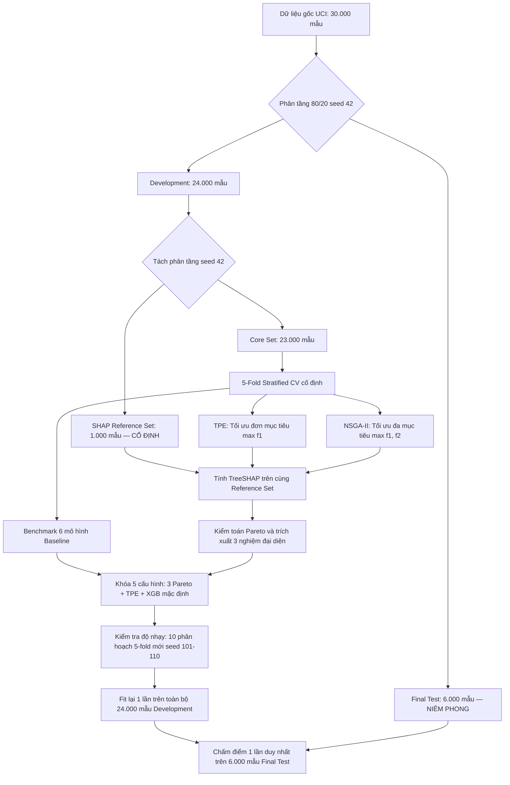

# Chương 2. Phương pháp đề xuất

**Đề tài:** Tối ưu đa mục tiêu siêu tham số XGBoost cho dự đoán rủi ro tín dụng cá nhân xét đến hiệu năng dự đoán và độ ổn định của giải thích SHAP.  
**Sinh viên thực hiện:** Lê Hoàng Sơn, Phạm Thiên Phúc — **Giảng viên hướng dẫn:** TS. Phan Tấn Quốc.

---

## 2.1. Phát biểu bài toán

Bộ dữ liệu *Default of Credit Card Clients* (Yeh & Lien, 2009) từ UCI Machine Learning Repository bao gồm 30.000 quan sát khách hàng thẻ tín dụng, 23 biến dự báo đặc trưng, một biến mã định danh `ID` và một nhãn nhị phân `default.payment.next.month`. Ký hiệu:

$$
x_i \in \mathbb{R}^{23}
$$

là thông tin hồ sơ của khách hàng thứ $i$ trước các bước mã hóa tiền xử lý, và $y_i \in \{0, 1\}$ là nhãn thực tế, trong đó $y_i = 1$ biểu thị khách hàng rơi vào trạng thái vỡ nợ (default) trong chu kỳ tháng tiếp theo, $y_i = 0$ biểu thị thanh toán đúng hạn. Mã `ID` chỉ đóng vai trò nhận diện bản ghi trong cơ sở dữ liệu và được loại bỏ hoàn toàn khỏi không gian biến đầu vào khi xây dựng mô hình.

Mô hình phân loại XGBoost ước lượng xác suất hậu nghiệm:

$$
\hat{p}_\theta(y = 1 \mid x) = \sigma(F_\theta(x))
$$

với cấu hình không gian siêu tham số $\theta \in \Theta$, trong đó $F_\theta(x)$ là tổng đầu ra raw margin (log-odds) của các cây quyết định tăng cường và $\sigma(z) = (1 + e^{-z})^{-1}$ là hàm sigmoid. Năng lực phân biệt hai lớp của mô hình được đánh giá thông qua diện tích dưới đường cong đặc trưng hoạt động của bộ thu (ROC-AUC). ROC-AUC đo lường khả năng xếp hạng tổng quát, không đồng nhất trực tiếp với lợi nhuận kinh doanh hay ngưỡng phê duyệt tín dụng của ngân hàng.

Đề tài giải quyết bài toán lựa chọn cấu hình siêu tham số $\theta^*$ thông qua hai tiêu chí định lượng:
1. **Hiệu năng dự đoán ($f_1(\theta)$):** Giá trị ROC-AUC trung bình qua kiểm định chéo phân tầng trên tập phát triển (Development Core).
2. **Độ ổn định của giải thích SHAP toàn cục ($f_2(\theta)$):** Hệ số tương quan thứ hạng Spearman trung bình của vector độ quan trọng TreeSHAP toàn cục tính trên cùng một tập tham chiếu (Reference Set) cố định qua các mô hình huấn luyện ở các fold khác nhau.

Nhánh tối ưu đơn mục tiêu giải bài toán cực đại hóa hiệu năng: $\max_{\theta \in \Theta} f_1(\theta)$. Nhánh tối ưu đa mục tiêu tìm kiếm tập các cấu hình không bị chi phối (Pareto optimal) theo cặp mục tiêu vector:

$$
\max_{\theta \in \Theta} F(\theta) = \left[ f_1(\theta), f_2(\theta) \right]
$$

Giá trị của cả hai hàm mục tiêu chỉ được tính toán từ quy trình kiểm định chéo trên dữ liệu phát triển (Development Set), tuân thủ cùng một phân hoạch mẫu, cùng một tập tham chiếu và cùng quy tắc tiền xử lý. Tập kiểm tra độc lập (Final Test Set) được niêm phong nghiêm ngặt, chỉ được đánh giá duy nhất một lần sau khi toàn bộ quy trình lựa chọn cấu hình đã được hoàn tất và khóa cố định.

---

## 2.2. Kiến trúc tổng thể của phương pháp đề xuất

Quy trình phương pháp luận của đề tài được thiết kế theo luồng xử lý khép kín nhằm bảo đảm tính tái lập và loại bỏ hoàn toàn nguy cơ rò rỉ thông tin (data leakage):

**Hình 2.1: Sơ đồ kiến trúc tổng thể quy trình phương pháp luận đề xuất.**

1. **Khởi tạo và phân tách dữ liệu:** Bắt đầu từ tệp dữ liệu chuẩn UCI `default_credit_card.csv` (30.000 dòng, 25 cột), loại bỏ biến định danh `ID`, phân chia phân tầng thành Development (24.000 mẫu, 80%) và Test (6.000 mẫu, 20%). Từ Development, trích xuất 1.000 mẫu phân tầng làm tập tham chiếu SHAP cố định (Reference Set). Phần còn lại gồm 23.000 mẫu tạo thành tập Core.
2. **Kiểm định chéo phân tầng trên Core:** Thiết lập 5 fold phân tầng cố định (`StratifiedKFold`, seed 42). Trong từng fold, pipeline tiền xử lý chỉ được fit trên 18.400 mẫu train, sau đó transform cho 4.600 mẫu validation và 1.000 mẫu tham chiếu Reference.
3. **Thực nghiệm đối chuẩn (Baseline Benchmark):** Đánh giá 6 mô hình học máy đối chứng (Logistic Regression, Random Forest, Gradient Boosting, LightGBM, CatBoost, XGBoost mặc định) trên cùng 5 fold Core để xác lập chuẩn so sánh hiệu năng ban đầu.
4. **Tối ưu hóa hai nhánh:** Tiến hành song song nhánh đơn mục tiêu TPE và nhánh đa mục tiêu NSGA-II trong Optuna với cùng không gian tìm kiếm 9 siêu tham số và ngân sách 64 trial hoàn thành mỗi nhánh. Mọi trial đều tính đủ 5 ROC-AUC validation và 5 vector TreeSHAP trên Reference Set.
5. **Kiểm toán Pareto và chọn nghiệm đại diện:** Trích xuất tập nghiệm không bị chi phối từ study NSGA-II, chọn ra 3 nghiệm đại diện theo quy tắc khóa: Nghiệm ưu tiên AUC, Nghiệm ưu tiên ổn định và Nghiệm cân bằng khoảng cách chuẩn hóa.
6. **Kiểm tra độ nhạy và đánh giá cuối cùng:** Kiểm toán tính vững chắc của 5 cấu hình đã khóa (3 nghiệm Pareto, nghiệm TPE tốt nhất, và XGBoost mặc định) qua 10 phân hoạch 5-fold mới trên Core (seed 101–110, tổng cộng 250 lần fit/TreeSHAP), sau đó huấn luyện lại trên toàn bộ 24.000 mẫu Development và đánh giá độc lập một lần duy nhất trên 6.000 mẫu Final Test.

---

## 2.3. Phân chia dữ liệu, protocol seed/fold và reference set cho SHAP

### 2.3.1. Giao thức phân chia Outer Split và Reference Set
Từ 30.000 quan sát gốc, phép chia ngẫu nhiên phân tầng (`StratifiedShuffleSplit`, seed 42) chia tách tập dữ liệu thành hai phần không giao nhau:
- **Tập phát triển (Development Set):** Chiếm 80% (24.000 quan sát), phục vụ toàn bộ các pha tiền xử lý, kiểm định chéo, tối ưu hóa siêu tham số, phân tích Pareto và kiểm tra độ nhạy.
- **Tập kiểm tra cuối cùng (Final Test Set):** Chiếm 20% (6.000 quan sát, gồm 1.327 ca default và 4.673 ca non-default, tỷ lệ default 22,1167%). Tập này bị niêm phong hoàn toàn và không tham gia vào bất kỳ khâu huấn luyện, thẩm định, tính toán SHAP hay lựa chọn nghiệm nào.

Từ 24.000 mẫu Development, thực hiện trích xuất phân tầng 1.000 quan sát (`stratify=y`, seed 42) làm **Tập tham chiếu SHAP cố định (SHAP Reference Set)**. 23.000 quan sát còn lại của Development tạo thành **Tập Core (Core Set)**. Ba tập dữ liệu này thỏa mãn điều kiện rời nhau đôi một:

$$
\text{Core} \cap \text{Reference} = \emptyset, \quad \text{Core} \cap \text{Test} = \emptyset, \quad \text{Reference} \cap \text{Test} = \emptyset
$$

Tập tham chiếu Reference chỉ đóng vai trò là tập các hồ sơ khách hàng **được giải thích** bởi SHAP để so sánh thứ hạng đặc trưng giữa các mô hình, tuyệt đối không tham gia vào tập train hay tập validation của bất kỳ fold nào trong quá trình HPO.

### 2.3.2. Cấu trúc 5-Fold Cross-Validation trên Core Set
Trên tập Core gồm 23.000 quan sát, một bộ chia 5-fold phân tầng (`StratifiedKFold(n_splits=5, shuffle=True, random_state=42)`) được tạo lập một lần duy nhất và áp dụng cố định cho mọi mô hình baseline và mọi trial tối ưu hóa:
- Mỗi fold $r \in \{1, \dots, 5\}$ gồm chính xác **18.400 quan sát train** và **4.600 quan sát validation**.
- Mỗi quan sát trong Core xuất hiện chính xác một lần tại tập validation của một fold duy nhất.
- Tỷ lệ lớp vỡ nợ (~22,12%) được bảo toàn đồng nhất trên tất cả các tập train và validation của cả 5 fold.

### 2.3.3. Pipeline tiền xử lý chống rò rỉ (No-Leakage Preprocessing)
Để ngăn chặn hoàn toàn hiện tượng rò rỉ thông tin từ tập validation hoặc tập reference vào quá trình huấn luyện:
1. **Làm sạch giá trị dị biệt:** Gộp các mã học vấn ngoài danh mục chuẩn `EDUCATION` $\in \{0, 5, 6\}$ về nhóm `4` (Others); gộp mã tình trạng hôn nhân dị biệt `MARRIAGE=0` về nhóm `3` (Others). Đây là quy tắc ánh xạ định danh cố định, không phụ thuộc vào thống kê dữ liệu.
2. **Mã hóa biến phân loại:** Ba biến danh mục `SEX`, `EDUCATION`, `MARRIAGE` được chuyển đổi thành biến giả (dummy variables) bằng `OneHotEncoder(handle_unknown='ignore', drop=None)`.
3. **Chuẩn hóa biến số học:** Riêng đối với mô hình đối chứng Logistic Regression, các biến số liên tục (`LIMIT_BAL`, `AGE`, các biến hóa đơn `BILL_AMT` và số tiền thanh toán `PAY_AMT`) được chuẩn hóa bằng `StandardScaler`. Các mô hình dạng cây (RF, GBM, LightGBM, CatBoost và XGBoost) giữ nguyên thang đo gốc và không sử dụng bước chuẩn hóa này.
4. **Nguyên tắc đóng gói trong Fold:** Trong từng fold $r$, encoder và scaler được `fit` **chỉ trên 18.400 quan sát train** của fold đó; sau đó áp dụng phép `transform` độc lập lên 4.600 quan sát validation và 1.000 quan sát của Reference Set.

---

## 2.4. Không gian siêu tham số XGBoost

Không gian tìm kiếm $\Theta$ bao gồm 9 siêu tham số trọng yếu chi phối cấu trúc cây, cơ chế học, lấy mẫu ngẫu nhiên và mức độ chính quy hóa của XGBoost, được cấu hình thống nhất trong `configs/xgb_search_space.yaml`:

**Bảng 2.1: Không gian 9 siêu tham số XGBoost và phương thức lấy mẫu.**

| Siêu tham số | Kiểu phân phối | Miền giá trị | Bước / Thang đo | Ý nghĩa kỹ thuật |
|---|:---:|:---:|:---:|---|
| `n_estimators` | Integer | [100, 1000] | Bước 50 | Số lượng cây quyết định tăng cường tối đa |
| `max_depth` | Integer | [2, 10] | Bước 1 | Độ sâu tối đa cho phép của mỗi cây quyết định |
| `learning_rate` | Float | [0.01, 0.30] | Thang Log | Tốc độ co hẹp trọng số cập nhật ($\eta$) |
| `min_child_weight` | Integer | [1, 15] | Bước 1 | Tổng trọng số Hessian tối thiểu tại nút lá |
| `subsample` | Float | [0.50, 1.00] | Bước 0.05 | Tỷ lệ lấy mẫu ngẫu nhiên hàng dữ liệu mỗi vòng lặp |
| `colsample_bytree` | Float | [0.50, 1.00] | Bước 0.05 | Tỷ lệ lấy mẫu ngẫu nhiên cột đặc trưng mỗi cây |
| `gamma` | Float | [0.0, 10.0] | Bước 0.5 | Ngưỡng suy giảm mất mát tối thiểu để chia nhánh ($\gamma$) |
| `reg_alpha` | Float | [$10^{-4}$, $10.0$] | Thang Log | Hệ số chính quy hóa $L_1$ trên trọng số lá |
| `reg_lambda` | Float | [$10^{-3}$, $100.0$] | Thang Log | Hệ số chính quy hóa $L_2$ trên trọng số lá |

Các tham số hệ thống được giữ cố định cho toàn bộ các lần chạy:
- `objective = "binary:logistic"` (hàm mất mát cross-entropy nhị phân).
- `eval_metric = "logloss"` (thước đo theo dõi huấn luyện).
- `tree_method = "hist"` (thuật toán xây dựng cây dựa trên phân vị lược đồ phân bố histogram, tối ưu tốc độ tính toán).
- `random_state = 42` (cố định hạt giống ngẫu nhiên của mô hình).
- `n_jobs = -1` (tận dụng toàn bộ luồng CPU khả dụng).

---

## 2.5. Objective 1: predictive performance

Với một cấu hình siêu tham số $\theta \in \Theta$, tại fold thứ $r \in \{1, \dots, 5\}$, mô hình XGBoost được huấn luyện trên tập train $D_{\mathrm{train}, r}$ (18.400 mẫu). Ký hiệu $\hat{p}_{\theta, r} \in [0, 1]^{4600}$ là vector xác suất vỡ nợ dự báo trên tập validation $D_{\mathrm{val}, r}$ (4.600 mẫu), và $y_{\mathrm{val}, r} \in \{0, 1\}^{4600}$ là vector nhãn thực tế.

Chỉ số ROC-AUC của fold $r$, ký hiệu $\operatorname{ROC-AUC}_r(\theta)$, được tính toán dựa trên thống kê Wilcoxon-Mann-Whitney:

$$
\operatorname{ROC-AUC}_r(\theta) = \frac{1}{n_r^+ n_r^-} \sum_{i: y_i = 1} \sum_{j: y_j = 0} \left( \mathbf{1}[\hat{p}_i > \hat{p}_j] + \frac{1}{2} \mathbf{1}[\hat{p}_i = \hat{p}_j] \right)
$$

trong đó $n_r^+$ và $n_r^-$ lần lượt là số lượng mẫu vỡ nợ và không vỡ nợ trong tập validation của fold $r$.

Hàm mục tiêu thứ nhất cần tối đa hóa ($f_1(\theta)$) là trung bình số học không trọng số của ROC-AUC trên 5 fold kiểm định chéo Core cố định:

$$
f_1(\theta) = \overline{\operatorname{ROC-AUC}}_{\mathrm{Core}}(\theta) = \frac{1}{5} \sum_{r=1}^5 \operatorname{ROC-AUC}_r(\theta)
$$

ROC-AUC đo lường khả năng phân tách tổng quát trên toàn bộ dải ngưỡng; nó không đòi hỏi việc chỉ định trước một ngưỡng quyết định tùy ý. Để bổ trợ thông tin đánh giá toàn diện, các chỉ số Average Precision (AP), Precision, Recall, F1-score, Balanced Accuracy và Brier score cũng được ghi nhận đồng thời trong kết quả chạy, nhưng không tham gia vào hàm mục tiêu $f_1$ của HPO.

---

## 2.6. Phương pháp tính SHAP/TreeSHAP

### 2.6.1. Giải thuật TreeSHAP trên raw margin
Để loại bỏ sự phụ thuộc vào các xấp xỉ lấy mẫu Monte Carlo và bảo đảm tính tái lập tuyệt đối, đề tài sử dụng giải thuật TreeSHAP chính xác thông qua hàm nội vi native của XGBoost: `Booster.predict(pred_contribs=True, approx_contribs=False)`.

Đầu ra của phép giải thích là raw margin của bộ phân loại nhị phân (tương ứng với thang đo log-odds trước khi biến đổi qua hàm sigmoid):

$$
z(x) = \ln \left( \frac{\hat{p}(x)}{1 - \hat{p}(x)} \right) = \phi_0 + \sum_{k=1}^K \phi_k(x)
$$

trong đó $\phi_0 = \mathbb{E}[z(x)]$ là giá trị đóng góp cơ sở (bias), và $\phi_k(x)$ là đóng góp TreeSHAP của cột thuộc tính thứ $k$ sau khi đã qua bước mã hóa One-Hot. Tổng giá trị của các đóng góp cộng với bias luôn được kiểm tra tự động để đảm bảo khớp chính xác với raw margin do mô hình sinh ra. Phép tính dựa trên đường đi của cấu trúc cây (tree-path-dependent); 1.000 mẫu Reference Set đóng vai trò là các đối tượng được giải thích, không phải một tập nền interventional.

### 2.6.2. Quy tắc gộp đóng góp cho biến phân loại One-Hot
Sau bước tiền xử lý, ba biến danh mục (`SEX`, `EDUCATION`, `MARRIAGE`) được mở rộng thành nhiều cột nhị phân, nâng tổng số cột đưa vào mô hình lên $K = 30$ cột (tương ứng 20 biến số học giữ nguyên và 10 cột mã hóa One-Hot).

Để đo lường độ quan trọng trên đúng **23 biến nghiệp vụ gốc**, đề tài thiết lập quy tắc gộp đóng góp SHAP: đối với biến phân loại gốc thứ $j$, gọi $G_j$ là tập hợp các chỉ số cột One-Hot tương ứng với biến $j$. Trên quan sát khách hàng thứ $i$ của tập Reference, đóng góp SHAP tổng hợp của biến gốc $j$ tại fold $r$ được tính bằng **tổng đại số có dấu trước khi lấy trị tuyệt đối**:

$$
\phi_{ij}^{(r)} = \sum_{c \in G_j} \phi_{ic}^{(r)}
$$

Đối với các biến số học không mã hóa One-Hot, tập $G_j$ chỉ chứa một phần tử duy nhất. Sau đó, độ quan trọng toàn cục (Global Feature Importance) của biến gốc $j$ trong lần huấn luyện thứ $r$ được tính bằng trung bình trị tuyệt đối của $\phi_{ij}^{(r)}$ trên toàn bộ $N_{\mathrm{ref}} = 1.000$ quan sát tham chiếu:

$$
I_j^{(r)} = \frac{1}{N_{\mathrm{ref}}} \sum_{i=1}^{N_{\mathrm{ref}}} \left| \phi_{ij}^{(r)} \right|, \qquad N_{\mathrm{ref}} = 1000
$$

Quy tắc này phản ánh chính xác cường độ tác động thuần túy của biến gốc $j$ lên biến thiên log-odds của mô hình: các đóng góp mang dấu trái ngược giữa các cột One-Hot trong cùng một hồ sơ khách hàng sẽ triệt tiêu lẫn nhau một cách tự nhiên. Kết quả thu được tại mỗi fold $r$ là một vector độ quan trọng toàn cục chuẩn hóa:

$$
I^{(r)} = \left[ I_1^{(r)}, I_2^{(r)}, \dots, I_{23}^{(r)} \right]^T \in \mathbb{R}^{23}
$$

---

## 2.7. Xây dựng độ đo SHAP stability

### 2.7.1. Định nghĩa độ ổn định thứ hạng Spearman (Spearman Rank Stability)
Năm tập huấn luyện độc lập của 5-fold CV trên Core tạo ra $R = 5$ mô hình khác nhau cho cùng một cấu hình siêu tham số $\theta$. Do hạt giống ngẫu nhiên của XGBoost được cố định ở `random_state=42`, nguồn biến thiên duy nhất được khảo sát trong thực nghiệm này là **sự thay đổi của tập dữ liệu huấn luyện** giữa các fold (data perturbation qua CV split).

Với mỗi cặp mô hình $(a, b)$ trong số 5 mô hình ($1 \le a < b \le 5$), hệ số tương quan thứ hạng Spearman giữa hai vector độ quan trọng $I^{(a)}$ và $I^{(b)}$ của 23 biến gốc được xác định bởi:

$$
\rho_s\left(I^{(a)}, I^{(b)}\right) = 1 - \frac{6 \sum_{j=1}^{23} \left( \operatorname{rank}\left(I_j^{(a)}\right) - \operatorname{rank}\left(I_j^{(b)}\right) \right)^2}{23 \cdot (23^2 - 1)}
$$

Độ đo ổn định giải thích tổng thể $S(\theta)$ là trung bình số học của hệ số Spearman trên toàn bộ $\binom{5}{2} = 10$ cặp mô hình:

$$
S(\theta) = \frac{2}{R(R-1)} \sum_{1 \le a < b \le R} \rho_s\left(I^{(a)}, I^{(b)}\right), \qquad R = 5
$$

### 2.7.2. Xử lý các trường hợp đồng hạng và suy biến
- **Đồng hạng (Ties):** Khi các biến có giá trị độ quan trọng bằng nhau, giải thuật gán hạng trung bình (fractional rank) theo chuẩn của SciPy.
- **Vector suy biến (Constant Vector):** Nếu một vector độ quan trọng có mọi phần tử đều bằng nhau (ví dụ: mô hình dự báo hằng số), hệ số tương quan thứ hạng không xác định; cặp chứa vector suy biến được gán điểm 0 theo nguyên tắc thận trọng (conservative penalty), không xem là ổn định hoàn hảo.
- **Độ đo bổ trợ Top-5 Jaccard:** Để khảo sát riêng sự nhất quán của nhóm 5 đặc trưng quan trọng nhất, chỉ số tương đồng Jaccard trung bình trên tập top-5 đặc trưng giữa các cặp mô hình cũng được tính toán bổ trợ:

$$
J_5(\theta) = \frac{2}{R(R-1)} \sum_{1 \le a < b \le R} \frac{\left| \operatorname{Top5}\left(I^{(a)}\right) \cap \operatorname{Top5}\left(I^{(b)}\right) \right|}{\left| \operatorname{Top5}\left(I^{(a)}\right) \cup \operatorname{Top5}\left(I^{(b)}\right) \right|}
$$

Trường hợp đồng hạng tại ranh giới vị trí thứ 5 được phá vỡ theo thứ tự định danh mặc định của 23 biến gốc. Chỉ số $J_5$ chỉ dùng làm chỉ báo phân tích bổ trợ, không thay thế mục tiêu chính $S(\theta)$.

---

## 2.8. Objective 2: explanation stability

Hàm mục tiêu thứ hai trong bài toán tối ưu đa mục tiêu là tối đa hóa độ ổn định thứ hạng giải thích SHAP:

$$
f_2(\theta) = S(\theta) \in [-1, 1]
$$

Hàm mục tiêu $f_2(\theta)$ phản ánh mức độ nhất quán của bảng xếp hạng độ quan trọng đặc trưng toàn cục khi mô hình được huấn luyện lại trên các tập con dữ liệu khác nhau của cùng một phân phối. Một cấu hình có $f_2 \to 1$ đảm bảo rằng ngân hàng khi cập nhật dữ liệu huấn luyện định kỳ sẽ không làm đảo lộn thứ tự các yếu tố rủi ro chính được giải trình trước cơ quan giám sát.

Cả hai mục tiêu $f_1(\theta)$ và $f_2(\theta)$ đều được tính toán từ **cùng 5 mô hình** huấn luyện trên 5 fold Core và cùng 1.000 quan sát của Reference Set. Mọi cấu hình đều được đánh giá trong cùng điều kiện thực nghiệm, loại bỏ mọi sự chênh lệch do phân hoạch ngẫu nhiên gây ra.

**Bảng 2.2: Tóm tắt các quyết định phương pháp luận cốt lõi trong tính toán SHAP stability.**

| Khía cạnh phương pháp luận | Quyết định thiết kế đề xuất | Cơ sở kỹ thuật và ý nghĩa khoa học |
|:---|:---|:---|
| **Tập đối tượng giải thích** | Tập tham chiếu cố định (Reference Set) $N_{\mathrm{ref}} = 1.000$ mẫu | Trích xuất phân tầng độc lập từ Development; cô lập tuyệt đối khỏi tập train và validation của mọi fold để loại trừ nhiễu do thay đổi mẫu giải thích. |
| **Không gian đầu ra SHAP** | Raw margin (log-odds trước sigmoid) | Đảm bảo tính cộng tính hoàn hảo ($\sum \phi_k = \hat{z}(x) - \mathbb{E}[\hat{z}(x)]$) theo tiên đề Efficiency của Lundberg & Lee (2017). |
| **Cơ chế tính toán TreeSHAP** | Thuật toán native `Booster.predict(pred_contribs=True)` | Tính toán giải tích chính xác dựa trên đường đi (tree-path-dependent) với độ phức tạp đa thức, loại bỏ phương sai lấy mẫu Monte Carlo. |
| **Quy tắc gộp biến phân loại** | Cộng đại số có dấu theo khách hàng trước khi lấy trị tuyệt đối | Bảo toàn bản chất triệt tiêu tương hỗ giữa các mức phân loại One-Hot; gộp về đúng 23 biến nghiệp vụ gốc mà không làm méo mó độ lớn đóng góp. |
| **Thước đo ổn định chính ($f_2$)** | Hệ số tương quan thứ hạng Spearman trung bình 10 cặp mô hình | Đo lường mức độ bảo toàn trật tự xếp hạng tương đối của 23 biến tài chính qua các tập huấn luyện độc lập; miền giá trị $[-1, 1]$. |
| **Chỉ số đo lường bổ trợ** | Độ trùng lặp Top-5 Jaccard ($J_5$) | Kiểm tra tính nhất quán riêng biệt của nhóm 5 đặc trưng chi phối quyết định tín dụng cao nhất; miền giá trị $[0, 1]$. |
| **Xử lý bất thường** | Gán thứ hạng trung bình (Ties); phạt điểm 0 cho vector suy biến | Tuân thủ chuẩn thống kê SciPy; xử lý thận trọng các trường hợp mô hình hỏng hoặc dự báo hằng số. |

---

## 2.9. Thiết kế tối ưu siêu tham số XGBoost

### 2.9.1. Bài toán tối ưu hóa tổng quát
Hai nhánh tối ưu hóa siêu tham số được định nghĩa chính xác như sau:
1. **Nhánh đơn mục tiêu (Single-Objective HPO):** Sử dụng thuật toán TPE để tìm kiếm:

$$
\theta_{\mathrm{TPE}}^* = \arg\max_{\theta \in \Theta} f_1(\theta)
$$

2. **Nhánh đa mục tiêu (Multi-Objective HPO):** Sử dụng thuật toán di truyền NSGA-II để tìm kiếm tập nghiệm Pareto:

$$
\Theta_{\mathrm{Pareto}}^* = \left\{ \theta \in \Theta : \nexists \theta' \in \Theta \text{ sao cho } \theta' \succ \theta \right\}
$$

với quan hệ chi phối Pareto được áp dụng đồng thời cho cặp mục tiêu $\max [f_1(\theta), f_2(\theta)]$.

### 2.9.2. Hai chiến lược tìm kiếm và quản lý Study
Quy trình tối ưu được quản lý thông qua thư viện Optuna với cơ sở dữ liệu lưu trữ SQLite độc lập (`hpo.sqlite3`):
- **Nhánh TPE:** Khởi tạo `TPESampler(seed=42, n_startup_trials=16)`. Sampler chỉ tiếp nhận phản hồi của mục tiêu đơn $f_1$. Giá trị $f_2$ và Jaccard được lưu trữ dưới dạng `user_attrs` để đối chứng.
- **Nhánh NSGA-II:** Khởi tạo `NSGAIISampler(seed=42, population_size=16)`. Sampler tiếp nhận đồng thời cặp mục tiêu $(f_1, f_2)$ với hướng tối ưu `directions=["maximize", "maximize"]`.
- Cả hai nhánh đều thực thi với chế độ tuần tự nghiêm ngặt `n_jobs=1` để đảm bảo tính tất định và đo lường chính xác thời gian thực thi của từng trial.

### 2.9.3. Ngân sách đánh giá và giai đoạn Pilot
- **Thử nghiệm Pilot:** Trước khi tiến hành lượt chạy chính, một pha pilot gồm 8 trial mỗi nhánh (gồm các cấu hình cực tiểu biên 100 cây, độ sâu 2 và cực đại biên 1.000 cây, độ sâu 10) đã được thực hiện và lưu trữ riêng. Toàn bộ 8/8 trial ở cả hai nhánh đều đạt trạng thái `COMPLETE`, xác nhận tính ổn định và tính khả thi về thời gian của pipeline. Dữ liệu pilot được cách ly hoàn toàn và không gộp vào study chính thức.
- **Ngân sách chính thức:** Ngân sách được khóa cố định ở **64 trial hoàn thành (`COMPLETE`)** cho mỗi nhánh. Với mỗi trial đòi hỏi huấn luyện 5 mô hình CV và tính toán 5 lượt TreeSHAP:
  - Nhánh TPE: $64 \times 5 = 320$ lần fit mô hình và 320 lần tính TreeSHAP.
  - Nhánh NSGA-II: $64 \times 5 = 320$ lần fit mô hình và 320 lần tính TreeSHAP.
  - Tổng ngân sách đánh giá hai nhánh đạt **640 lần fit XGBoost** và **640 lần giải thích TreeSHAP** trên tập Core.
  - Cỡ quần thể 16 cho phép NSGA-II tiến hóa qua chính xác $64 / 16 = 4$ thế hệ di truyền.

### 2.9.4. Trình tự thực thi của một Trial
Mỗi trial $t$ trong Optuna tuân thủ chu trình khép kín 4 bước:
1. Sampler đề xuất vector siêu tham số $\theta$ từ không gian $\Theta$.
2. Với từng fold $r \in \{1, \dots, 5\}$: fit preprocessor trên train Core, huấn luyện XGBoost, dự báo xác suất trên validation Core tính $\operatorname{ROC-AUC}_r$, và tính TreeSHAP trên 1.000 mẫu Reference Set.
3. Tổng hợp $f_1(\theta)$ qua 5 fold, gộp các cột One-Hot thành 23 biến gốc, tính ma trận tương quan Spearman giữa 10 cặp vector quan trọng để thu được $f_2(\theta)$ và $J_5(\theta)$.
4. Kiểm tra tính hữu hạn: nếu $f_1 \in [0, 1]$ và $f_2 \in [-1, 1]$, trial được đánh dấu `COMPLETE` và lưu vào SQLite. Bất kỳ lỗi ngoại lệ nào sẽ đánh dấu trial là `FAIL`, tuyệt đối không gán giá trị giả định $(0, 0)$.

---

## 2.10. Pareto dominance và Pareto front

Xét tập hợp $C$ gồm tất cả các trial có trạng thái `COMPLETE` trong study NSGA-II chính thức ($|C| = 64$). Mỗi trial $t \in C$ có tọa độ mục tiêu $F(t) = (f_1(t), f_2(t))$.

Trial $a$ **chi phối** trial $b$ ($a \succ b$) khi và chỉ khi:

$$
f_1(a) \ge f_1(b) \quad \land \quad f_2(a) \ge f_2(b) \quad \land \quad \left( f_1(a) > f_1(b) \lor f_2(a) > f_2(b) \right)
$$

Số lượng nghiệm trong $C$ chi phối trial $b$ được xác định bởi:

$$
d(b) = \sum_{a \in C, a \ne b} \mathbf{1}[a \succ b]
$$

Tập nghiệm không bị chi phối thực nghiệm (Empirical Pareto Front) là:

$$
P(C) = \{ b \in C : d(b) = 0 \}
$$

Quy trình kiểm toán độc lập (`pareto.py`) đọc dữ liệu trực tiếp từ SQLite, tự động so khớp từng cặp tọa độ để tính $d(b)$, sau đó đối chiếu chéo với thuộc tính `study.best_trials` của Optuna nhằm bảo đảm tính toàn vẹn 100% của thuật toán lọc.

---

## 2.11. Phương pháp lựa chọn nghiệm đại diện từ Pareto front

Việc lựa chọn các cấu hình siêu tham số đại diện phục vụ kiểm tra độ nhạy và đánh giá cuối cùng được **khóa tiên nghiệm hoàn toàn trên tập Development**, không sử dụng bất kỳ thông tin nào từ tập Final Test.

Từ tập nghiệm không bị chi phối $P(C)$, nếu tồn tại các trial có cùng tọa độ mục tiêu $(f_1, f_2)$, giữ lại trial có mã số nhỏ nhất để thu được tập các điểm Pareto duy nhất $U$. Ba cấu hình đại diện ứng với ba triết lý ra quyết định được xác định tuần tự theo thuật toán:

1. **Nghiệm ưu tiên hiệu năng dự đoán (Pareto AUC):**
   Chọn điểm trong $U$ có giá trị $f_1$ cực đại:

   $$
   t_{\mathrm{AUC}} = \arg\max_{u \in U} f_1(u)
   $$

   (Nếu có nhiều điểm đồng hạng, ưu tiên $f_2$ cao hơn, sau đó ưu tiên mã trial nhỏ hơn).

2. **Nghiệm ưu tiên độ ổn định giải thích (Pareto Stability):**
   Chọn điểm trong $U$ có giá trị $f_2$ cực đại:

   $$
   t_{\mathrm{Stability}} = \arg\max_{u \in U} f_2(u)
   $$

   (Nếu có nhiều điểm đồng hạng, ưu tiên $f_1$ cao hơn, sau đó ưu tiên mã trial nhỏ hơn. Điểm này đảm bảo khác biệt với $t_{\mathrm{AUC}}$ khi hai mục tiêu có sự đánh đổi).

3. **Nghiệm cân bằng thỏa hiệp (Pareto Balanced):**
   Xét tập các điểm còn lại $U' = U \setminus \{t_{\mathrm{AUC}}, t_{\mathrm{Stability}}\}$. Thực hiện chuẩn hóa min-max riêng biệt cho từng hàm mục tiêu trên **toàn bộ tập $U$**:

   $$
   \tilde{f}_j(u) = \frac{f_j(u) - \min_{v \in U} f_j(v)}{\max_{v \in U} f_j(v) - \min_{v \in U} f_j(v)}, \qquad j \in \{1, 2\}
   $$

   (Nếu một mục tiêu có mẫu số bằng 0, gán $\tilde{f}_j(u) = 1$). Điểm lý tưởng trong không gian chuẩn hóa là $(1, 1)$. Nghiệm cân bằng là điểm trong $U'$ có khoảng cách Euclid ngắn nhất tới điểm lý tưởng:

   $$
   t_{\mathrm{Balanced}} = \arg\min_{u \in U'} D(u) = \arg\min_{u \in U'} \sqrt{ (1 - \tilde{f}_1(u))^2 + (1 - \tilde{f}_2(u))^2 }
   $$

Quy tắc này tạo ra chính xác 3 cấu hình đại diện phản ánh ba góc độ lựa chọn khách quan: tối đa hóa phân tách rủi ro, tối đa hóa tuân thủ giải trình pháp lý, và giải pháp cân bằng tối ưu hóa hình học. Cùng với cấu hình tối ưu đơn mục tiêu TPE ($t_{\mathrm{TPE}}$) và cấu hình XGBoost mặc định, đề tài khóa cố định danh sách **5 cấu hình ứng viên** để bước vào giai đoạn thực nghiệm chuyên sâu ở Chương 3.

---

## 2.12. Tóm tắt chương

Chương 2 đã thiết lập một khung phương pháp luận hoàn chỉnh và chặt chẽ cho bài toán tối ưu hóa đa mục tiêu siêu tham số XGBoost trong thẩm định rủi ro tín dụng cá nhân:
1. **Kiểm soát rò rỉ dữ liệu:** Phân lập tuyệt đối giữa Development (Core 23.000 mẫu, Reference 1.000 mẫu) và Final Test (6.000 mẫu); mọi biến đổi One-Hot và chuẩn hóa đều được đóng gói bên trong từng fold CV.
2. **Hàm mục tiêu toán học rõ ràng:** Xác lập $f_1$ là ROC-AUC trung bình 5-fold Core và $f_2$ là độ ổn định thứ hạng Spearman trung bình của vector TreeSHAP 23 biến gốc trên 1.000 mẫu tham chiếu cố định.
3. **Chiến lược tối ưu hóa đối chuẩn:** Triển khai đồng thời TPE đơn mục tiêu và NSGA-II đa mục tiêu với cùng không gian 9 siêu tham số và ngân sách đối ứng 64 trial hoàn thành mỗi nhánh.
4. **Quy tắc trích xuất nghiệm Pareto tường minh:** Xác định thuật toán chọn 3 nghiệm đại diện (ưu tiên AUC, ưu tiên ổn định, và cân bằng khoảng cách chuẩn hóa) hoàn toàn độc lập với dữ liệu kiểm tra.

Toàn bộ các kết quả số liệu thực nghiệm, kiểm toán Pareto độc lập, đánh giá độ nhạy qua 10 phân hoạch mới và kiểm định trên Final Test độc lập sẽ được trình bày chi tiết trong Chương 3.
